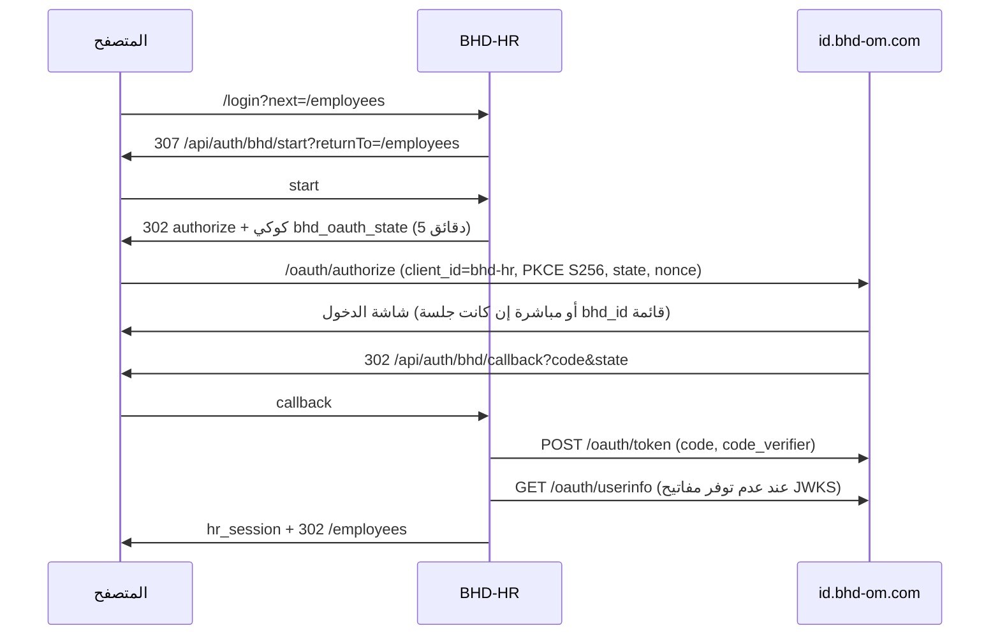

# المرجع التقني — BHD-HR

كل ما يحتاجه المطوّر لفهم النظام وتشغيله وصيانته وتطويره. دليل الاستخدام في [`BHD-HR-USER-GUIDE.md`](./BHD-HR-USER-GUIDE.md)، والدخول الموحّد في [`BHD-HR-SSO-INSTALL.md`](./BHD-HR-SSO-INSTALL.md)، وسجل النشر والحوادث في [`BHD-HR-DEPLOYMENT-LOG.md`](./BHD-HR-DEPLOYMENT-LOG.md).

---

## 1. التقنيات

| الطبقة | التقنية |
|---|---|
| الإطار | Next.js 15 (App Router، Server Components، Server Actions) |
| الواجهة | React 19، TypeScript 5، Tailwind CSS v4، أيقونات `lucide-react` |
| الخط والهوية | IBM Plex Sans Arabic للعربية وInter للإنجليزية والأرقام (عبر `next/font`)، ألوان BHD (`#092d24` حبر، `#075c45` زمردي، `#fbfaf7` رملي، حدود `#d7e2dc`؛ والفيروزي والكحلي والذهبي للتمييز فقط) |
| قاعدة البيانات | PostgreSQL على Neon عبر Prisma 6 — مشروع Neon مستقل **BHD HR** (`billowing-hat-97652194`)، الفرع `production`، القاعدة `neondb`، `aws-us-east-2`، Postgres 18. لا يشارك خادم ONE-BHD |
| الملفات | تُخزَّن داخل قاعدة البيانات في جدول `StoredFile` (لأن الاستضافة بلا قرص دائم)، وتُخدَم عبر `/files/[name]` بعد التحقق من الجلسة. الحد 4 ميغابايت للملف |
| الهوية | OIDC مع `https://id.bhd-om.com` (PKCE S256)، مكتبة `jose` |
| التصدير | `exceljs` (Excel من الخادم)، `jspdf` + `html2canvas-pro` (PDF في المتصفح) |
| الاستضافة | Vercel — المشروع `bhd-hr`، الرابط `https://bhd-hr.vercel.app`، ومربوط بمستودع GitHub فيُنشر تلقائياً عند كل دفع إلى `main` |
| التشغيل المحلي | Node.js ≥ 20، `npm run dev` (يتصل بقاعدة Neon نفسها) |

| الذكاء الاصطناعي | الترجمة الفورية (الأسماء والمسميات) عبر **Vercel AI Gateway** بحزمة `ai` (v5). النموذج الافتراضي `google/gemini-2.5-flash-lite`، ويُغيَّر بالمتغير `AI_TRANSLATE_MODEL`. على Vercel يتوثّق تلقائياً برمز OIDC للمشروع (لا مفتاح)؛ محلياً يلزم `VERCEL_OIDC_TOKEN` (من `vercel env pull`) أو `AI_GATEWAY_API_KEY`. بوابة Neon للذكاء الاصطناعي غير متاحة في الخطة المجانية |

لا توجد خدمات خارجية أخرى: لا طوابير، لا مدفوعات، لا بريد.

---

## 2. بنية المجلدات

```
prisma/
  schema.prisma          نموذج البيانات
  seed.ts                إنشاء المنشأة والمسؤول الأول (admin@bhd.local / admin123)
public/brand/            شعار BHD الرسمي (svg)
docs/                    هذا التوثيق + مستندات ONE-BHD المرجعية
src/
  app/
    (app)/               الصفحات الداخلية (تتطلب دخولاً) + layout فيه الرأس والمشغّل والفوتر
    (print)/             صفحات الطباعة (قسيمة، إيصال، كشف مسير، كشف حساب، جهات الاتصال)
    api/auth/            start / callback / logout / admin-entry للدخول الموحّد
    files/[name]/        تقديم الملفات المرفوعة بعد التحقق
    invite/[token]/      صفحة قبول الدعوة
    reports/export/      تنزيل التقرير الشهري Excel
    (app)/pay-items/     السلف والمكافآت والخصومات؛ (print)/pay-items/[id]/print إيصال استلام سلفة
    login/               غلاف الدخول + دخول الطوارئ المحلي
  components/
    bhd/                 BhdAppSwitcher و BhdAppIcon (منسوخان من ONE-BHD) و site-footer
    app-frame.tsx        هيكل الواجهة: الشريط الجانبي، الدرج والشريط السفلي للهاتف، الشريط العلوي
    nav-speed.tsx        الجلب المسبق وشريط التقدّم (انظر «سرعة التنقل» أدناه)
    get-form.tsx         نموذج بحث/فلترة بتنقل داخلي بلا إعادة تحميل
    ui.tsx               عناصر الواجهة المشتركة (انظر «نظام الواجهة» أدناه)
    ...                  النماذج والمطبوعات
  lib/
    bhd/apps.ts          كتالوج تطبيقات BHD المجمّد — منسوخ حرفياً، لا يُعدّل هنا
    bhd/identity.ts      إعدادات OIDC، PKCE، تبديل الرمز، التحقق من id_token
    auth.ts              جلسة المنتج، المنشأة النشطة، الأدوار، can / requireUser / requirePermission / requireAdmin
    permissions.ts       الوحدات والعمليات، قوالب الأدوار، normalizePermissions (آمن للمتصفح)
    report-data.ts       بيانات التقرير الشهري حسب صلاحيات المستخدم (للصفحة وملف Excel)
    workspace.ts         ربط الدعوات بالبريد، وإنشاء منشأة خاصة لكل حساب بلا عضوية
    salary.ts payroll.ts حساب الراتب والخصم
    pay-items.ts         تطبيق السلف والمكافآت والخصومات والعلاوات على الرواتب، وتقدّم كل بند
    allowances.ts        قواعد العلاوات: الاستحقاق حسب الدورية، المبلغ (ثابت / نسبة)، الوصف
    hr-catalog.ts        كتالوج المنشأة (مسميات، أقسام، إجازات، علاوات) والتهيئة الكسولة وترحيل البيانات القديمة
    hr-defaults.ts       القوائم الجاهزة للمسميات الوظيفية والأقسام (عربي/إنجليزي)
    nationalities.ts     كل جنسيات العالم برمز ISO (عربي/إنجليزي)، العماني أولاً
    ai.ts                الترجمة بالذكاء الاصطناعي (مفردة ودفعات) عبر AI Gateway
    search.ts            توحيد النص العربي للبحث (أ/إ/آ، ة/ه، ى/ي، التشكيل)
    leave.ts             أرصدة الإجازات حسب أنواع المنشأة وتنبيهاتها وخيارات الحضور
    alerts.ts            توليد التنبيهات
    calendar.ts          أحداث التقويم والتذكيرات
    contacts.ts          جهات الاتصال للعرض والطباعة
    i18n.ts lang.ts      الترجمة (عربي / إنجليزي)
  server/                Server Actions لكل عملية كتابة
```

### نظام الواجهة

- **الرموز** في `src/app/globals.css` داخل `@theme`: سلّم `teal` (الزمردي)، وسلّم `slate` المبني على الحبر والحدود (`slate-200` = `#d7e2dc`، `slate-900` = `#092d24`)، و`sand` و`gold` و`aqua` و`navy` للتمييز، والظلال `shadow-card` و`shadow-raised` و`shadow-float`، والحركة `animate-fade-up` (150–320 م.ث، وتتوقف مع `prefers-reduced-motion`). لا تُضف لوحة ألوان محلية.
- **الهيكل** `AppFrame`: شريط جانبي ثابت بمجموعات (عام، الموارد البشرية، المالية، النظام) على الشاشات الكبيرة؛ وعلى الهاتف والجهاز اللوحي درج جانبي وشريط علوي باسم الصفحة وشريط سفلي بأهم أربعة أقسام مسموحة وزر «المزيد». الفوتر وزر المشغّل خارج نطاق التعديل. على الكمبيوتر تُطوى القائمة إلى شريط أيقونات بعرض 5rem (زر أسفلها)؛ الحالة في الكوكي `hr_sidebar` (`SIDEBAR_COOKIE` في `utils.ts`) ويقرؤها `(app)/layout.tsx` فيبدأ العرض بالحالة الصحيحة بلا وميض، والعرض عبر `--sidebar-width` و`.app-shell[data-sidebar="collapsed"]`.
- **العناصر** في `ui.tsx`: `PageHeader` (عنوان + أيقونة + أزرار)، `Card`، `SectionTitle`، `Stat`، `EmptyState`، `Toolbar`، `InfoItem`، `ToneBadge`، وأنماط الأزرار `primaryBtn` / `secondaryBtn` / `dangerBtn` / `ghostBtn` و`linkAction` و`fieldClass` (ارتفاع 44px على الهاتف).
- **الجداول المتجاوبة:** غلّف الجدول بـ `div.table-shell` وأعطه `table-stack`، وضع `data-label` على كل خلية بيانات، و`cell-title` لخلية الاسم، و`cell-actions` لخلية الإجراءات. تحت 640px يتحوّل كل صف إلى بطاقة تعرض العناوين. لإخفاء عمود على الأجهزة المتوسطة فقط استخدم `hidden xl:table-cell` (يبقى ظاهراً في بطاقة الهاتف).
- **التبويبات والفلاتر:** `.segmented` مع `aria-current="page"` للعنصر النشط.
- **زخرفة «الأفق الأعلى»** `.higher-horizon` بشفافية لا تتجاوز 12% وعلى الطرف المقابل للنص.
- **الفحص:** كل صفحة بلا تمرير أفقي من 360px، وبالعربية والإنجليزية.

### سرعة التنقل

- **`NavSpeed`** (`src/components/nav-speed.tsx`، داخل `AppFrame`): بعد فتح أي صفحة يجلب في الخلفية كل الأقسام المسموحة للمستخدم كاملة (`router.prefetch` بنوع `full`)، ويجلب أي رابط داخلي عند مرور المؤشر أو اللمس، ويحدّث البيانات عند العودة إلى التبويب بعد 30 ثانية، ويُظهر شريط تقدّم رفيعاً أعلى الصفحة فقط إن تأخرت الصفحة أكثر من 120 م.ث. لا يجلب مسبقاً `/api` و`/files` و`/reports/export` وصفحات الطباعة.
- **ذاكرة الموجّه** في `next.config.ts`: `staleTimes` = 30 ثانية للصفحات المزورة و120 ثانية للمجلوبة مسبقاً. كل حفظ يمسحها عبر `refreshAll()` (`revalidatePath("/", "layout")`)، فتظهر التعديلات فوراً. **أي Server Action جديد يغيّر بيانات يجب أن يستدعي `refreshAll()`.**
- **لا `loading.tsx`:** تبقى الصفحة الحالية ظاهرة حتى تجهز التالية، بلا وميض هيكل تحميل.
- **نماذج البحث والفلترة** تستخدم `GetForm` (`next/form`) بدل `<form method="get">`، فلا يُعاد تحميل الصفحة كاملة. وتبديل اللغة يستخدم `router.refresh()` بدل إعادة التحميل.
- **المنطقة:** `vercel.json` يضع الدوال في `cle1` (كليفلاند، AWS us-east-2)، نفس منطقة قاعدة Neon، فزمن كل استعلام قرابة 1 م.ث. لا تغيّرها دون نقل القاعدة معها.
- استعلامات `getAlerts` تعمل بالتوازي (`Promise.all`).

---

## 3. نموذج البيانات

| الجدول | الغرض | أهم الحقول |
|---|---|---|
| `Company` | المنشأة (مساحة العمل) وإعداداتها — حدّ العزل لكل البيانات | الاسم، العملة، `salaryDays`، أيام تنبيه المستندات، `payDay`، `leaveWarningDays`، `catalogVersion` (0 = لم يُهيّأ الكتالوج بعد) |
| `JobTitle` / `Department` | المسميات الوظيفية والأقسام لكل منشأة | `nameAr` (فريد داخل المنشأة)، `nameEn` |
| `LeaveType` | أنواع الإجازات لكل منشأة | `key` (فريد داخل المنشأة؛ `annual`/`sick`/`compensatory`/`other` للأساسية و`t<hex>` للمضافة، وهو ما يُخزَّن في `balanceKey`)، `nameAr`، `nameEn`، `days`، `allJobs`، `jobTitleIds[]`، `sortOrder` |
| `AllowanceType` | تعريف العلاوة (القيم الافتراضية) | `nameAr`، `nameEn`، `calc` (`FIXED`/`PERCENT`)، `base` (`BASIC`/`PACKAGE`)، `value`، `frequency` (`MONTHLY`/`QUARTERLY`/`SEMI_ANNUAL`/`ANNUAL`)، `payMonth` |
| `EmployeeAllowance` | علاوة موظف | `employeeId` (حذف متسلسل)، `allowanceTypeId`، نفس حقول القاعدة، `startYear`/`startMonth`، `active` |
| `User` | الحسابات | `email` (فريد)، `password` (scrypt أو فارغ لحسابات BHD)، `bhdSub` (فريد)، `picture`، `lastLoginAt`. لا دور ولا منشأة على الحساب نفسه |
| `Membership` | من يصل إلى أي منشأة وبأي صلاحية | `companyId`، `userId` (فارغ للدعوة حتى أول دخول)، `email`، `role` (`ADMIN` / `MANAGER` / `VIEWER` / `CUSTOM`)، `permissions` (JSON للدور `CUSTOM` فقط)، `inviteToken` (فريد)، `invitedById`، `invitedAt`، `acceptedAt`؛ فريد على (`companyId`، `email`) |
| `Employer` | الكفلاء وأصحاب العمل | `kind` (COMPANY / PERSON)، الاسم، الهاتف، البريد، الشعار |
| `Employee` | الموظفون | البيانات الشخصية، `nationality` (رمز ISO مثل `OM`؛ القيم النصية القديمة تُقرأ أيضاً)، الوثائق وتواريخ انتهائها و`idFileUrl`/`passportFileUrl`/`residenceFileUrl`، `jobTitleId`+`jobTitle`/`jobTitleEn` و`departmentId`+`department`/`departmentEn` (نص مكرر للعرض والبحث)، الحالة، `leaveDays` (JSON: أيام مخصصة لكل `key` تختلف عن الافتراضي؛ أعمدة `annualLeaveDays` وأخواتها قديمة لا تُقرأ)، مكوّنات الراتب، `employerId`. `employeeNumber` فريد داخل المنشأة (كل منشأة تبدأ من EMP-0001) |
| `EmployeeDocument` | المستندات الإضافية | النوع، الرقم، الانتهاء، `fileUrl` |
| `Attendance` | يوم غياب / إجازة | `date` (يوم واحد لكل صف، فريد مع الموظف)، `type`، `deductsSalary`، `balanceKey`، `groupId` يجمع أيام الفترة الواحدة |
| `LeaveCredit` | إضافة رصيد يدوية | `balanceKey`، `days`، السبب |
| `Salary` | راتب شهر لموظف | لقطة كاملة للراتب والأسماء وقت الإنشاء، الخصومات، `extraEarnings` و`extraDeductions` (مجموع سطور البنود)، الصافي، حالة الصرف، `companyId`، `receiptNo` (فريد داخل المنشأة، وتسلسله لكل منشأة) |
| `PayItem` | سلفة أو مكافأة أو بدل أو استحقاق أو خصم | `kind` (`ADVANCE` / `BONUS` / `ALLOWANCE` / `ENTITLEMENT` / `DEDUCTION`)، `title`، `amount` (للسلفة: المبلغ كله؛ لغيرها: لكل شهر)، `issuedAt`، `startYear`/`startMonth`، `months` (للسلفة: الأقساط؛ لغيرها: عدد الأشهر، فارغ = حتى الإيقاف)، `paymentMethod`، `stoppedAt`، `createdByName` |
| `SalaryLine` | بند مطبّق على راتب شهر | `salaryId` (حذف متسلسل)، `payItemId` أو `allowanceId` (يُفرَّغان عند حذف المصدر)، `kind` (`RECURRING` للعلاوة)، `title`، `titleEn`، `amount`، `deduct` — لقطة لا تتغير بعد الصرف. `Salary` يحفظ أيضاً `jobTitleEn` و`departmentEn` |
| `Reminder` | تذكيرات التقويم | العنوان، التاريخ، التكرار (NONE / MONTHLY / YEARLY)، موظف اختياري، `done` |
| `AuditLog` | سجل العمليات | `companyId`، المستخدم، الموظف، الإجراء، الرسالة |
| `StoredFile` | الملفات المرفوعة (مستندات وشعارات) | `companyId`، `name` (فريد، يظهر في الرابط `/files/<name>`)، `mime`، `size`، `data` (البايتات) |

**التواريخ** تُخزّن عند الظهر بتوقيت UTC وتُقرأ بدوال `getUTC*` حتى لا ينزاح اليوم بسبب فرق التوقيت.

**الحذف المتسلسل:** حذف موظف يحذف حضوره ومستنداته ورواتبه وتذكيراته وملفاته المرفوعة. سجلات `AuditLog` تبقى ويُفرَّغ فيها `employeeId`. `deleteEmployee` يرفض حذف موظف له راتب مصروف (يُستخدم «منتهي الخدمة» بدلاً منه) حتى لا تضيع الإيصالات.

---

## 4. القواعد الحسابية

```
الإجمالي     = الأساسي + السكن + النقل + البدلات الأخرى
قيمة اليوم   = الإجمالي ÷ salaryDays (افتراضياً 30)
خصم الغياب   = قيمة اليوم × أيام الغياب   (نصف يوم = 0.5)
الصافي       = الإجمالي + extraEarnings − خصم الغياب − الخصومات الأخرى − extraDeductions
```

كل المبالغ تُقرّب إلى 3 خانات عشرية (`round3`). `totalEarnings` و`totalDeductions` في `lib/salary.ts` هما ما تعرضه القوائم والكشوف والتقارير.

**البنود المالية** (`lib/pay-items.ts`):
- `scheduledAmount(item, monthKey, recovered)`: لا شيء قبل شهر البداية أو بعد الإيقاف. غير السلفة: `amount` في كل شهر ضمن `months` (أو دائماً إن كان فارغاً). السلفة: `min(amount ÷ months, المتبقي)`، والقسط ذو الترتيب `months − 1` فما بعده يأخذ كل المتبقي، فالشهر الفائت يُستوفى في الأخير.
- `recovered` = سطور السلفة في رواتب **مصروفة** أو في أشهر **أسبق** من الشهر المحسوب.
- `syncSalaryLines(db, salaryId)`: لراتب غير مصروف فقط — يحذف سطوره ويعيد بناءها من البنود غير الموقوفة، ثم يحدّث `extraEarnings` و`extraDeductions` والصافي. الراتب المصروف لا يُلمس.
- `syncEmployeeSalaries`: يطبّق ذلك على كل رواتب الموظف غير المصروفة من الأقدم إلى الأحدث. يُستدعى داخل معاملة عند إضافة بند أو تعديله أو إيقافه أو حذفه، ويُستدعى `syncSalaryLines` عند إنشاء راتب وعند «إعادة الاحتساب».
- لا يُحذف بند له سطر في راتب مصروف (يُوقف بدلاً من ذلك)، ولا تنزل السلفة عن المسدَّد، ولا يتغير النوع بعد الصرف.
- خصم الغياب على الحزمة الثابتة فقط.

**العلاوات** (`lib/allowances.ts`): `allowanceDue(rule, year, month)` صحيح إن كانت سارية وبعد شهر البداية، وللشهرية كل شهر، ولغيرها حين `(month − payMonth) mod (3|6|12) = 0`. `allowanceAmount` = `value` للثابتة، أو `value% × الأساسي` (أو × الإجمالي لـ `PACKAGE`) من لقطة الراتب. `syncSalaryLines` يضيف سطر `RECURRING` لكل علاوة مستحقة، فتدخل في `extraEarnings` لا في خصم الغياب. أي تعديل لعلاوات الموظف أو لتعريف العلاوة (مع «تطبيق على الموظفين») يعيد مزامنة رواتبه غير المصروفة.

**كتالوج المنشأة** (`lib/hr-catalog.ts`): `getHrCatalog(companyId)` (مخزّن لكل طلب) يستدعي `ensureCatalog` عند `catalogVersion < 1`. داخل معاملة: يحجز المنشأة بـ `updateMany` مشروط (فلا تتكرر التهيئة مع طلبين متزامنين)، يضيف القوائم الجاهزة وأنواع الإجازات الأربعة (سنوية 30، والبقية 0)، يربط نص الوظيفة والقسم لكل موظف بعنصر الكتالوج (وينشئ الناقص)، وينقل أعمدة الإجازة القديمة المختلفة عن الافتراضي إلى `leaveDays`.

**أرصدة الإجازات** لكل نوع من `LeaveType` يشمل وظيفة الموظف (`allJobs` أو `jobTitleIds` يحتوي `jobTitleId`)، أو له حركة سابقة:

```
المستحق = leaveDays[key] إن وُجد، وإلا LeaveType.days
المتبقي = المستحق + الإضافات (LeaveCredit) − المستخدم (Attendance)
```

أنواع الحضور: الأساسية `LEAVE`/`SICK`/`COMPENSATORY`/`OTHER_LEAVE` تقابل `annual`/`sick`/`compensatory`/`other`، والأنواع المضافة تُسجَّل `CUSTOM_LEAVE` مع `balanceKey`. قيمة الاختيار في النماذج `leave:<key>`، و`parseAttendanceChoice` يحوّلها. الخادم يرفض نوعاً لا يشمل وظيفة الموظف.

**مستويات التنبيه** (`leaveWarnings`):
- `exceeded`: المتبقي أقل من صفر.
- `exhausted`: المتبقي صفر وقد استُخدم شيء.
- `low`: المتبقي بين 1 و`leaveWarningDays`، والرصيد الكلي أكبر من الحد.

تسجيل إجازة تتجاوز الرصيد يتطلب `allowOverdraft=1` من النموذج، ويُكتب التجاوز في `AuditLog`.

---

## 5. المصادقة والصلاحيات

### جلسة المنتج
- الكوكي `hr_session` = `userId.HMAC-SHA256(AUTH_SECRET)`، وهي HttpOnly وSameSite=Lax وHost-only، وSecure على الإنتاج.
- **سياسة BHD:** مدتها 400 يوم، ولا تنتهي بالخمول، ولا تُجدَّد عند القراءة؛ تُكتب فقط عند الدخول وتُمسح عند الخروج. لا KeepAlive، ولا `router.refresh()` عند عودة التبويب، ولا جوجل داخل المنتج.
- على الإنتاج يرفض النظام العمل بدون `AUTH_SECRET`.
- على الإنتاج (`NODE_ENV=production`) لا تعمل كلمة المرور الافتراضية: أي حساب محلي ما زال `mustChangePassword` يُرفض. الدخول الطبيعي على النسخة المنشورة يكون عبر حساب BHD الموحّد.

### الدخول الموحّد (OIDC)



| الملف | العمل |
|---|---|
| `api/auth/bhd/start` | يولّد `state` و`nonce` و`verifier`، يحفظها في `bhd_oauth_state`، ويحوّل إلى `authorize` |
| `api/auth/bhd/callback` | يطابق `state`، يبدّل الرمز من الخادم، يتحقق من `id_token`، يربط المستخدم، ويضع الجلسة |
| `api/auth/bhd/logout` | يمسح الجلسة ثم يحوّل إلى `end-session` على الهوية |
| `api/auth/admin-entry` | دخول الإدارة: يفتح `/settings` عبر الهوية (لا يرسل إلى كلمة المرور المحلية) |
| `login/page.tsx` | غلاف: يحوّل إلى `start` إلا مع `?local=1`؛ و`local=1` مع `next=/settings` أو `/admin` يذهب إلى `admin-entry` |

**التحقق من `id_token`:** أولاً RS256 من `/oauth/jwks.json`؛ ثم HS256 إن وُجد `BHD_IDENTITY_TOKEN_SECRET`؛ وإلا `/oauth/userinfo` بالـ access token مع فحص `iss` و`aud` و`exp` و`nonce` من الرمز ومطابقة `sub`. يُشترط `email_verified === true`. الهوية حالياً تنشر `{"keys":[]}` فيُستخدم مسار `userinfo`.

**ربط المستخدم** (`BHD-PRODUCT-SSO-ADMIN.md` §3.3، والدليل الموحّد §0.7 — نمط وازن: «إنشاء مستخدم + شركة، أدمن تلك الشركة فقط»):
1. بالـ `bhdSub`.
2. بالبريد الموثّق، مع الاحتفاظ بعضوياته وأدواره.
3. وإلا حساب جديد بلا كلمة مرور.
4. ثم `linkInvitations`: كل `Membership` بنفس البريد و`userId` فارغ تُربط بالحساب.
5. ثم `ensureWorkspace`: إن لم تكن للحساب أي عضوية تُنشأ له منشأة جديدة باسمه وهو `ADMIN` فيها. **لا تفعيل يدوي ولا حالة انتظار.**

نفس المنطق (الخطوتان 4 و5) يعمل عند الدخول المحلي `?local=1`.

### العزل بين المنشآت

- الحساب لا يصل إلى منشأة إلا عبر صف `Membership`. `getSessionUser` يحمّل عضويات الحساب ويختار المنشأة النشطة من الكوكي `hr_company` **بشرط أن تكون من عضوياته**؛ أي قيمة أخرى تُتجاهل ويُستخدم أول عضوية.
- كل استعلام يقيّد بـ `companyId` من الجلسة: مباشرة (`Employee`، `Employer`، `Reminder`، `Salary`، `StoredFile`، `AuditLog`) أو عبر الموظف (`Attendance`، `EmployeeDocument`، `LeaveCredit`). الوصول بالمعرّف من منشأة أخرى يعطي «غير موجود».
- `/files/<name>` يتحقق من `companyId` للملف. التنبيهات والتقويم والتقارير وسجل العمليات كلها للمنشأة النشطة فقط.
- رقم الموظف ورقم الإيصال تسلسلهما لكل منشأة.
- مستخدم في أكثر من منشأة يرى قائمة منسدلة في الرأس للتبديل (`switchCompany` يرفض أي منشأة ليست من عضوياته). الكوكي `hr_company` تُكتب فقط عند التبديل وتُمسح عند الدخول والخروج.
- إزالة عضو تقطع وصوله فوراً. إن لم تبقَ له أي عضوية تُنشأ له منشأته الخاصة في دخوله التالي.

### الصلاحيات (لكل منشأة على حدة)

الصلاحية نص بصيغة `<وحدة>.<عملية>` (`src/lib/permissions.ts`):

| الوحدة | العمليات |
|---|---|
| `employees` الموظفون | `view` `create` `edit` `delete` |
| `employers` دفتر العناوين | `view` `create` `edit` `delete` |
| `attendance` الحضور والإجازات | `view` `create` `edit` `delete` |
| `salaries` الرواتب | `view` `create` `edit` `delete` `pay` (صرف وإلغاء صرف). تشمل السلف والمكافآت والخصومات: الإضافة `create`، التعديل والإيقاف `edit`، الحذف `delete` |
| `documents` المستندات | `view` `create` `edit` `delete` |
| `calendar` التقويم والتذكيرات | `view` `create` `edit` `delete` |
| `reports` التقارير | `view` `export` (Excel) |
| `activity` سجل العمليات | `view` |

| الدور | الاسم في الواجهة | الصلاحيات |
|---|---|---|
| `ADMIN` | مسؤول | الكل + إعدادات المنشأة والأعضاء والدعوات (`requireAdmin`) |
| `MANAGER` | مدير | الكل، بلا الإعدادات والأعضاء |
| `VIEWER` | مستخدم | كل `*.view` + `reports.export` |
| `CUSTOM` | مخصص | ما في `Membership.permissions` بعد `normalizePermissions` |

- `normalizePermissions` يُبقي الصلاحيات المعروفة فقط، ويضيف `<وحدة>.view` تلقائياً إن مُنحت أي عملية أخرى في الوحدة.
- `getSessionUser` يعيد `role` و`permissions` للمنشأة النشطة. `can(user, perm)` للإخفاء في الواجهة، و`requirePermission(perm, back)` في **كل** Server Action وكل صفحة؛ عند الرفض يحوّل إلى `back?error=ليست لديك صلاحية…`. الإخفاء في الواجهة لا يكفي وحده: طلب POST مزوّر يُرفض في الخادم.
- الشريط الجانبي يعرض الوحدات التي يملك المستخدم `view` لها فقط. التنبيهات وأحداث التقويم تُصفّى حسب الوحدة (عقود وأعياد ميلاد ← الموظفون، مستندات ← المستندات، إجازات وغياب ← الحضور، تذكيرات ← التقويم، الباقي ← الرواتب).
- بلا `salaries.view` تُخفى المبالغ في قوائم الموظفين والكفلاء ولوحة المعلومات. بلا `salaries.edit` لا تظهر حقول الراتب في نموذج الموظف ولا تُغيَّر من الخادم.
- `/files/<name>` يتطلب `documents.view` لملفات المستندات؛ الشعارات متاحة لكل أعضاء المنشأة.
- كل مستخدم يعدّل بياناته الشخصية (`updateProfile`) أياً كان دوره. لا يغيّر المسؤول صلاحيته ولا يزيل نفسه، فتبقى لكل منشأة مسؤول واحد على الأقل.

### الدعوات

1. المسؤول: الإعدادات ← المستخدمون والصلاحيات ← «دعوة مستخدم» (نافذة: البريد + `AccessEditor` لاختيار دور أو جدول صلاحيات مخصص). `inviteMember` ينشئ `Membership` برمز عشوائي `inviteToken` (24 بايت base64url)، ويربط `userId` فوراً إن كان للبريد حساب.
2. يظهر رابط `/invite/<token>` مع نسخ ومشاركة بالبريد وواتساب (لا يرسل النظام بريداً بنفسه). «تجديد الرابط» (`renewInviteLink`) يبطل الرابط القديم ما دامت الدعوة لم تُقبل.
3. صفحة `/invite/[token]`: بلا جلسة ← الدخول ثم العودة إلى الرابط. رمز غير موجود أو مقبول من حساب آخر ← «الرابط غير صالح». بريد الحساب لا يطابق الدعوة ← رسالة عدم تطابق وزر خروج، و`acceptInvite` يرفض أيضاً من الخادم.
4. القبول (`acceptInvite`): يربط `userId`، يضع `acceptedAt`، يكتب `MEMBER_JOIN` في السجل، يجعل المنشأة نشطة (`hr_company`) ويفتح `/` بالصلاحيات الممنوحة.
5. بدون الرابط أيضاً: الدخول بحساب BHD بنفس البريد يربط الدعوة تلقائياً (`linkInvitations`) ويضع `acceptedAt`.
6. «الصلاحيات» في صف كل عضو تفتح النافذة نفسها (`updateMemberAccess`). «إلغاء الدعوة / إزالة» تحذف العضوية فيُقطع الوصول فوراً.

### التقارير والتصدير

- `buildMonthlyReport(user, year, month, lang)` يجمع الملخص والرواتب والغياب والمستندات والموظفين، وكل قسم يُملأ فقط إن كان للمستخدم `view` على وحدته.
- **الطباعة:** `window.print()` مع أنماط الطباعة؛ عناصر `data-pdf-ignore` والواجهة المحيطة لا تُطبع.
- **Excel:** `GET /reports/export?year=&month=` (يتطلب `reports.export`، وإلا 403). مكتبة `exceljs`، أوراق: الملخص، الرواتب (مع صف الإجمالي)، الغياب، المستندات، الموظفون — حسب الصلاحيات؛ اتجاه من اليمين لليسار بالعربية، صيغة `#,##0.000`، رأس مثبّت وفلترة. يُكتب `REPORT_EXPORT` في السجل.
- **PDF:** في المتصفح (`report-toolbar.tsx`): `html2canvas-pro` يلتقط `#report-content` بدقة ×2 ثم `jspdf` يقسّمه صفحات A4. المكتبتان تُحمّلان عند الضغط فقط فلا تثقلان الصفحة.

---

## 6. متغيرات البيئة

انسخ `.env.example` إلى `.env`. الملف `.env` لا يُرفع إلى Git.

محلياً تأتي روابط القاعدة من `.env.local` الذي يكتبه `neon link` (ويعيد كتابته `neon deploy`)، وNext.js يقدّمه على `.env`. أوامر Prisma CLI (`prisma db push`) لا تقرأ `.env.local`، فمرّر لها الرابطين في متغيرات الجلسة عند الحاجة.

| المتغير | إلزامي | الوصف |
|---|---|---|
| `DATABASE_URL` | نعم | رابط Postgres عبر مجمّع الاتصالات (مضيف `...-pooler...neon.tech`، القاعدة `neondb` في مشروع BHD HR) |
| `DATABASE_URL_UNPOOLED` | نعم | رابط Postgres المباشر (المضيف نفسه بدون `-pooler`)، يستخدمه `prisma db push` |
| `AUTH_SECRET` | على الإنتاج | سر توقيع جلسة المنتج (نص عشوائي طويل). سر Vercel مختلف عن السر المحلي |
| `APP_ORIGIN` | على الإنتاج | الأصل العام، حالياً `https://bhd-hr.vercel.app` |
| `BHD_IDENTITY_ISSUER` | لا | افتراضياً `https://id.bhd-om.com` |
| `BHD_OAUTH_CLIENT_ID` | للدخول الموحّد | `bhd-hr`. فارغ = دخول محلي فقط |
| `BHD_OAUTH_CLIENT_SECRET` | لا | يُرسل إن وُجد؛ الهوية تقبل PKCE وحده لعملاء المنظومة |
| `BHD_OAUTH_REDIRECT_URI` | لا | افتراضياً `{الأصل}/api/auth/bhd/callback` |
| `BHD_IDENTITY_TOKEN_SECRET` | لا | للتحقق HS256 إن وفّرته الهوية |
| `AI_TRANSLATE_MODEL` | لا | نموذج الترجمة في AI Gateway، افتراضياً `google/gemini-2.5-flash-lite` |
| `VERCEL_OIDC_TOKEN` / `AI_GATEWAY_API_KEY` | محلياً فقط للترجمة | على Vercel يُوفَّر الرمز تلقائياً. محلياً: `vercel env pull <ملف مؤقت>` وانسخ السطر إلى `.env.development.local` ثم احذف الملف المؤقت (الرمز يصلح 12 ساعة). بدونه تعمل الصفحات وتظهر رسالة «تعذرت الترجمة الآلية» |

---

## 7. التشغيل والصيانة

```bash
npm install          # يشغّل prisma generate تلقائياً
npm run db:setup     # لقاعدة جديدة فارغة فقط: إنشاء الجداول والمسؤول الأول
npm run dev          # http://localhost:3000
```

> التشغيل المحلي يتصل بقاعدة Neon نفسها التي يستخدمها الموقع المنشور، فأي تعديل محلي يظهر على الإنتاج فوراً.

### Neon

- المجلد مربوط بالمشروع عبر `neon link --project-id billowing-hat-97652194 --branch production -y` (يكتب `.neon` و`.env.local`، وكلاهما مستثنى).
- `neon.ts` سياسة الفرع (`defineConfig({})` من `@neon/config/v1`، فارغة). `neon config plan` للمعاينة، و`neon deploy` للتطبيق.
- `neon status` يعرض حالة الفرع، و`neon open` يفتح المشروع في اللوحة.
- مهارات Neon للوكلاء في `.agents/skills/`، وخادم Neon MCP مضاف إلى المحررات.
- لفرع تجريبي معزول عن الإنتاج: `neon checkout <name>` ثم `neon link` له، وحدّث `.env.local`.

### النشر على Vercel

- المشروع `bhd-hr` مربوط بمستودع `ainoamn/BHD-HR`. **كل `git push` إلى `main` يبني وينشر على الإنتاج تلقائياً.** سكربت البناء `prisma generate && next build`.
- منطقة الدوال `cle1` في `vercel.json` (بجوار قاعدة Neon في `aws-us-east-2`).
- متغيرات البيئة مضبوطة في Vercel (Settings → Environment Variables) للبيئات الثلاث: `DATABASE_URL`، `DATABASE_URL_UNPOOLED`، `AUTH_SECRET`، `APP_ORIGIN`، `BHD_IDENTITY_ISSUER`، `BHD_OAUTH_CLIENT_ID`، `BHD_OAUTH_REDIRECT_URI`. غياب `DATABASE_URL` أو `AUTH_SECRET` يُظهر «Application error: a server-side exception».
- لا تنشر من سطر الأوامر (`vercel deploy`) إلا عند الضرورة؛ الملف `.vercelignore` يمنع رفع `.env` وملفات القواعد والنسخ الاحتياطية، لكن النشر عبر Git هو الطريق المعتمد.
- Vercel يحدّ جسم الطلب بـ 4.5 ميغابايت، لذلك حد رفع الملف 4 ميغابايت (`MAX_UPLOAD_BYTES`) و`serverActions.bodySizeLimit` = `4.5mb`.
- عند إضافة نطاق جديد (مثل `hr.bhd-om.com`): أضفه في Vercel، وحدّث `APP_ORIGIN` و`BHD_OAUTH_REDIRECT_URI`، وتأكد أن رابطي `callback` والخروج مسجّلان للعميل `bhd-hr` في `app/lib/identity/clients.ts` في ONE-BHD.

**تعديل نموذج البيانات:**
1. أوقف الخادم المحلي (عملية node) على Windows.
2. خذ نسخة احتياطية (انظر أدناه).
3. `npx prisma db push` ثم `npx prisma generate`، ثم ادفع الكود.

**النسخ الاحتياطي:** Neon يحتفظ بسجل استرجاع زمني (Point-in-time restore) من لوحته. للنسخة اليدوية: `pg_dump "<DATABASE_URL_UNPOOLED>" > bhd-hr-YYYYMMDD.sql`. ويمكن أخذ نسخة لحظية من الفرع: `neon snapshots`. لا ترفع أي نسخة إلى Git. نسخ SQLite القديمة (`prisma/*.db`) باقية محلياً للرجوع فقط، ومستثناة من Git لأنها بيانات شخصية.

**الأسرار:** `.env` و`.env.*` (عدا `.env.example`) مستثناة من Git ومن رفع Vercel.

**الفحص قبل أي دمج:**

```bash
npx tsc --noEmit
npm run build
```

**اختبار الصلاحيات دون المساس بالإنتاج:** أنشئ فرع Neon (`neon branches create --name <x> --parent production`)، ضع روابطه في `.env.development.local` (Next.js يقدّمه على `.env.local` في `npm run dev`)، و`prisma db push` عليه بتمرير الروابط في متغيرات الجلسة. لاختبار Server Actions بلا متصفح: كوكي `hr_session` موقّعة بـ `AUTH_SECRET`، وطلب `multipart` فيه الحقل المخفي `$ACTION_ID_<id>` المأخوذ من HTML الصفحة. احذف الملف والفرع بعد الانتهاء.

---

## 8. توافق مستندات ONE-BHD

| المستند | التطبيق هنا |
|---|---|
| `BHD-PRODUCT-SSO-ADMIN.md` | start / callback / logout / admin-entry، غلاف `/login`، `bhdSub`، رابط الإدارة في الفوتر |
| `BHD-IDENTITY-SSO.md` | OIDC + PKCE S256، `state` و`nonce`، كوكيز Host-only، `email_verified`، لا مفاتيح في المتصفح |
| `BHD-SESSION-POLICY.md` | 400 يوم، بلا خمول ولا KeepAlive ولا جوجل محلي، لا `Set-Cookie` عند القراءة |
| `BHD-APP-SWITCHER.md` | `apps.ts` و`BhdAppIcon` و`BhdAppSwitcher` منسوخة حرفياً (تغيير مسار الاستيراد فقط)، في الرأس بجانب زر الحساب |
| `BHD-UNIFIED-LOGIN-AND-APPS.md` §0.1 و§0.5 | الألوان والخط والحدود؛ فوتر «برامجنا» والروابط ورابط الإدارة |
| `BHD-BRAND-IDENTITY.md` | الشعار الرسمي بنسخة الحبر في الواجهة والنسخة الفاتحة في الفوتر |

**ما يبقى قراراً في ONE-BHD:** إضافة BHD-HR إلى الكتالوج المجمّد `apps.ts` (فيظهر في مشغّل كل المنتجات) وقلب `mode` إلى `sso`. هذا لا يُعدّل من هذا المستودع.

---

## 9. سجل التغييرات

| التاريخ | التغيير |
|---|---|
| 2026-10-11 | القائمة الجانبية قابلة للطي على الكمبيوتر (شريط أيقونات، تُحفظ الحالة في كوكي `hr_sidebar`) |
| 2026-10-11 | تنقل فوري: جلب مسبق لكل الأقسام وعند المرور، ذاكرة موجّه تُمسح مع كل حفظ، إزالة هيكل التحميل، نماذج بحث وتبديل لغة بلا إعادة تحميل، شريط تقدّم رفيع، الدوال في `cle1` بجوار القاعدة، وتوازي استعلامات التنبيهات. التفاصيل في `BHD-HR-DEPLOYMENT-LOG.md` §11 |
| 2026-10-11 | إعادة تصميم الواجهة كاملة: رموز الهوية، خطا Plex Arabic وInter، هيكل `AppFrame` (شريط جانبي بمجموعات، درج وشريط سفلي للهاتف)، عناصر مشتركة جديدة، جداول تتحول إلى بطاقات على الهاتف، وإعادة تصميم كل الصفحات والدخول والدعوة و404 والتحميل. التفاصيل في `BHD-HR-DEPLOYMENT-LOG.md` §10 |
| 2026-10-11 | الموارد البشرية ثنائية اللغة: ترجمة فورية بالذكاء الاصطناعي (اسم الموظف وكل الأسماء)، كل جنسيات العالم برمز ISO مع بحث والعماني افتراضياً، مرفقات البطاقة والجواز والإقامة، صفحة `/settings/hr` للمسميات الوظيفية والأقسام (قوائم جاهزة) وأنواع الإجازات (الأيام والوظائف المشمولة) والعلاوات (ثابتة / نسبة، شهرية / ربعية / نصف سنوية / سنوية)، أرصدة إجازات ديناميكية، علاوات في الرواتب والقسيمة. التفاصيل في `BHD-HR-DEPLOYMENT-LOG.md` §9 |
| 2026-10-08 | السلف والمكافآت والبدلات والاستحقاقات والخصومات المستقبلية: جدولا `PayItem` و`SalaryLine`، صفحة `/pay-items`، تبويب في ملف الموظف، إضافة من صفحة الراتب، تطبيق تلقائي على الرواتب غير المصروفة، أقساط مع استيفاء الفائت، إيقاف / إعفاء، إيصال استلام سلفة، سطور في القسيمة، وأعمدة وورقة سلف في التقرير وExcel. التفاصيل في `BHD-HR-DEPLOYMENT-LOG.md` §8 |
| 2026-10-08 | دعوة المستخدمين برابط `/invite/<token>`، نافذة الصلاحيات (أدوار جاهزة + دور مخصص بجدول وحدة × عملية)، فرض الصلاحية في كل عملية وصفحة والشريط الجانبي والتنبيهات والملفات؛ إضافة/تعديل/حذف للموظفين والكفلاء والحضور (تعديل الفترة) والرواتب (إضافة راتب موظف واحد، تعديل كل المكوّنات، إلغاء الصرف، حذف غير المصروف) والمستندات (تعديل واستبدال الملف)؛ التقارير: طباعة وتنزيل Excel وPDF. التفاصيل في `BHD-HR-DEPLOYMENT-LOG.md` §7 |
| 2026-10-08 | عزل كامل بين المنشآت وتفعيل تلقائي: جدول `Membership` بأدوار مسؤول / مدير / مستخدم، منشأة خاصة لكل حساب BHD جديد، دعوة بالبريد، تبديل المنشأة، `companyId` على `Salary` و`StoredFile` و`AuditLog`، تسلسل رقم الموظف والإيصال لكل منشأة، إزالة `PENDING` و`BHD_ADMIN_EMAILS`. التفاصيل في `BHD-HR-DEPLOYMENT-LOG.md` §6 |
| 2026-10-08 | الانتقال إلى مشروع Neon مستقل BHD HR (`billowing-hat-97652194`، `us-east-2`): `neon link`، `neon.ts`، مهارات Neon وMCP، نقل كل البيانات مع مطابقة الأعداد والملفات، تحديث متغيرات Vercel، والتحقق من أن الإنتاج يقرأ من القاعدة الجديدة. التفاصيل في `BHD-HR-DEPLOYMENT-LOG.md` §5 |
| 2026-10-08 | النشر على Vercel: الانتقال من SQLite إلى PostgreSQL (Neon، قاعدة `bhd_hr`)، تخزين الملفات في `StoredFile`، بحث غير حساس لحالة الأحرف، متغيرات البيئة على Vercel، `.vercelignore`، تسجيل `bhd-hr.vercel.app` في ONE-BHD. نُقلت كل البيانات الحقيقية من SQLite |
| 2026-10-08 | الدخول الموحّد BHD، سياسة الجلسة، المشغّل، الفوتر، الهوية البصرية، إدارة المستخدمين، توثيق شامل. تسجيل العميل `bhd-hr` في ONE-BHD |
| 2026-10-08 | طرق عرض دفتر العناوين، طباعة جهات الاتصال، التقويم والتذكيرات، تنبيهات تجاوز الإجازات |
| قبل ذلك | النظام ثنائي اللغة، دفتر العناوين، الصرف الجماعي، القسيمة والإيصال، الصفحات المتجاوبة |
