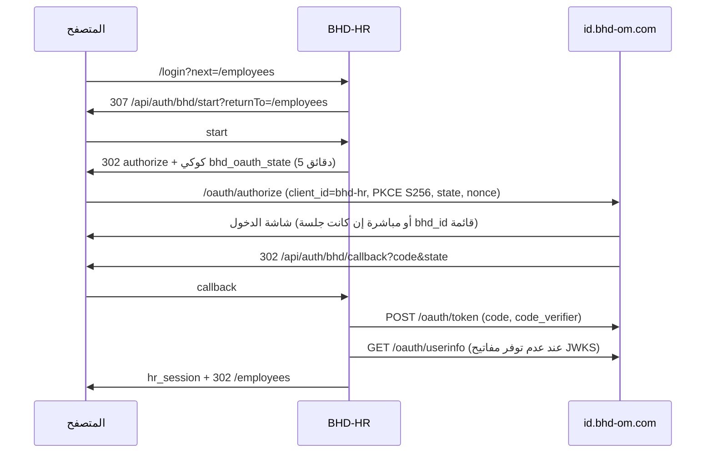

# المرجع التقني — BHD-HR

كل ما يحتاجه المطوّر لفهم النظام وتشغيله وصيانته وتطويره. دليل الاستخدام في [`BHD-HR-USER-GUIDE.md`](./BHD-HR-USER-GUIDE.md)، والدخول الموحّد في [`BHD-HR-SSO-INSTALL.md`](./BHD-HR-SSO-INSTALL.md)، وسجل النشر والحوادث في [`BHD-HR-DEPLOYMENT-LOG.md`](./BHD-HR-DEPLOYMENT-LOG.md).

---

## 1. التقنيات

| الطبقة | التقنية |
|---|---|
| الإطار | Next.js 15 (App Router، Server Components، Server Actions) |
| الواجهة | React 19، TypeScript 5، Tailwind CSS v4، أيقونات `lucide-react` |
| الخط والهوية | IBM Plex Sans Arabic للعربية وInter للإنجليزية والأرقام (عبر `next/font`)، ألوان BHD (`#092d24` حبر، `#075c45` زمردي، `#fbfaf7` رملي، حدود `#d7e2dc`؛ والفيروزي والكحلي والذهبي للتمييز فقط) |
| قاعدة البيانات | PostgreSQL على Neon عبر Prisma 6 — مشروع Neon مستقل **BHD HR** (`billowing-hat-97652194`)، الفرع `production`، القاعدة `neondb`، `aws-us-east-2`، Postgres 18. لا يشارك خادم ONE-BHD |
| الملفات | تُخزَّن داخل قاعدة البيانات في جدول `StoredFile` (لأن الاستضافة بلا قرص دائم)، وتُخدَم عبر `/files/[name]` بعد التحقق من الجلسة. الحد 4 ميغابايت للملف |
| الهوية | OIDC مع `https://id.bhd-om.com` (PKCE S256)، مكتبة `jose` |
| التصدير | `exceljs` (Excel من الخادم)، `jspdf` + `html2canvas-pro` (PDF في المتصفح) |
| الاستضافة | Vercel — المشروع `bhd-hr`، الرابط `https://bhd-hr.vercel.app`، ومربوط بمستودع GitHub فيُنشر تلقائياً عند كل دفع إلى `main` |
| التشغيل المحلي | Node.js ≥ 20، `npm run dev` (يتصل بقاعدة Neon نفسها) |

| الذكاء الاصطناعي | الترجمة الفورية (الأسماء والمسميات) عبر **Vercel AI Gateway** بحزمة `ai` (v5). النموذج الافتراضي `google/gemini-2.5-flash-lite`، ويُغيَّر بالمتغير `AI_TRANSLATE_MODEL`. على Vercel يتوثّق تلقائياً برمز OIDC للمشروع (لا مفتاح)؛ محلياً يلزم `VERCEL_OIDC_TOKEN` (من `vercel env pull`) أو `AI_GATEWAY_API_KEY`. بوابة Neon للذكاء الاصطناعي غير متاحة في الخطة المجانية |

لا توجد خدمات خارجية أخرى: لا طوابير، لا مدفوعات، لا بريد.

---

## 2. بنية المجلدات

```
prisma/
  schema.prisma          نموذج البيانات
  seed.ts                إنشاء المنشأة والمسؤول الأول (admin@bhd.local / admin123)
public/brand/            شعار BHD الرسمي (svg)
docs/                    هذا التوثيق + مستندات ONE-BHD المرجعية
src/
  app/
    (app)/               الصفحات الداخلية (تتطلب دخولاً) + layout فيه الرأس والمشغّل والفوتر
    (print)/             صفحات الطباعة (قسيمة، إيصال، كشف مسير، كشف حساب، جهات الاتصال)
    api/auth/            start / callback / logout / admin-entry للدخول الموحّد
    files/[name]/        تقديم الملفات المرفوعة بعد التحقق
    invite/[token]/      صفحة قبول الدعوة
    reports/export/      تنزيل التقرير الشهري Excel
    salaries/wps/        ملف تحويل الرواتب (WPS/SIF) CSV؛ salaries/spf/ كشف اشتراكات الحماية الاجتماعية Excel
    (print)/employees/[id]/hr-doc/  شهادة راتب، شهادة خبرة، رسالة تحويل راتب، تسوية نهاية الخدمة
    (app)/pay-items/     السلف والمكافآت والخصومات؛ (print)/pay-items/[id]/print إيصال استلام سلفة
    (app)/tasks/         لوحة المهام وقائمتها، و[id] تفاصيل المهمة
    (app)/letters/       الخطابات والإنذارات: القائمة، new، [id]؛ (print)/letters/[id]/print للطباعة
    letter/[token]/      نسخة الموظف العامة من الخطاب (بلا دخول) وتأكيد الاستلام
    portal/[token]/      بوابة الموظف (بلا دخول): الحضور، الإجازات وطلبها، القسائم (payslip/[id])، المستندات، الخطابات
    (app)/approvals/     طلبات الموظفين: الموافقة على الإجازات ومراجعة المستندات المرسلة من البوابة
    (app)/org/           الهيكل التنظيمي حسب «المدير المباشر»
    (app)/assistant/     المساعد الذكي (محادثة)
    (app)/recruitment/   التوظيف: الشواغر، [id] الشاغر ومرشحوه، candidates/[id] المرشح
    apply/[token]/       صفحة التقديم العامة على شاغر (بلا دخول)
    (app)/performance/   جولات تقييم الأداء، [id] الجولة، reviews/[id] تقييم موظف
    (app)/assets/        العُهد والأصول، و[id] العهدة وسجلها
    (app)/expenses/      طلبات تعويض المصروفات والموافقة والصرف
    (app)/analytics/     لوحة المالك (تحليلات 12 شهراً + قراءة بالذكاء الاصطناعي)
    login/               غلاف الدخول + دخول الطوارئ المحلي
  components/
    bhd/                 BhdAppSwitcher و BhdAppIcon (منسوخان من ONE-BHD) و site-footer
    app-frame.tsx        هيكل الواجهة: الشريط الجانبي، الدرج والشريط السفلي للهاتف، الشريط العلوي
    nav-speed.tsx        الجلب المسبق وشريط التقدّم (انظر «سرعة التنقل» أدناه)
    get-form.tsx         نموذج بحث/فلترة بتنقل داخلي بلا إعادة تحميل
    phone-input.tsx      حقل الهاتف: رمز الدولة (كل الدول، عُمان افتراضياً) + الرقم
    employee-multi-select.tsx  اختيار موظف أو أكثر (شرائح + بحث)؛ لا يوضع داخل Field
    task-board.tsx task-list.tsx task-form.tsx  لوحة المهام (سحب وإفلات) والقائمة والنموذج
    employee-workspace.tsx     تبويبات الملاحظات والمهام والخطابات في ملف الموظف
    letter-form.tsx letter-sheet.tsx share-letter.tsx  نموذج الخطاب، ورقته الرسمية، أزرار المشاركة
    assistant-chat.tsx   واجهة المساعد: الرسائل، الروابط، بطاقات الاقتراح مع «تأكيد وحفظ»
    job-form.tsx         نموذج الشاغر (إضافة وتعديل)
    expense-claim.tsx    بطاقة طلب المصروف بخطوتها التالية (موافقة / رفض، ثم الصرف) — في المصروفات والطلبات وملف الموظف
    employee-hr-tab.tsx  تبويب «الأداء والعهد والمصروفات» في ملف الموظف (يحمّل بياناته بنفسه)
    owner-insights.tsx   زر «حلّل الأرقام بالذكاء الاصطناعي» في لوحة المالك
    ui.tsx               عناصر الواجهة المشتركة (انظر «نظام الواجهة» أدناه)
    ...                  النماذج والمطبوعات
  lib/
    bhd/apps.ts          كتالوج تطبيقات BHD المجمّد — منسوخ حرفياً، لا يُعدّل هنا
    bhd/identity.ts      إعدادات OIDC، PKCE، تبديل الرمز، التحقق من id_token
    auth.ts              جلسة المنتج، المنشأة النشطة، الأدوار، can / requireUser / requirePermission / requireAdmin
    permissions.ts       الوحدات والعمليات، قوالب الأدوار، normalizePermissions (آمن للمتصفح)
    report-data.ts       بيانات التقرير الشهري حسب صلاحيات المستخدم (للصفحة وملف Excel)
    workspace.ts         ربط الدعوات بالبريد، وإنشاء منشأة خاصة لكل حساب بلا عضوية
    salary.ts payroll.ts حساب الراتب والخصم
    pay-items.ts         تطبيق السلف والمكافآت والخصومات والعلاوات على الرواتب، وتقدّم كل بند
    allowances.ts        قواعد العلاوات: الاستحقاق حسب الدورية، المبلغ (ثابت / نسبة)، الوصف
    hr-catalog.ts        كتالوج المنشأة (مسميات، أقسام، إجازات، علاوات) والتهيئة الكسولة وترحيل البيانات القديمة
    hr-defaults.ts       القوائم الجاهزة للمسميات الوظيفية والأقسام (عربي/إنجليزي)
    nationalities.ts     كل جنسيات العالم برمز ISO (عربي/إنجليزي)، العماني أولاً
    phone.ts             رموز الاتصال الدولية لكل الدول وتوحيد الأرقام وعرضها (انظر «أرقام الهاتف» أدناه)
    ai.ts                الترجمة بالذكاء الاصطناعي (مفردة ودفعات)، صياغة الخطابات، اقتراح خطوات المهمة — عبر AI Gateway
    tasks.ts             حالات المهام وأولوياتها وأنواع الملاحظات و dueInfo (آمن للمتصفح)
    task-data.ts         تحميل المهام للوحة وخيارات الموظفين
    letters.ts           أنواع الخطابات، القوالب، تدرّج الإنذارات، حالة الخطاب، نص الرسالة (آمن للمتصفح، بلا prisma)
    delivery.ts          إرسال نسخ الخطابات بالبريد (Resend) وواتساب (Meta Cloud API) — يعمل عند ضبط المتغيرات فقط
    oman.ts              اشتراكات الحماية الاجتماعية، مكافأة نهاية الخدمة، مدة الخدمة، نسبة التعمين
    banks.ts             البنوك العاملة في عُمان ورموز BIC، تنظيف رقم الحساب
    payroll-check.ts     فحص الرواتب غير المصروفة قبل الصرف
    hr-docs.ts           نصوص شهادات الراتب والخبرة ورسالة تحويل الراتب (عربي/إنجليزي)
    portal.ts            رمز البوابة ورابطها، قراءة الموظف من الرمز، خيارات الإجازة في البوابة، حالات الطلب
    clock.ts             يوم مسقط ووقته، التأخير، المسافة (haversine)، التحقق من الإحداثيات
    assistant.ts         المساعد الذكي: التعليمات، أدوات القراءة حسب الصلاحية، أدوات الاقتراح، runAssistant
    recruitment.ts       حالات الشاغر ومراحل المرشح وأنواع التوظيف ورمز رابط التقديم
    performance.ts       معايير التقييم الافتراضية، الدرجات 1–5، المتوسط، وحقائق الفترة من ملف الموظف (reviewFacts)
    assets.ts expenses.ts  أنواع العهد وحالاتها وسجلها؛ أنواع المصروفات وحالاتها وطرق صرفها (آمنة للمتصفح)
    analytics.ts         بيانات لوحة المالك (loadAnalytics) ونصها للذكاء الاصطناعي (analyticsFacts)
    employee-number.ts   الرقم الوظيفي التالي (خارج ملفات "use server" حتى لا يصبح نقطة استدعاء)
    inline-logo.ts       تضمين الشعار data: للصفحات العامة (الخطاب والبوابة)
    search.ts            توحيد النص العربي للبحث (أ/إ/آ، ة/ه، ى/ي، التشكيل)
    leave.ts             أرصدة الإجازات حسب أنواع المنشأة وتنبيهاتها وخيارات الحضور
    alerts.ts            توليد التنبيهات
    calendar.ts          أحداث التقويم والتذكيرات
    contacts.ts          جهات الاتصال للعرض والطباعة
    i18n.ts lang.ts      الترجمة (عربي / إنجليزي)
  server/                Server Actions لكل عملية كتابة
```

### نظام الواجهة

- **الرموز** في `src/app/globals.css` داخل `@theme`: سلّم `teal` (الزمردي)، وسلّم `slate` المبني على الحبر والحدود (`slate-200` = `#d7e2dc`، `slate-900` = `#092d24`)، و`sand` و`gold` و`aqua` و`navy` للتمييز، والظلال `shadow-card` و`shadow-raised` و`shadow-float`، والحركة `animate-fade-up` (150–320 م.ث، وتتوقف مع `prefers-reduced-motion`). لا تُضف لوحة ألوان محلية.
- **الهيكل** `AppFrame`: شريط جانبي ثابت بمجموعات (عام، الموارد البشرية، المالية، النظام) على الشاشات الكبيرة؛ وعلى الهاتف والجهاز اللوحي درج جانبي وشريط علوي باسم الصفحة وشريط سفلي بأهم أربعة أقسام مسموحة وزر «المزيد». الفوتر وزر المشغّل خارج نطاق التعديل. على الكمبيوتر تُطوى القائمة إلى شريط أيقونات بعرض 5rem (زر أسفلها)؛ الحالة في الكوكي `hr_sidebar` (`SIDEBAR_COOKIE` في `utils.ts`) ويقرؤها `(app)/layout.tsx` فيبدأ العرض بالحالة الصحيحة بلا وميض، والعرض عبر `--sidebar-width` و`.app-shell[data-sidebar="collapsed"]`.
- **العناصر** في `ui.tsx`: `PageHeader` (عنوان + أيقونة + أزرار)، `Card`، `SectionTitle`، `Stat`، `EmptyState`، `Toolbar`، `InfoItem`، `ToneBadge`، وأنماط الأزرار `primaryBtn` / `secondaryBtn` / `dangerBtn` / `ghostBtn` و`linkAction` و`fieldClass` (ارتفاع 44px على الهاتف).
- **الجداول المتجاوبة:** غلّف الجدول بـ `div.table-shell` وأعطه `table-stack`، وضع `data-label` على كل خلية بيانات، و`cell-title` لخلية الاسم، و`cell-actions` لخلية الإجراءات. تحت 640px يتحوّل كل صف إلى بطاقة تعرض العناوين. لإخفاء عمود على الأجهزة المتوسطة فقط استخدم `hidden xl:table-cell` (يبقى ظاهراً في بطاقة الهاتف).
- **التبويبات والفلاتر:** `.segmented` مع `aria-current="page"` للعنصر النشط.
- **زخرفة «الأفق الأعلى»** `.higher-horizon` بشفافية لا تتجاوز 12% وعلى الطرف المقابل للنص.
- **صفحة بحجم الشاشة:** `.screen-fit` في `globals.css` يجعل العنصر بارتفاع الشاشة ناقص الشريط العلوي والحواف وشريط الهاتف السفلي وشريط التنبيه (`--banner-height`، يقيسه `AppFrame` فعلياً). يستخدمه التقويم: صفوف الأيام `minmax(0,1fr)` فتتقلص الخلايا لتتسع للشهر كاملاً، واللوحة الجانبية على xl تتمرر داخلياً.
- **تنبيه:** `cn` يجمع الأسماء فقط بلا دمج، فلا تضف `px-0` أو `size-*` فوق `secondaryBtn` / `primaryBtn` (يبقى `px-4` و`min-h-11` ويُضغط المحتوى)؛ اكتب صنفاً مستقلاً.
- **الفحص:** كل صفحة بلا تمرير أفقي من 360px، وبالعربية والإنجليزية.

### أرقام الهاتف

- **التخزين:** كل رقم يُحفظ بصيغة واحدة `+968 91234567` (رمز الدولة، مسافة، الرقم المحلي بلا صفر بادئ إلا لإيطاليا وسان مارينو والفاتيكان).
- **الإدخال:** `PhoneField` / `PhoneInput` في `phone-input.tsx` — زر رمز الدولة (243 دولة، أسماؤها من `Intl.DisplayNames` بالعربية والإنجليزية، عُمان أولاً وافتراضياً) مع بحث بالاسم بأي لغة أو بالرمز، وحقل الرقم. لصق رقم يبدأ بـ `+` أو `00` يختار الدولة تلقائياً. القيمة المرسلة في حقل مخفي بالاسم المطلوب. لا تضعه داخل `Field` (وهو `<label>` فيسرق زر الدولة النقرات)؛ استخدم `PhoneField`.
- **الخادم:** كل Server Action يحفظ هاتفاً يمرّره على `normalizePhone` (الموظف، الكفيل، الكفيل الجديد من نموذج الموظف، المنشأة). الرقم بلا رمز يُعدّ عُمانياً.
- **العرض:** `formatPhone` للنص و`phoneHref` لروابط `tel:` في كل مكان (الملفات، دفتر العناوين وطباعته، رأس القسائم والإيصالات، ملف Excel)، فالأرقام القديمة المحفوظة بلا رمز تظهر بـ `+968`. داخل نص عربي مدمج يُحاط الرقم بـ LRI/PDI حتى لا ينقلب.

### سرعة التنقل

- **`NavSpeed`** (`src/components/nav-speed.tsx`، داخل `AppFrame`): بعد فتح أي صفحة يجلب في الخلفية كل الأقسام المسموحة للمستخدم كاملة (`router.prefetch` بنوع `full`)، ويجلب أي رابط داخلي عند مرور المؤشر أو اللمس، ويحدّث البيانات عند العودة إلى التبويب بعد 30 ثانية، ويُظهر شريط تقدّم رفيعاً أعلى الصفحة فقط إن تأخرت الصفحة أكثر من 120 م.ث. لا يجلب مسبقاً `/api` و`/files` و`/reports/export` وصفحات الطباعة.
- **ذاكرة الموجّه** في `next.config.ts`: `staleTimes` = 30 ثانية للصفحات المزورة و120 ثانية للمجلوبة مسبقاً. كل حفظ يمسحها عبر `refreshAll()` (`revalidatePath("/", "layout")`)، فتظهر التعديلات فوراً. **أي Server Action جديد يغيّر بيانات يجب أن يستدعي `refreshAll()`.**
- **لا `loading.tsx`:** تبقى الصفحة الحالية ظاهرة حتى تجهز التالية، بلا وميض هيكل تحميل.
- **نماذج البحث والفلترة** تستخدم `GetForm` (`next/form`) بدل `<form method="get">`، فلا يُعاد تحميل الصفحة كاملة. وتبديل اللغة يستخدم `router.refresh()` بدل إعادة التحميل.
- **المنطقة:** `vercel.json` يضع الدوال في `cle1` (كليفلاند، AWS us-east-2)، نفس منطقة قاعدة Neon، فزمن كل استعلام قرابة 1 م.ث. لا تغيّرها دون نقل القاعدة معها.
- استعلامات `getAlerts` تعمل بالتوازي (`Promise.all`).

### المهام والملاحظات والخطابات

- **الموظفون لا يدخلون النظام.** المهام والملاحظات يديرها مستخدمو النظام وتُسند إلى سجلات الموظفين. الموظف يتعامل فقط مع رابط نسخته من الخطاب ورابط بوابته (انظر «بوابة الموظف» أدناه).
- **المهام** (`server/task-actions.ts`): `createTask` / `updateTask` (يستبدل المسندين) / `setTaskStatus` / `deleteTask`، والخطوات `addTaskItem` / `toggleTaskItem` / `deleteTaskItem`، و`suggestTaskItems` (اقتراح خطوات بالذكاء الاصطناعي)، والتعليقات. اللوحة تنقل البطاقة بالسحب والإفلات (HTML5) أو بقائمة «نقل إلى» على الأجهزة اللمسية، وتستدعي `moveTask(taskId, status, orderedIds)` مباشرة (يعيد `{error?}` ولا يحوّل) مع تحديث متفائل. `completedAt` يُضبط عند `DONE` ويُفرَّغ عند الخروج منها. المكتملة تظهر 30 يوماً فقط ما لم يُطلب `done=all`.
- **التنبيهات والتقويم:** مهمة غير مكتملة متأخرة أو تستحق خلال `TASK_ALERT_DAYS` (يومان) تظهر في التنبيهات (`task-<id>`)، وكل مهمة لها استحقاق تظهر في التقويم (النوع `task`). كلاهما يتطلب `tasks.view`.
- **الملاحظات** (`server/note-actions.ts`): إضافة، تعديل، تثبيت، حذف. المثبتة تظهر أعلى تبويب البيانات في ملف الموظف.
- **الخطابات** (`server/letter-actions.ts`):
  - `createLetters` يصدر خطاباً مستقلاً لكل موظف مختار. `refNo` يُولَّد `HR-<السنة>-<تسلسل>` داخل المنشأة ويُعاد المحاولة عند تعارض المفتاح الفريد. `token` عشوائي 24 بايت.
  - ترويسة الخطاب من الكفيل إن وُجد وإلا المنشأة (`headerFor` كالقسائم).
  - مستوى الإنذار المقترح من عدد الإنذارات غير الملغاة خلال 365 يوماً (`nextWarningKind`).
  - الصياغة: `draftLetter` (ذكاء اصطناعي، يعيد عربي وإنجليزي) أو `LETTER_TEMPLATES` مع `{reason}`.
  - لكل قناة مختارة تُنشأ `LetterDelivery` بحالة `PENDING` إن كان للموظف بريد صحيح / هاتف. ثم `sendPendingCopies` يرسل ما قناته مفعّلة فقط. «إرسال النسخ المنتظرة الآن» في الإعدادات (`sendPendingLetterCopies`، للمسؤول) يرسل المتراكم بعد التفعيل. **كود الإرسال (Resend و Meta) لم يُختبر على مزوّد حقيقي بعد؛ اختبره بخطاب لموظف تجريبي فور ضبط المتغيرات.**
  - المشاركة اليدوية تعمل دائماً: `wa.me` و`mailto:` ونسخ الرابط من صفحة الخطاب.
- **نسخة الموظف `/letter/<token>`:** خارج `(app)` و`(print)` فلا تتطلب دخولاً. الرمز هو المفتاح الوحيد (`noindex`، `no-referrer`). أول فتح يضبط `viewedAt`. زر «أقر باستلام الخطاب» (`acknowledgeLetter`) يضبط `acknowledgedAt` ويكتب في السجل. الشعار يُضمَّن `data:` من `StoredFile` لأن `/files` يتطلب دخولاً. الخطاب الملغى يُعرض بعلامة «ملغى» بلا زر تأكيد.

### ملخص اليوم والمهمة المجدولة وقراءة المستندات

- **ملخص اليوم** (`lib/brief.ts`، `components/daily-brief.tsx`): بطاقة في لوحة المعلومات تُحمَّل داخل `Suspense` فلا تؤخر الصفحة. الحقائق تأتي من `computeAlerts(company, permissions, lang)` (نفس التنبيهات، مقيدة بصلاحيات القارئ) وعدد الخطابات غير المؤكدة بعد 3 أيام، ثم `aiDailyBrief` يكتب سطراً عاماً و5 نقاط كحد أقصى من هذه الحقائق فقط. يُخزَّن في `DailyBrief` لكل (منشأة، يوم مسقط، لغة، `scope` = بصمة الصلاحيات)، فيُستدعى الذكاء الاصطناعي مرة يومياً لكل مجموعة صلاحيات. زر «تحديث» (`refreshDailyBrief`) يحذف نسخة اليوم ويعيد البناء. عند تعذر الذكاء الاصطناعي يظهر ملخص ثابت من التنبيهات ولا يُخزَّن.
- **المهمة المجدولة** `GET /api/cron/daily` (`vercel.json` → `crons`، يومياً 03:00 UTC = 07:00 مسقط): ترفض أي طلب بلا `Authorization: Bearer $CRON_SECRET`. لكل منشأة: ترسل نسخ الخطابات المنتظرة (`sendPendingCopies`)، وإذا كان البريد مفعّلاً ترسل ملخص اليوم (`sendEmailMessage`) لكل مسؤول ومدير قَبِل الدعوة، فقط إن كانت هناك تنبيهات. تعيد أعداداً بلا بيانات شخصية.
- **قراءة المستندات** (`components/document-scan.tsx`، `readDocumentFile` في `server/ai-actions.ts`، `aiReadDocument` في `lib/ai.ts`): يختار المستخدم صورة أو PDF (حتى 4 ميغابايت، يتطلب `employees.create/edit` أو `documents.create/edit`)، فيقرأ نموذج الرؤية (`AI_VISION_MODEL`، افتراضياً `google/gemini-2.5-flash`) النوع والرقم والانتهاء والاسمين والجنسية (ISO) والميلاد والجنس، ويُطلب منه ترك ما لا يُقرأ فارغاً. لا يُحفظ شيء في الخادم: المكوّن يعبئ حقول النموذج المحيط (بضبط القيمة وإطلاق `input`/`change` فتلتقطها الحقول المتحكَّم بها، و`SEARCH_SELECT_SET` لقائمة الجنسية) ويضع الملف نفسه في حقل المرفق المطابق (`DataTransfer`)، ثم يحفظ المستخدم بعد المراجعة. في نموذج الموظف: البطاقة العمانية → صف البطاقة، بطاقة المقيم → صف الإقامة، الجواز → صف الجواز؛ الاسم والميلاد والجنس تُعبأ إن كانت فارغة فقط، والجنسية تُستبدل.

### الامتثال العماني ومستندات الموارد البشرية وفحص ما قبل الصرف

- **الحماية الاجتماعية** (`spfContribution` في `lib/oman.ts`، الإعدادات ← «عُمان والبنك»، `updateSocialProtection` للمسؤول): معطّلة افتراضياً. النسب الافتراضية حسب صندوق الحماية الاجتماعية (يوليو 2026): العماني 8% على الموظف و14.5% على صاحب العمل، وغير العماني 2% على صاحب العمل فقط (تأمين الأمومة والمرض)، بسقف أجر 3000 ر.ع، على الإجمالي (الحزمة + العلاوات المتكررة) أو على الأساسي حسب `spfBase`. لا يتأثر الأجر المؤمَّن عليه بخصم الغياب. `syncSalaryLines` يضيف سطر خصم `SOCIAL` بحصة الموظف (فيدخل في `extraDeductions` ويظهر في القسيمة) ويحفظ `spfEmployee` و`spfEmployer` على الراتب؛ حصة صاحب العمل تكلفة لا تُخصم. حفظ الإعدادات يعيد حساب كل الرواتب غير المصروفة، وتغيير جنسية الموظف يعيد حساب رواتبه. **راجع النسب مع الصندوق قبل التفعيل**؛ نظام ادخار الوافدين (9%) لم يُطبَّق.
- **مكافأة نهاية الخدمة** (`gratuity`): لغير العماني فقط (العماني مشمول بالصندوق). قانون العمل م.61 (المرسوم 53/2023): أجر شهر أساسي عن كل سنة، والكسور بالنسبة. الخدمة قبل 31/7/2023 بالقاعدة السابقة: 15 يوماً عن كل سنة من الثلاث الأولى ثم شهر. الحساب بأيام كاملة (اليوم الأخير محسوب) على أساس 365 يوماً للسنة. تظهر المستحقة حتى اليوم في ملف الموظف وفي التسوية.
- **مستندات الموارد البشرية** `/employees/<id>/hr-doc?type=salary|experience|bank|settlement&to=&end=&leave=`: يتطلب `employees.view`، والأنواع الثلاثة التي فيها راتب تتطلب `salaries.view`. ترويسة الكفيل أو المنشأة (`HeaderBar`)، نص عربي يطابق جنس الموظف ونص إنجليزي، والهوية: البطاقة الشخصية للعماني ثم بطاقة المقيم ثم الجواز. رسالة تحويل الراتب تذكر بنك الموظف وحسابه وتعهد التحويل. التسوية: مدة الخدمة، المكافأة بتفصيلها، بدل الإجازات غير المستخدمة (الرصيد السنوي من النظام أو `leave`) × (الأساسي ÷ `salaryDays`)، الرواتب غير المصروفة، خصم السلف المتبقية، والصافي — حساب استرشادي يُراجع قبل الاعتماد.
- **ملف WPS** `GET /salaries/wps?year=&month=&employerId=` (يتطلب `salaries.pay`): CSV بتخطيط SIF الشائع لدى البنوك العمانية: صف الدافع (السجل التجاري للكفيل المختار أو للمنشأة، بنك المنشأة وحسابها، الإجمالي، العدد) ثم صف لكل موظف (نوع الهوية `C` مدنية / `P` جواز، الرقم، الرقم الوظيفي، الاسم الإنجليزي، BIC، الحساب، أيام العمل، الصافي، الأساسي، الإضافات، الخصومات، الحماية الاجتماعية). يُستثنى من بلا بنك أو حساب أو صافيه صفر. **تأكد من التخطيط مع البنك قبل أول رفع.** يُكتب `WPS_EXPORT` في السجل.
- **كشف الحماية الاجتماعية** `GET /salaries/spf?year=&month=` (يتطلب `salaries.view`): Excel بحصة الموظف وصاحب العمل لكل موظف والإجماليات.
- **فحص ما قبل الصرف** (`payrollIssues` في `lib/payroll-check.ts`، بطاقة «مراجعة قبل الصرف» في `/salaries` عند وجود رواتب غير مصروفة): خطر = صافٍ سالب؛ تنبيه = صافٍ أو أساسي صفر، تغيّر الصافي أكثر من 25% عن الشهر السابق، خصومات تتجاوز نصف المستحقات، موظف منتهي الخدمة أو غير نشط، أيام غياب تغيّرت بعد إنشاء الراتب؛ معلومة = موظفون بلا بنك أو حساب، موظفون نشطون بلا مسير. أول 12 ملاحظة بروابط.
- **التعمين** (`omanization`): نسبة العمانيين بين النشطين والإجازة، إجمالاً ولكل قسم؛ تلميح في بطاقة «الموظفون النشطون» في لوحة المعلومات، وقسم `#omanization` في التقارير. النسبة المطلوبة تختلف حسب النشاط وتحددها وزارة العمل.
- **البنوك** (`lib/banks.ts`): قائمة البنوك العاملة في عُمان برموز BIC (تحقق من الرمز مع البنك). بنك المنشأة وحسابها في الإعدادات، وبنك الموظف وحسابه في نموذج الموظف ضمن قسم الراتب (يحفظان فقط لمن لديه `salaries.edit`، ويُحتفظ بهما عند التعديل بدونها).

### بوابة الموظف والطلبات والهيكل التنظيمي وتسجيل الحضور

- **الرابط:** بطاقة «بوابة الموظف» في ملف الموظف (`#portal`، تتطلب `employees.edit`): `renewPortalLink` ينشئ `Employee.portalToken` (24 بايت base64url، فريد) أو يستبدله فيتوقف القديم فوراً، و`disablePortalLink` يفرّغه. المشاركة بواتساب والبريد ونسخ الرابط (`ShareLetter` مع `openLabel`). لا كلمة مرور: الرمز هو المفتاح، فيُعامل كسر.
- **الصفحة `/portal/<token>`:** خارج `(app)` فلا تتطلب دخولاً (`force-dynamic`، `noindex`، `no-referrer`). `portalEmployee` يرفض رمزاً أقصر من 20 حرفاً أو موظفاً منتهي الخدمة، فتظهر «الرابط غير صالح». الشعار مضمَّن (`inlineLogo`). الأقسام: الحضور (إن فُعّل)، الإجازات (الأرصدة من `computeLeaveBalances`، نموذج الطلب، آخر 20 طلباً بحالتها وملاحظة الإدارة)، الرواتب المصروفة (آخر 12، والقسيمة `/portal/<token>/payslip/<id>` تعرض رواتب هذا الموظف المصروفة فقط وإلا 404)، المستندات وتواريخها مع إرسال نسخة محدّثة، الخطابات غير الملغاة.
- **Server Actions البوابة** (`server/portal-actions.ts`): كلها تقرأ الموظف من الرمز في `FormData` (لا من جلسة) وتحوّل إلى `/portal/invalid` إن لم يصلح.
  - `requestLeave`: نوع من `portalLeaveChoices` (الأنواع التي تشمل وظيفته ثم «بخصم راتب»)، حتى 90 يوماً، ويرفض التداخل مع طلب معلّق أو موافق عليه. يُنشأ `LeaveRequest` بحالة `PENDING` ويُكتب في السجل.
  - `cancelLeaveRequest`: للمعلّق فقط.
  - `submitPortalDocument`: نوع من `EXTRA_DOC_TYPES` وملف إلزامي (4 ميغابايت)، وحد 10 مستندات غير مراجعة لكل موظف. يُنشأ `EmployeeDocument` مع `submittedAt`.
  - `clockPunch({token, lat, lng, accuracy})`: يعيد `{error|message}` ولا يحوّل. يتطلب `clockEnabled`. إن حُدد موقع العمل: يلزم الموقع، ويُرفض إذا كانت `المسافة − min(الدقة، 100) > workRadius`. أول تسجيل في يوم مسقط يُنشئ `ClockEntry` (مع `lateMinutes` بعد `workStart`)، والثاني يضع الانصراف، والثالث يُرفض.
- **الموافقات `/approvals`** (`server/request-actions.ts`): تظهر لمن لديه `attendance.view` أو `documents.view`.
  - `decideLeaveRequest` (يتطلب `attendance.create`): الرفض يضع `REJECTED` مع الملاحظة. الموافقة تتحقق من الرصيد (وتطلب `allowOverdraft=1` عند التجاوز)، ثم داخل معاملة ترفض أي يوم مسجّل مسبقاً في الحضور، وتنشئ صفوف `Attendance` بنفس `groupId` (خصم الراتب لـ «بخصم راتب» فقط، والملاحظة «طلب من البوابة: …»)، وتضع `APPROVED` و`attendanceGroupId`.
  - `reviewPortalDocument` (يتطلب `documents.edit`): القبول يضع `reviewedAt`، والرفض يحذف المستند وملفه.
  - التنبيهات: كل طلب معلّق `request-<id>` (`attendance.view`)، والمستندات غير المراجعة `review-documents` (`documents.view`)؛ وتظهر في ملخص اليوم أيضاً لأنه مبني على التنبيهات.
- **`SubmitButton` بـ `name`/`value`:** نماذج Server Actions لا ترسل اسم الزر المضغوط وقيمته بشكل موثوق، فالزر ينسخهما عند الضغط إلى حقل مخفي (`data-submitter`). استخدمه لنموذج واحد بأكثر من نتيجة (موافقة / رفض).
- **المدير المباشر والهيكل:** `Employee.managerId` (علاقة ذاتية `ReportsTo`، تُفرَّغ عند حذف المدير). `resolveManager` في `employee-actions.ts` يرفض الموظف نفسه ومديراً من منشأة أخرى والحلقات (يصعد السلسلة حتى 100 خطوة). `/org` (`employees.view`) يبني شجرة غير المنتهية خدمتهم (عمق حتى 12)، ومن بلا مدير ولا فريق يُجمَّع حسب القسم.
- **تسجيل الحضور:** الإعدادات ← «تسجيل الحضور» (`updateClockSettings`، للمسؤول): `clockEnabled`، `workLat`/`workLng` (زر «موقعي الحالي» في `WorkSitePicker`)، `workRadius` (30–5000 م)، `workStart` (HH:MM بتوقيت مسقط). الأوقات تُعرض بتوقيت مسقط (UTC+4 بلا توقيت صيفي). السجل اليومي في `/attendance#clock` (اختيار اليوم، من سجّل ومن لم يسجّل ومن عليه غياب/إجازة مسجّلة)، وآخر 31 يوماً في تبويب الحضور بملف الموظف. تسجيل الحضور لا يُنشئ صفوف `Attendance` ولا يؤثر على الراتب.

### المساعد الذكي

- **الصفحة `/assistant`** (لكل مستخدم مسجّل، في مجموعة «عام» وفي الشريط السفلي للهاتف): `AssistantChat` يحفظ المحادثة في `sessionStorage` (`bhd-hr-assistant`) فقط؛ لا شيء في القاعدة. «محادثة جديدة» يمسحها. الاقتراحات الجاهزة تُختار حسب صلاحيات المستخدم.
- **`askAssistant(history)`** (`server/assistant-actions.ts`): يتحقق من الجلسة، يأخذ آخر 12 رسالة (4000 حرف لكل رسالة)، ويشترط أن تكون الأخيرة من المستخدم، ثم `runAssistant`.
- **`runAssistant`** (`lib/assistant.ts`): `generateText` من حزمة `ai` عبر AI Gateway، بالنموذج `AI_ASSISTANT_MODEL` (افتراضياً `google/gemini-2.5-flash`) مع نماذج احتياطية في `providerOptions.gateway.models` (`openai/gpt-4.1-mini` ثم `anthropic/claude-haiku-4.5`) لأن حد البوابة 5 طلبات في الدقيقة لكل نموذج. حتى 8 خطوات، `temperature: 0`، والخطوة الأولى تُجبر على استدعاء أداة (`toolChoice: "required"`؛ للتحية ونحوها أداة `no_lookup_needed`) فلا يجيب النموذج من خياله. التعليمات: الإجابة من نتائج الأدوات فقط، العربية أو الإنجليزية حسب الواجهة، نقاط «• » بلا Markdown.
- **أدوات القراءة** (كل أداة تُبنى فقط إن كان لدى المستخدم صلاحيتها، وكلها مقيدة بالمنشأة النشطة): `company_overview`، `current_alerts` (`computeAlerts` بصلاحيات المستخدم)، `find_employees` و`employee_profile` (`employees.view`؛ المستندات بـ `documents.view`، الأرصدة والحضور بـ `attendance.view`، الراتب بـ `salaries.view`)، `attendance_on_day` و`pending_leave_requests` (`attendance.view`)، `payroll_summary` (`salaries.view`). الروابط التي تعيدها الأدوات تظهر شرائح تحت الرد (حتى 12).
- **الكتابة بالتأكيد فقط:** المساعد لا يكتب في القاعدة. `propose_task` و`propose_note` (`tasks.create`) و`propose_reminder` (`calendar.create`) تتحقق من المدخلات وتحل الموظف بالاسم أو الرقم (وتسأل عند التشابه)، ثم تضيف «اقتراحاً» يظهر بطاقة بزر «تأكيد وحفظ». إذا حاول النموذج الاقتراح ولم يُجهَّز شيء يُضاف تنبيه للمستخدم. `confirmAssistantProposal` يعيد التحقق من الصلاحية والموظفين والقيم كاملة ثم ينشئ `Task` أو `EmployeeNote` أو `Reminder`، ويكتب في السجل «… عبر المساعد الذكي»، ويستدعي `refreshAll()`.
- **الأعطال:** حد الطلبات يعيد «المساعد مشغول الآن. حاول بعد دقيقة.»، وأي خطأ آخر «المساعد غير متاح الآن…» مع تسجيله في سجلات الخادم.

### التوظيف وتقييم الأداء والعهد والمصروفات ولوحة المالك

- **الشواغر** (`server/recruitment-actions.ts`، `recruitment.*`): `saveJob` (المسمى والقسم من الكتالوج، العدد، الراتب المتوقع، آخر موعد، الحالة `OPEN`/`ON_HOLD`/`CLOSED`)، `setApplyLink` (`renew` يولّد `applyToken` جديداً 18 بايت فيتوقف القديم، `off` يفرّغه)، `deleteJob`. مراحل المرشح: `NEW` → `SCREENING` → `INTERVIEW` → `OFFER` → `HIRED` / `REJECTED`.
- **التقديم العام `/apply/<token>`** (`server/apply-actions.ts`، `submitApplication`): بلا دخول (`noindex`). يرفض الشاغر غير المفتوح أو بعد `closesAt`، ويشترط اسماً (3 أحرف) وبريداً أو هاتفاً وسيرة (صورة أو PDF، 4 ميغابايت). حقل فخ `website` للروبوتات، وحد 300 طلب لكل رابط، والتكرار بنفس البريد أو الهاتف يُقبل بصمت دون إنشاء مرشح ثانٍ.
- **تقييم السيرة بالذكاء الاصطناعي** (`aiScreenCandidate` في `lib/ai.ts`، `screenCandidate` / `screenJobCandidates` بدفعات 5): يقرأ نموذج الرؤية ملف السيرة من `StoredFile` ويقارنه بوصف الشاغر، فيعيد درجة 0–100 وملخصاً ونقاط قوة وفجوات، ويعبئ البريد والهاتف والخبرة إن كانت فارغة. التعليمات تمنع استخدام العمر والجنس والجنسية والديانة والحالة الاجتماعية. استبدال السيرة يمسح التقييم السابق.
- **المقابلة:** `interviewAt` من حقل `datetime-local` يُقرأ بتوقيت مسقط (`+04:00`) ويُعرض بـ `muscatDateTime`؛ تظهر في التقويم (النوع `interview`، `recruitment.view`) وفي التنبيهات إن كانت خلال 48 ساعة (`interview-<id>`).
- **التعيين** `hireCandidate` (يتطلب `employees.create`؛ الراتب يُحفظ فقط مع `salaries.edit`): ينشئ `Employee` بالرقم التالي والاسم والتواصل والمسمى والقسم وتاريخ المباشرة، ويضيف السيرة مستنداً (`CERTIFICATE`) في ملفه، ويضع المرشح `HIRED` مع `employeeId`، ويغلق الشاغر تلقائياً عند اكتمال العدد، ثم يفتح تعديل الموظف لإكمال بياناته. حذف المرشح لا يحذف السيرة إن كانت مستنداً لموظف.
- **تقييم الأداء** (`server/performance-actions.ts`، `performance.*`): `createCycle` بالاسم والفترة والموعد والمعايير (7 جاهزة + حتى 5 إضافية بمفاتيح `custom1..5`) ونطاق القسم، وينشئ `PerformanceReview` لكل موظف نشط أو في إجازة؛ `addMissingEmployees` للمنضمين لاحقاً؛ `setCycleStatus` يغلق الجولة (لا تعديل بعدها) أو يعيد فتحها. `saveReview` يقرأ `score_<key>` (1–5) والنصوص؛ `decision=finish` يشترط كل الدرجات ويضع `DONE` و`overall` (المتوسط لأقرب 0.1)، و`draft` يعيده مسودة ويخفيه من البوابة. `draftReview` (`aiDraftReview`) يكتب نقاط القوة والتحسين والأهداف من `reviewFacts` (الغياب والإجازات، التأخير في تسجيل الحضور، المهام المنجزة والمتأخرة، الملاحظات حسب النوع، الخطابات والإنذارات، التقييم السابق) في الحقول الفارغة فقط. `shareReview` يضبط `sharedAt` فيظهر في البوابة (الدرجات والنصوص دون التعليق الداخلي). التنبيه `cycle-<id>` عند اقتراب `dueDate` وبقاء تقييمات غير معتمدة.
- **العهد** (`server/asset-actions.ts`، `assets.*`): `saveAsset` (مع تسليم فوري اختياري)، `assignAsset` (للمتاحة أو في الصيانة، لا لموظف منتهي الخدمة)، `returnAsset` (الحالة عند الاستلام، ثم متاحة أو صيانة)، `setAssetStatus` (متاحة / صيانة / مستبعدة، فقط إن لم تكن مع موظف)، `deleteAsset` (لا تُحذف وهي مع موظف). كل حركة تُضاف إلى `AssetEvent`. التنبيه `asset-<id>` (خطر) لكل عهدة مع موظف منتهي الخدمة. `/approvals` تُفتح أيضاً بـ `expenses.view`.
- **المصروفات** (`server/expense-actions.ts`، `expenses.*`): من البوابة `submitExpense` (الإيصال إلزامي، حد 10 طلبات معلّقة لكل موظف) و`cancelExpense` للمعلّق، أو من الإدارة `addExpense` (الإيصال اختياري، ويمكن اعتماده مباشرة). `decideExpense` (`expenses.edit`) يوافق أو يرفض (السبب إلزامي عند الرفض). `payExpense` (`expenses.pay`): `SALARY` (يتطلب أيضاً `salaries.create`) ينشئ `PayItem` من نوع `ENTITLEMENT` لشهر واحد بعنوان «تعويض مصروف: …» في أول شهر غير مصروف (الشهر الحالي بتوقيت مسقط، أو التالي إن صُرف راتبه) ثم `syncEmployeeSalaries`، فلا يدخل في الحماية الاجتماعية؛ أو `CASH` / `BANK_TRANSFER` / `CHEQUE` فيُسجَّل مصروفاً فوراً. `deleteExpense` يرفض المصروف الذي دخل راتباً مصروفاً، وإلا يحذف بنده ويعيد احتساب الرواتب. الإيصالات في `/files` تتطلب `expenses.view`. التنبيهات `expenses-pending` و`expenses-approved`.
- **لوحة المالك `/analytics`** (`reports.view`؛ كل المبالغ تتطلب `salaries.view`): `loadAnalytics` يحسب لآخر 12 شهراً بتوقيت مسقط: عدد الموظفين في نهاية كل شهر (من `joiningDate` أو تاريخ الإنشاء، و`terminatedAt`)، التعيين والخروج، معدل الدوران = الخارجون ÷ متوسط العدد، الغياب (نصف يوم = 0.5) والمرضية والإجازات شهرياً، تكلفة الرواتب الشهرية = الصافي + حصتي الحماية الاجتماعية، الأقسام (العدد، العمانيون، إجمالي الرواتب)، التعمين، مكافأة نهاية الخدمة المستحقة اليوم لغير العمانيين، العقود المنتهية أو التي تنتهي خلال 90 يوماً، مسار التوظيف، المصروفات حسب النوع، العهد، ومتوسط تقييم الأداء. الرسوم CSS بلا مكتبة. زر «حلّل الأرقام» يستدعي `ownerInsights()` (يعيد `{text|error}`) الذي يرسل `analyticsFacts` فقط (بلا أسماء ولا بيانات شخصية) إلى `aiOwnerInsights`.
- **`Employee.terminatedAt`:** يُضبط عند تحويل الحالة إلى «منتهي الخدمة» (ويُحفظ إن كان موجوداً) ويُفرَّغ عند إعادته؛ تعتمد عليه لوحة المالك في الخروج والدوران.

---

## 3. نموذج البيانات

| الجدول | الغرض | أهم الحقول |
|---|---|---|
| `Company` | المنشأة (مساحة العمل) وإعداداتها — حدّ العزل لكل البيانات | الاسم، العملة، `salaryDays`، أيام تنبيه المستندات، `payDay`، `leaveWarningDays`، `catalogVersion` (0 = لم يُهيّأ الكتالوج بعد)، الحماية الاجتماعية `spfEnabled` و`spfEmployeeRate` و`spfEmployerRate` و`spfExpatEmployerRate` و`spfWageCap` و`spfBase` (`GROSS`/`BASIC`)، `bankBic` و`bankAccount` لملف WPS، تسجيل الحضور `clockEnabled` و`workLat`/`workLng` و`workRadius` (افتراضياً 200) و`workStart` |
| `JobTitle` / `Department` | المسميات الوظيفية والأقسام لكل منشأة | `nameAr` (فريد داخل المنشأة)، `nameEn` |
| `LeaveType` | أنواع الإجازات لكل منشأة | `key` (فريد داخل المنشأة؛ `annual`/`sick`/`compensatory`/`other` للأساسية و`t<hex>` للمضافة، وهو ما يُخزَّن في `balanceKey`)، `nameAr`، `nameEn`، `days`، `allJobs`، `jobTitleIds[]`، `sortOrder` |
| `AllowanceType` | تعريف العلاوة (القيم الافتراضية) | `nameAr`، `nameEn`، `calc` (`FIXED`/`PERCENT`)، `base` (`BASIC`/`PACKAGE`)، `value`، `frequency` (`MONTHLY`/`QUARTERLY`/`SEMI_ANNUAL`/`ANNUAL`)، `payMonth` |
| `EmployeeAllowance` | علاوة موظف | `employeeId` (حذف متسلسل)، `allowanceTypeId`، نفس حقول القاعدة، `startYear`/`startMonth`، `active` |
| `User` | الحسابات | `email` (فريد)، `password` (scrypt أو فارغ لحسابات BHD)، `bhdSub` (فريد)، `picture`، `lastLoginAt`. لا دور ولا منشأة على الحساب نفسه |
| `Membership` | من يصل إلى أي منشأة وبأي صلاحية | `companyId`، `userId` (فارغ للدعوة حتى أول دخول)، `email`، `role` (`ADMIN` / `MANAGER` / `VIEWER` / `CUSTOM`)، `permissions` (JSON للدور `CUSTOM` فقط)، `inviteToken` (فريد)، `invitedById`، `invitedAt`، `acceptedAt`؛ فريد على (`companyId`، `email`) |
| `Employer` | الكفلاء وأصحاب العمل | `kind` (COMPANY / PERSON)، الاسم، الهاتف، البريد، الشعار |
| `Employee` | الموظفون | البيانات الشخصية، `nationality` (رمز ISO مثل `OM`؛ القيم النصية القديمة تُقرأ أيضاً)، الوثائق وتواريخ انتهائها و`idFileUrl`/`passportFileUrl`/`residenceFileUrl`، `jobTitleId`+`jobTitle`/`jobTitleEn` و`departmentId`+`department`/`departmentEn` (نص مكرر للعرض والبحث)، الحالة، `leaveDays` (JSON: أيام مخصصة لكل `key` تختلف عن الافتراضي؛ أعمدة `annualLeaveDays` وأخواتها قديمة لا تُقرأ)، مكوّنات الراتب، `bankBic` و`bankAccount`، `employerId`، `managerId` (المدير المباشر)، `portalToken` (فريد، رابط البوابة)، `terminatedAt` (تاريخ انتهاء الخدمة). `employeeNumber` فريد داخل المنشأة (كل منشأة تبدأ من EMP-0001) |
| `EmployeeDocument` | المستندات الإضافية | النوع، الرقم، الانتهاء، `fileUrl`، `submittedAt` (أرسله الموظف من البوابة)، `reviewedAt` |
| `LeaveRequest` | طلب إجازة من البوابة | `employeeId`، `choice` (`leave:<key>` أو `UNPAID_LEAVE`)، `fromDate`/`toDate`، `days`، `reason`، `status` (`PENDING`/`APPROVED`/`REJECTED`/`CANCELLED`)، `decidedById`/`decidedByName`/`decidedAt`/`decisionNote`، `attendanceGroupId` (صفوف الحضور المنشأة عند الموافقة) |
| `ClockEntry` | تسجيل حضور يومي من البوابة | `day` (`YYYY-MM-DD` مسقط، فريد مع الموظف)، `inAt`/`outAt`، الإحداثيات والمسافة لكل منهما، `lateMinutes` |
| `Attendance` | يوم غياب / إجازة | `date` (يوم واحد لكل صف، فريد مع الموظف)، `type`، `deductsSalary`، `balanceKey`، `groupId` يجمع أيام الفترة الواحدة |
| `LeaveCredit` | إضافة رصيد يدوية | `balanceKey`، `days`، السبب |
| `Salary` | راتب شهر لموظف | لقطة كاملة للراتب والأسماء وقت الإنشاء، الخصومات، `extraEarnings` و`extraDeductions` (مجموع سطور البنود)، الصافي، `spfEmployee` (داخل `extraDeductions` كسطر `SOCIAL`) و`spfEmployer` (تكلفة على صاحب العمل لا تُخصم)، حالة الصرف، `companyId`، `receiptNo` (فريد داخل المنشأة، وتسلسله لكل منشأة) |
| `PayItem` | سلفة أو مكافأة أو بدل أو استحقاق أو خصم | `kind` (`ADVANCE` / `BONUS` / `ALLOWANCE` / `ENTITLEMENT` / `DEDUCTION`)، `title`، `amount` (للسلفة: المبلغ كله؛ لغيرها: لكل شهر)، `issuedAt`، `startYear`/`startMonth`، `months` (للسلفة: الأقساط؛ لغيرها: عدد الأشهر، فارغ = حتى الإيقاف)، `paymentMethod`، `stoppedAt`، `createdByName` |
| `SalaryLine` | بند مطبّق على راتب شهر | `salaryId` (حذف متسلسل)، `payItemId` أو `allowanceId` (يُفرَّغان عند حذف المصدر)، `kind` (`RECURRING` للعلاوة)، `title`، `titleEn`، `amount`، `deduct` — لقطة لا تتغير بعد الصرف. `Salary` يحفظ أيضاً `jobTitleEn` و`departmentEn` |
| `Reminder` | تذكيرات التقويم | العنوان، التاريخ، التكرار (NONE / MONTHLY / YEARLY)، موظف اختياري، `done` |
| `AuditLog` | سجل العمليات | `companyId`، المستخدم، الموظف، الإجراء، الرسالة |
| `StoredFile` | الملفات المرفوعة (مستندات وشعارات) | `companyId`، `name` (فريد، يظهر في الرابط `/files/<name>`)، `mime`، `size`، `data` (البايتات) |
| `Task` | مهمة | `companyId`، `title`، `description`، `status` (`TODO` / `IN_PROGRESS` / `REVIEW` / `DONE`)، `priority` (`URGENT` / `HIGH` / `NORMAL` / `LOW`)، `startDate`، `dueDate`، `completedAt` (يُضبط عند `DONE`)، `position` (ترتيب داخل العمود)، `createdById` / `createdByName` |
| `TaskAssignee` | إسناد المهمة لموظف (أكثر من موظف للمهمة) | مفتاح مركّب (`taskId`، `employeeId`)، حذف متسلسل من الطرفين |
| `TaskItem` / `TaskComment` | خطوات التنفيذ والتعليقات | الخطوة: `text`، `done`، `position`. التعليق: `userId`، `authorName`، `body` |
| `EmployeeNote` | ملاحظة في ملف الموظف (داخلية) | `employeeId` (حذف متسلسل)، `kind` (`GENERAL` / `PERFORMANCE` / `CONDUCT` / `TRAINING` / `PRAISE`)، `body`، `pinned`، `authorId` / `authorName` |
| `Letter` | خطاب أو إنذار للموظف | `kind` (`NOTICE` / `WARNING_1` / `WARNING_2` / `FINAL_WARNING` / `APPRECIATION` / `GENERAL`)، `refNo` (`HR-YYYY-0001`، فريد داخل المنشأة)، `issuedAt`، `subject`/`body` و`subjectEn`/`bodyEn`، الموقّع، `token` (فريد، 24 بايت base64url — مفتاح نسخة الموظف)، `viewedAt`، `acknowledgedAt`، `cancelledAt` |
| `LetterDelivery` | نسخة مرسلة عبر قناة | `channel` (`EMAIL` / `WHATSAPP`)، `target`، `status` (`PENDING` / `SENT` / `FAILED`)، `error`، `sentAt` |
| `DailyBrief` | ملخص اليوم المكتوب بالذكاء الاصطناعي (ذاكرة مؤقتة) | `companyId`، `day` (`YYYY-MM-DD` بتوقيت مسقط)، `lang`، `scope` (بصمة الصلاحيات)، `text`؛ فريد على الأربعة |
| `JobOpening` | شاغر وظيفي | `title`/`titleEn`، `jobTitleId`، `departmentId`+`department`/`departmentEn`، `description`، `location`، `employmentType` (`FULL_TIME`/`PART_TIME`/`CONTRACT`/`INTERNSHIP`)، `openings`، `salaryMin`/`salaryMax`، `status` (`OPEN`/`ON_HOLD`/`CLOSED`)، `applyToken` (فريد، رابط التقديم)، `closesAt` |
| `Candidate` | مرشح لشاغر | `jobId` (حذف متسلسل)، الاسم والتواصل والجنسية والمسمى الحالي والخبرة والراتب المتوقع، `source` (`HR`/`APPLY_LINK`)، `cvUrl`، `coverNote`، `stage`، `rating` (1–5)، `aiScore`/`aiSummary`/`aiStrengths[]`/`aiGaps[]`/`aiAt`، `interviewAt`، `notes`، `rejectReason`، `employeeId` (بعد التعيين) |
| `ReviewCycle` | جولة تقييم أداء | `name`، `periodStart`/`periodEnd`، `dueDate`، `status` (`OPEN`/`CLOSED`)، `criteria` (JSON: `[{key, ar, en}]`) |
| `PerformanceReview` | تقييم موظف في جولة | `cycleId` (حذف متسلسل)، `employeeId`، `status` (`DRAFT`/`DONE`)، `scores` (JSON: مفتاح المعيار ← 1–5)، `overall`، `strengths`، `improvements`، `goals`، `comment` (داخلي)، `reviewerName`، `completedAt`، `sharedAt` (ظاهر في البوابة)؛ فريد على (`cycleId`، `employeeId`) |
| `Asset` / `AssetEvent` | عهدة وسجل حركتها | `name`، `category` (`LAPTOP`/`PHONE`/`VEHICLE`/`ACCESS_CARD`/`TOOL`/`UNIFORM`/`FURNITURE`/`OTHER`)، `tag`، `serialNo`، `value`، `purchaseDate`، `status` (`AVAILABLE`/`ASSIGNED`/`MAINTENANCE`/`RETIRED`)، `employeeId`، `assignedAt`. الحدث: `kind` (`CREATE`/`ASSIGN`/`RETURN`/`MAINTENANCE`/`AVAILABLE`/`RETIRE`)، الموظف واسمه، الملاحظة، المنفّذ |
| `ExpenseClaim` | طلب تعويض مصروف | `employeeId`، `category`، `title`، `amount`، `spentAt`، `receiptUrl`، `source` (`HR`/`PORTAL`)، `status` (`PENDING`/`APPROVED`/`PAID`/`REJECTED`/`CANCELLED`)، القرار (`decidedByName`، `decidedAt`، `decisionNote`)، الصرف (`payMethod`: `SALARY`/`CASH`/`BANK_TRANSFER`/`CHEQUE`، `payItemId`، `paidAt`، `paidByName`) |

**التواريخ** تُخزّن عند الظهر بتوقيت UTC وتُقرأ بدوال `getUTC*` حتى لا ينزاح اليوم بسبب فرق التوقيت.

**الحذف المتسلسل:** حذف موظف يحذف حضوره ومستنداته ورواتبه وتذكيراته وملفاته المرفوعة. سجلات `AuditLog` تبقى ويُفرَّغ فيها `employeeId`. `deleteEmployee` يرفض حذف موظف له راتب مصروف (يُستخدم «منتهي الخدمة» بدلاً منه) حتى لا تضيع الإيصالات.

---

## 4. القواعد الحسابية

```
الإجمالي     = الأساسي + السكن + النقل + البدلات الأخرى
قيمة اليوم   = الإجمالي ÷ salaryDays (افتراضياً 30)
خصم الغياب   = قيمة اليوم × أيام الغياب   (نصف يوم = 0.5)
الصافي       = الإجمالي + extraEarnings − خصم الغياب − الخصومات الأخرى − extraDeductions
```

كل المبالغ تُقرّب إلى 3 خانات عشرية (`round3`). `totalEarnings` و`totalDeductions` في `lib/salary.ts` هما ما تعرضه القوائم والكشوف والتقارير.

**البنود المالية** (`lib/pay-items.ts`):
- `scheduledAmount(item, monthKey, recovered)`: لا شيء قبل شهر البداية أو بعد الإيقاف. غير السلفة: `amount` في كل شهر ضمن `months` (أو دائماً إن كان فارغاً). السلفة: `min(amount ÷ months, المتبقي)`، والقسط ذو الترتيب `months − 1` فما بعده يأخذ كل المتبقي، فالشهر الفائت يُستوفى في الأخير.
- `recovered` = سطور السلفة في رواتب **مصروفة** أو في أشهر **أسبق** من الشهر المحسوب.
- `syncSalaryLines(db, salaryId)`: لراتب غير مصروف فقط — يحذف سطوره ويعيد بناءها من البنود غير الموقوفة، ثم يحدّث `extraEarnings` و`extraDeductions` والصافي. الراتب المصروف لا يُلمس.
- `syncEmployeeSalaries`: يطبّق ذلك على كل رواتب الموظف غير المصروفة من الأقدم إلى الأحدث. يُستدعى داخل معاملة عند إضافة بند أو تعديله أو إيقافه أو حذفه، ويُستدعى `syncSalaryLines` عند إنشاء راتب وعند «إعادة الاحتساب».
- لا يُحذف بند له سطر في راتب مصروف (يُوقف بدلاً من ذلك)، ولا تنزل السلفة عن المسدَّد، ولا يتغير النوع بعد الصرف.
- خصم الغياب على الحزمة الثابتة فقط.
- عند تفعيل الحماية الاجتماعية يضيف `syncSalaryLines` سطر `SOCIAL` (خصم) بحصة الموظف من الأجر المؤمَّن عليه (انظر «الامتثال العماني»)، ويعيد حساب الصافي معه. `updateSalaryAdjustments` يستدعيه أيضاً بعد تعديل مكوّنات الراتب.

**العلاوات** (`lib/allowances.ts`): `allowanceDue(rule, year, month)` صحيح إن كانت سارية وبعد شهر البداية، وللشهرية كل شهر، ولغيرها حين `(month − payMonth) mod (3|6|12) = 0`. `allowanceAmount` = `value` للثابتة، أو `value% × الأساسي` (أو × الإجمالي لـ `PACKAGE`) من لقطة الراتب. `syncSalaryLines` يضيف سطر `RECURRING` لكل علاوة مستحقة، فتدخل في `extraEarnings` لا في خصم الغياب. أي تعديل لعلاوات الموظف أو لتعريف العلاوة (مع «تطبيق على الموظفين») يعيد مزامنة رواتبه غير المصروفة.

**كتالوج المنشأة** (`lib/hr-catalog.ts`): `getHrCatalog(companyId)` (مخزّن لكل طلب) يستدعي `ensureCatalog` عند `catalogVersion < 1`. داخل معاملة: يحجز المنشأة بـ `updateMany` مشروط (فلا تتكرر التهيئة مع طلبين متزامنين)، يضيف القوائم الجاهزة وأنواع الإجازات الأربعة (سنوية 30، والبقية 0)، يربط نص الوظيفة والقسم لكل موظف بعنصر الكتالوج (وينشئ الناقص)، وينقل أعمدة الإجازة القديمة المختلفة عن الافتراضي إلى `leaveDays`.

**أرصدة الإجازات** لكل نوع من `LeaveType` يشمل وظيفة الموظف (`allJobs` أو `jobTitleIds` يحتوي `jobTitleId`)، أو له حركة سابقة:

```
المستحق = leaveDays[key] إن وُجد، وإلا LeaveType.days
المتبقي = المستحق + الإضافات (LeaveCredit) − المستخدم (Attendance)
```

أنواع الحضور: الأساسية `LEAVE`/`SICK`/`COMPENSATORY`/`OTHER_LEAVE` تقابل `annual`/`sick`/`compensatory`/`other`، والأنواع المضافة تُسجَّل `CUSTOM_LEAVE` مع `balanceKey`. قيمة الاختيار في النماذج `leave:<key>`، و`parseAttendanceChoice` يحوّلها. الخادم يرفض نوعاً لا يشمل وظيفة الموظف.

**مستويات التنبيه** (`leaveWarnings`):
- `exceeded`: المتبقي أقل من صفر.
- `exhausted`: المتبقي صفر وقد استُخدم شيء.
- `low`: المتبقي بين 1 و`leaveWarningDays`، والرصيد الكلي أكبر من الحد.

تسجيل إجازة تتجاوز الرصيد يتطلب `allowOverdraft=1` من النموذج، ويُكتب التجاوز في `AuditLog`.

---

## 5. المصادقة والصلاحيات

### جلسة المنتج
- الكوكي `hr_session` = `userId.HMAC-SHA256(AUTH_SECRET)`، وهي HttpOnly وSameSite=Lax وHost-only، وSecure على الإنتاج.
- **سياسة BHD:** مدتها 400 يوم، ولا تنتهي بالخمول، ولا تُجدَّد عند القراءة؛ تُكتب فقط عند الدخول وتُمسح عند الخروج. لا KeepAlive، ولا `router.refresh()` عند عودة التبويب، ولا جوجل داخل المنتج.
- على الإنتاج يرفض النظام العمل بدون `AUTH_SECRET`.
- على الإنتاج (`NODE_ENV=production`) لا تعمل كلمة المرور الافتراضية: أي حساب محلي ما زال `mustChangePassword` يُرفض. الدخول الطبيعي على النسخة المنشورة يكون عبر حساب BHD الموحّد.

### الدخول الموحّد (OIDC)



| الملف | العمل |
|---|---|
| `api/auth/bhd/start` | يولّد `state` و`nonce` و`verifier`، يحفظها في `bhd_oauth_state`، ويحوّل إلى `authorize` |
| `api/auth/bhd/callback` | يطابق `state`، يبدّل الرمز من الخادم، يتحقق من `id_token`، يربط المستخدم، ويضع الجلسة |
| `api/auth/bhd/logout` | يمسح الجلسة ثم يحوّل إلى `end-session` على الهوية |
| `api/auth/admin-entry` | دخول الإدارة: يفتح `/settings` عبر الهوية (لا يرسل إلى كلمة المرور المحلية) |
| `login/page.tsx` | غلاف: يحوّل إلى `start` إلا مع `?local=1`؛ و`local=1` مع `next=/settings` أو `/admin` يذهب إلى `admin-entry` |

**التحقق من `id_token`:** أولاً RS256 من `/oauth/jwks.json`؛ ثم HS256 إن وُجد `BHD_IDENTITY_TOKEN_SECRET`؛ وإلا `/oauth/userinfo` بالـ access token مع فحص `iss` و`aud` و`exp` و`nonce` من الرمز ومطابقة `sub`. يُشترط `email_verified === true`. الهوية حالياً تنشر `{"keys":[]}` فيُستخدم مسار `userinfo`.

**ربط المستخدم** (`BHD-PRODUCT-SSO-ADMIN.md` §3.3، والدليل الموحّد §0.7 — نمط وازن: «إنشاء مستخدم + شركة، أدمن تلك الشركة فقط»):
1. بالـ `bhdSub`.
2. بالبريد الموثّق، مع الاحتفاظ بعضوياته وأدواره.
3. وإلا حساب جديد بلا كلمة مرور.
4. ثم `linkInvitations`: كل `Membership` بنفس البريد و`userId` فارغ تُربط بالحساب.
5. ثم `ensureWorkspace`: إن لم تكن للحساب أي عضوية تُنشأ له منشأة جديدة باسمه وهو `ADMIN` فيها. **لا تفعيل يدوي ولا حالة انتظار.**

نفس المنطق (الخطوتان 4 و5) يعمل عند الدخول المحلي `?local=1`.

### العزل بين المنشآت

- الحساب لا يصل إلى منشأة إلا عبر صف `Membership`. `getSessionUser` يحمّل عضويات الحساب ويختار المنشأة النشطة من الكوكي `hr_company` **بشرط أن تكون من عضوياته**؛ أي قيمة أخرى تُتجاهل ويُستخدم أول عضوية.
- كل استعلام يقيّد بـ `companyId` من الجلسة: مباشرة (`Employee`، `Employer`، `Reminder`، `Salary`، `StoredFile`، `AuditLog`) أو عبر الموظف (`Attendance`، `EmployeeDocument`، `LeaveCredit`). الوصول بالمعرّف من منشأة أخرى يعطي «غير موجود».
- `/files/<name>` يتحقق من `companyId` للملف. التنبيهات والتقويم والتقارير وسجل العمليات كلها للمنشأة النشطة فقط.
- رقم الموظف ورقم الإيصال تسلسلهما لكل منشأة.
- مستخدم في أكثر من منشأة يرى قائمة منسدلة في الرأس للتبديل (`switchCompany` يرفض أي منشأة ليست من عضوياته). الكوكي `hr_company` تُكتب فقط عند التبديل وتُمسح عند الدخول والخروج.
- إزالة عضو تقطع وصوله فوراً. إن لم تبقَ له أي عضوية تُنشأ له منشأته الخاصة في دخوله التالي.

### الصلاحيات (لكل منشأة على حدة)

الصلاحية نص بصيغة `<وحدة>.<عملية>` (`src/lib/permissions.ts`):

| الوحدة | العمليات |
|---|---|
| `employees` الموظفون | `view` `create` `edit` `delete` |
| `employers` دفتر العناوين | `view` `create` `edit` `delete` |
| `attendance` الحضور والإجازات | `view` `create` `edit` `delete` |
| `salaries` الرواتب | `view` `create` `edit` `delete` `pay` (صرف وإلغاء صرف). تشمل السلف والمكافآت والخصومات: الإضافة `create`، التعديل والإيقاف `edit`، الحذف `delete` |
| `documents` المستندات | `view` `create` `edit` `delete` |
| `calendar` التقويم والتذكيرات | `view` `create` `edit` `delete` |
| `tasks` المهام والملاحظات | `view` `create` `edit` `delete` — تشمل ملاحظات ملف الموظف. حذف تعليق الغير يتطلب `delete`؛ صاحب التعليق يحذفه دائماً |
| `letters` الإنذارات والخطابات | `view` `create` `edit` (إلغاء / استعادة، طلب نسخة) `delete` |
| `recruitment` التوظيف | `view` `create` `edit` (المرشحون والمراحل وتقييم السيرة ورابط التقديم) `delete`. التعيين يتطلب أيضاً `employees.create` |
| `performance` تقييم الأداء | `view` `create` (جولة، إضافة الموظفين الجدد) `edit` (التقييم، الصياغة، المشاركة، إغلاق الجولة) `delete` |
| `assets` العُهد والأصول | `view` `create` `edit` (تسليم، استلام، حالة) `delete` |
| `expenses` المصروفات | `view` `create` `edit` (موافقة / رفض) `delete` `pay` (الصرف؛ مع الراتب يتطلب أيضاً `salaries.create`) |
| `reports` التقارير | `view` `export` (Excel) |
| `activity` سجل العمليات | `view` |

| الدور | الاسم في الواجهة | الصلاحيات |
|---|---|---|
| `ADMIN` | مسؤول | الكل + إعدادات المنشأة والأعضاء والدعوات (`requireAdmin`) |
| `MANAGER` | مدير | الكل، بلا الإعدادات والأعضاء |
| `VIEWER` | مستخدم | كل `*.view` + `reports.export` |
| `CUSTOM` | مخصص | ما في `Membership.permissions` بعد `normalizePermissions` |

- `normalizePermissions` يُبقي الصلاحيات المعروفة فقط، ويضيف `<وحدة>.view` تلقائياً إن مُنحت أي عملية أخرى في الوحدة.
- `getSessionUser` يعيد `role` و`permissions` للمنشأة النشطة. `can(user, perm)` للإخفاء في الواجهة، و`requirePermission(perm, back)` في **كل** Server Action وكل صفحة؛ عند الرفض يحوّل إلى `back?error=ليست لديك صلاحية…`. الإخفاء في الواجهة لا يكفي وحده: طلب POST مزوّر يُرفض في الخادم.
- الشريط الجانبي يعرض الوحدات التي يملك المستخدم `view` لها فقط. التنبيهات وأحداث التقويم تُصفّى حسب الوحدة (عقود وأعياد ميلاد ← الموظفون، مستندات ← المستندات، إجازات وغياب ← الحضور، تذكيرات ← التقويم، مهام ← المهام، الباقي ← الرواتب).
- بلا `salaries.view` تُخفى المبالغ في قوائم الموظفين والكفلاء ولوحة المعلومات. بلا `salaries.edit` لا تظهر حقول الراتب في نموذج الموظف ولا تُغيَّر من الخادم.
- `/files/<name>` يتطلب `documents.view` لملفات المستندات، و`recruitment.view` للسير الذاتية، و`expenses.view` للإيصالات؛ الشعارات متاحة لكل أعضاء المنشأة.
- التنبيهات الجديدة: المقابلات ← التوظيف، طلبات المصروفات ← المصروفات، عهدة مع موظف منتهي الخدمة ← العهد، موعد جولة التقييم ← تقييم الأداء.
- كل مستخدم يعدّل بياناته الشخصية (`updateProfile`) أياً كان دوره. لا يغيّر المسؤول صلاحيته ولا يزيل نفسه، فتبقى لكل منشأة مسؤول واحد على الأقل.

### الدعوات

1. المسؤول: الإعدادات ← المستخدمون والصلاحيات ← «دعوة مستخدم» (نافذة: البريد + `AccessEditor` لاختيار دور أو جدول صلاحيات مخصص). `inviteMember` ينشئ `Membership` برمز عشوائي `inviteToken` (24 بايت base64url)، ويربط `userId` فوراً إن كان للبريد حساب.
2. يظهر رابط `/invite/<token>` مع نسخ ومشاركة بالبريد وواتساب (لا يرسل النظام بريداً بنفسه). «تجديد الرابط» (`renewInviteLink`) يبطل الرابط القديم ما دامت الدعوة لم تُقبل.
3. صفحة `/invite/[token]`: بلا جلسة ← الدخول ثم العودة إلى الرابط. رمز غير موجود أو مقبول من حساب آخر ← «الرابط غير صالح». بريد الحساب لا يطابق الدعوة ← رسالة عدم تطابق وزر خروج، و`acceptInvite` يرفض أيضاً من الخادم.
4. القبول (`acceptInvite`): يربط `userId`، يضع `acceptedAt`، يكتب `MEMBER_JOIN` في السجل، يجعل المنشأة نشطة (`hr_company`) ويفتح `/` بالصلاحيات الممنوحة.
5. بدون الرابط أيضاً: الدخول بحساب BHD بنفس البريد يربط الدعوة تلقائياً (`linkInvitations`) ويضع `acceptedAt`.
6. «الصلاحيات» في صف كل عضو تفتح النافذة نفسها (`updateMemberAccess`). «إلغاء الدعوة / إزالة» تحذف العضوية فيُقطع الوصول فوراً.

### التقارير والتصدير

- `buildMonthlyReport(user, year, month, lang)` يجمع الملخص والرواتب والغياب والمستندات والموظفين، وكل قسم يُملأ فقط إن كان للمستخدم `view` على وحدته.
- **الطباعة:** `window.print()` مع أنماط الطباعة؛ عناصر `data-pdf-ignore` والواجهة المحيطة لا تُطبع.
- **Excel:** `GET /reports/export?year=&month=` (يتطلب `reports.export`، وإلا 403). مكتبة `exceljs`، أوراق: الملخص، الرواتب (مع صف الإجمالي)، الغياب، المستندات، الموظفون — حسب الصلاحيات؛ اتجاه من اليمين لليسار بالعربية، صيغة `#,##0.000`، رأس مثبّت وفلترة. يُكتب `REPORT_EXPORT` في السجل.
- **PDF:** في المتصفح (`report-toolbar.tsx`): `html2canvas-pro` يلتقط `#report-content` بدقة ×2 ثم `jspdf` يقسّمه صفحات A4. المكتبتان تُحمّلان عند الضغط فقط فلا تثقلان الصفحة.

---

## 6. متغيرات البيئة

انسخ `.env.example` إلى `.env`. الملف `.env` لا يُرفع إلى Git.

محلياً تأتي روابط القاعدة من `.env.local` الذي يكتبه `neon link` (ويعيد كتابته `neon deploy`)، وNext.js يقدّمه على `.env`. أوامر Prisma CLI (`prisma db push`) لا تقرأ `.env.local`، فمرّر لها الرابطين في متغيرات الجلسة عند الحاجة.

| المتغير | إلزامي | الوصف |
|---|---|---|
| `DATABASE_URL` | نعم | رابط Postgres عبر مجمّع الاتصالات (مضيف `...-pooler...neon.tech`، القاعدة `neondb` في مشروع BHD HR) |
| `DATABASE_URL_UNPOOLED` | نعم | رابط Postgres المباشر (المضيف نفسه بدون `-pooler`)، يستخدمه `prisma db push` |
| `AUTH_SECRET` | على الإنتاج | سر توقيع جلسة المنتج (نص عشوائي طويل). سر Vercel مختلف عن السر المحلي |
| `APP_ORIGIN` | على الإنتاج | الأصل العام، حالياً `https://bhd-hr.vercel.app` |
| `BHD_IDENTITY_ISSUER` | لا | افتراضياً `https://id.bhd-om.com` |
| `BHD_OAUTH_CLIENT_ID` | للدخول الموحّد | `bhd-hr`. فارغ = دخول محلي فقط |
| `BHD_OAUTH_CLIENT_SECRET` | لا | يُرسل إن وُجد؛ الهوية تقبل PKCE وحده لعملاء المنظومة |
| `BHD_OAUTH_REDIRECT_URI` | لا | افتراضياً `{الأصل}/api/auth/bhd/callback` |
| `BHD_IDENTITY_TOKEN_SECRET` | لا | للتحقق HS256 إن وفّرته الهوية |
| `AI_TRANSLATE_MODEL` | لا | نموذج الترجمة والصياغة وملخص اليوم في AI Gateway، افتراضياً `google/gemini-2.5-flash-lite` |
| `AI_VISION_MODEL` | لا | نموذج قراءة المستندات (صور وPDF)، افتراضياً `google/gemini-2.5-flash` |
| `AI_ASSISTANT_MODEL` | لا | نموذج المساعد الذكي، افتراضياً `google/gemini-2.5-flash` (الاحتياطي `openai/gpt-4.1-mini` و`anthropic/claude-haiku-4.5`) |
| `CRON_SECRET` | على الإنتاج | سر المهمة المجدولة؛ Vercel يرسله تلقائياً في `Authorization`. مضبوط في Vercel (Production) بقيمة عشوائية. بدونه ترفض `/api/cron/daily` كل الطلبات |
| `RESEND_API_KEY`، `MAIL_FROM` | لإرسال الخطابات بالبريد | مفتاح Resend، والمرسل بصيغة `BHD HR <hr@bhd-om.com>` من نطاق موثّق في Resend. بدونهما تبقى نسخ البريد «بالانتظار» |
| `WHATSAPP_TOKEN`، `WHATSAPP_PHONE_NUMBER_ID`، `WHATSAPP_TEMPLATE`، `WHATSAPP_TEMPLATE_LANG` | لإرسال الخطابات بواتساب | WhatsApp Business Cloud API (Meta): رمز دائم لمستخدم النظام، معرّف رقم الإرسال، واسم قالب معتمد فيه 4 متغيرات بالترتيب: اسم الموظف، نوع الخطاب، الرقم المرجعي، الرابط. اللغة افتراضياً `ar`. بدونها تبقى نسخ واتساب «بالانتظار» |
| `VERCEL_OIDC_TOKEN` / `AI_GATEWAY_API_KEY` | محلياً فقط للترجمة | على Vercel يُوفَّر الرمز تلقائياً. محلياً: `vercel env pull <ملف مؤقت>` وانسخ السطر إلى `.env.development.local` ثم احذف الملف المؤقت (الرمز يصلح 12 ساعة). بدونه تعمل الصفحات وتظهر رسالة «تعذرت الترجمة الآلية» |

---

## 7. التشغيل والصيانة

```bash
npm install          # يشغّل prisma generate تلقائياً
npm run db:setup     # لقاعدة جديدة فارغة فقط: إنشاء الجداول والمسؤول الأول
npm run dev          # http://localhost:3000
```

> التشغيل المحلي يتصل بقاعدة Neon نفسها التي يستخدمها الموقع المنشور، فأي تعديل محلي يظهر على الإنتاج فوراً.

### Neon

- المجلد مربوط بالمشروع عبر `neon link --project-id billowing-hat-97652194 --branch production -y` (يكتب `.neon` و`.env.local`، وكلاهما مستثنى).
- `neon.ts` سياسة الفرع (`defineConfig({})` من `@neon/config/v1`، فارغة). `neon config plan` للمعاينة، و`neon deploy` للتطبيق.
- `neon status` يعرض حالة الفرع، و`neon open` يفتح المشروع في اللوحة.
- مهارات Neon للوكلاء في `.agents/skills/`، وخادم Neon MCP مضاف إلى المحررات.
- لفرع تجريبي معزول عن الإنتاج: `neon checkout <name>` ثم `neon link` له، وحدّث `.env.local`.

### النشر على Vercel

- المشروع `bhd-hr` مربوط بمستودع `ainoamn/BHD-HR`. **كل `git push` إلى `main` يبني وينشر على الإنتاج تلقائياً.** سكربت البناء `prisma generate && next build`.
- منطقة الدوال `cle1` في `vercel.json` (بجوار قاعدة Neon في `aws-us-east-2`).
- متغيرات البيئة مضبوطة في Vercel (Settings → Environment Variables) للبيئات الثلاث: `DATABASE_URL`، `DATABASE_URL_UNPOOLED`، `AUTH_SECRET`، `APP_ORIGIN`، `BHD_IDENTITY_ISSUER`، `BHD_OAUTH_CLIENT_ID`، `BHD_OAUTH_REDIRECT_URI`. غياب `DATABASE_URL` أو `AUTH_SECRET` يُظهر «Application error: a server-side exception».
- لا تنشر من سطر الأوامر (`vercel deploy`) إلا عند الضرورة؛ الملف `.vercelignore` يمنع رفع `.env` وملفات القواعد والنسخ الاحتياطية، لكن النشر عبر Git هو الطريق المعتمد.
- Vercel يحدّ جسم الطلب بـ 4.5 ميغابايت، لذلك حد رفع الملف 4 ميغابايت (`MAX_UPLOAD_BYTES`) و`serverActions.bodySizeLimit` = `4.5mb`.
- عند إضافة نطاق جديد (مثل `hr.bhd-om.com`): أضفه في Vercel، وحدّث `APP_ORIGIN` و`BHD_OAUTH_REDIRECT_URI`، وتأكد أن رابطي `callback` والخروج مسجّلان للعميل `bhd-hr` في `app/lib/identity/clients.ts` في ONE-BHD.

**تعديل نموذج البيانات:**
1. أوقف الخادم المحلي (عملية node) على Windows.
2. خذ نسخة احتياطية (انظر أدناه).
3. `npx prisma db push` ثم `npx prisma generate`، ثم ادفع الكود.

**النسخ الاحتياطي:** Neon يحتفظ بسجل استرجاع زمني (Point-in-time restore) من لوحته. للنسخة اليدوية: `pg_dump "<DATABASE_URL_UNPOOLED>" > bhd-hr-YYYYMMDD.sql`. ويمكن أخذ نسخة لحظية من الفرع: `neon snapshots`. لا ترفع أي نسخة إلى Git. نسخ SQLite القديمة (`prisma/*.db`) باقية محلياً للرجوع فقط، ومستثناة من Git لأنها بيانات شخصية.

**الأسرار:** `.env` و`.env.*` (عدا `.env.example`) مستثناة من Git ومن رفع Vercel.

**الفحص قبل أي دمج:**

```bash
npx tsc --noEmit
npm run build
```

**اختبار الصلاحيات دون المساس بالإنتاج:** أنشئ فرع Neon (`neon branches create --name <x> --parent production`)، ضع روابطه في `.env.development.local` (Next.js يقدّمه على `.env.local` في `npm run dev`)، و`prisma db push` عليه بتمرير الروابط في متغيرات الجلسة. لاختبار Server Actions بلا متصفح: كوكي `hr_session` موقّعة بـ `AUTH_SECRET`، وطلب `multipart` فيه الحقل المخفي `$ACTION_ID_<id>` المأخوذ من HTML الصفحة. احذف الملف والفرع بعد الانتهاء.

---

## 8. توافق مستندات ONE-BHD

| المستند | التطبيق هنا |
|---|---|
| `BHD-PRODUCT-SSO-ADMIN.md` | start / callback / logout / admin-entry، غلاف `/login`، `bhdSub`، رابط الإدارة في الفوتر |
| `BHD-IDENTITY-SSO.md` | OIDC + PKCE S256، `state` و`nonce`، كوكيز Host-only، `email_verified`، لا مفاتيح في المتصفح |
| `BHD-SESSION-POLICY.md` | 400 يوم، بلا خمول ولا KeepAlive ولا جوجل محلي، لا `Set-Cookie` عند القراءة |
| `BHD-APP-SWITCHER.md` | `apps.ts` و`BhdAppIcon` و`BhdAppSwitcher` منسوخة حرفياً (تغيير مسار الاستيراد فقط)، في الرأس بجانب زر الحساب |
| `BHD-UNIFIED-LOGIN-AND-APPS.md` §0.1 و§0.5 | الألوان والخط والحدود؛ فوتر «برامجنا» والروابط ورابط الإدارة |
| `BHD-BRAND-IDENTITY.md` | الشعار الرسمي بنسخة الحبر في الواجهة والنسخة الفاتحة في الفوتر |

**ما يبقى قراراً في ONE-BHD:** إضافة BHD-HR إلى الكتالوج المجمّد `apps.ts` (فيظهر في مشغّل كل المنتجات) وقلب `mode` إلى `sso`. هذا لا يُعدّل من هذا المستودع.

---

## 9. سجل التغييرات

| التاريخ | التغيير |
|---|---|
| 2026-10-12 | المرحلة الرابعة: التوظيف (`/recruitment`: شواغر، رابط تقديم عام `/apply/<token>`، مسار المرشحين، تقييم السيرة بالذكاء الاصطناعي، المقابلات في التقويم والتنبيهات، التعيين إلى ملف موظف)؛ تقييم الأداء (`/performance`: جولات ومعايير 1–5، حقائق الفترة من ملف الموظف، صياغة بالذكاء الاصطناعي، المشاركة في البوابة)؛ العُهد (`/assets`: تسليم واستلام وصيانة وسجل، تنبيه العهد لدى المغادرين)؛ المصروفات (`/expenses` وفي البوابة والطلبات: إيصال، موافقة، صرف مع الراتب كاستحقاق أو مباشرة)؛ لوحة المالك (`/analytics`: 12 شهراً من العدد والتكلفة والدوران والغياب والتعمين والالتزامات، مع قراءة بالذكاء الاصطناعي)؛ تبويب «الأداء والعهد والمصروفات» في ملف الموظف؛ أربع وحدات صلاحيات جديدة. سبعة جداول جديدة وعمود `Employee.terminatedAt` (`db push` إضافي، وقيد فريد على `applyToken` الجديد) |
| 2026-10-12 | المرحلة الثالثة (ج): المساعد الذكي `/assistant` — محادثة تقرأ بيانات المنشأة بأدوات مقيدة بصلاحيات المستخدم (الملخص، التنبيهات، الموظفون وملفاتهم، الحضور، طلبات الإجازة، الرواتب)، ويقترح مهمة أو ملاحظة أو تذكيراً لا يُحفظ إلا بعد «تأكيد وحفظ» مع التسجيل في السجل؛ نماذج احتياطية عبر AI Gateway. بلا تغيير في القاعدة |
| 2026-10-12 | المرحلة الثالثة (أ، ب): بوابة الموظف برابط شخصي (`/portal/<token>`: الأرصدة، طلب إجازة وإلغاؤه، القسائم، المستندات وإرسال المحدّث، الخطابات، تسجيل الحضور)؛ صفحة «طلبات الموظفين» (`/approvals`) للموافقة على الإجازات وتسجيلها في الحضور ومراجعة المستندات؛ المدير المباشر والهيكل التنظيمي (`/org`)؛ تسجيل الحضور والانصراف بالموقع ونطاق العمل والتأخير، وسجل الدوام في الحضور وملف الموظف. جدولان جديدان وأعمدة جديدة (`db push` إضافي، وقيد فريد على `portalToken` الجديد) |
| 2026-10-12 | المرحلة الثانية: الامتثال العماني — اشتراكات الحماية الاجتماعية (إعدادات، سطر خصم في الراتب، حصة صاحب العمل، كشف Excel)، ملف تحويل الرواتب WPS، بنك وحساب للمنشأة والموظف، مكافأة نهاية الخدمة، نسبة التعمين في لوحة المعلومات والتقارير؛ مستندات الموارد البشرية (شهادة راتب وخبرة، رسالة تحويل راتب، تسوية نهاية الخدمة)؛ فحص الرواتب قبل الصرف. أعمدة جديدة فقط (`db push` إضافي) |
| 2026-10-12 | المرحلة الأولى من خطة الذكاء الاصطناعي: ملخص اليوم في لوحة المعلومات (جدول `DailyBrief`)، مهمة مجدولة يومية `/api/cron/daily` (نسخ الخطابات المنتظرة وملخص اليوم بالبريد للمسؤولين عند التفعيل، `CRON_SECRET`)، قراءة البطاقة والجواز والإقامة والمستندات بالذكاء الاصطناعي لتعبئة النماذج وإرفاق الملف |
| 2026-10-12 | المهام والملاحظات والخطابات: لوحة مهام بأسلوب ClickUp (`/tasks`، أعمدة وسحب وإفلات، قائمة، أولوية، استحقاق، خطوات مع اقتراح بالذكاء الاصطناعي، تعليقات، أكثر من موظف للمهمة)؛ ملاحظات مؤرخة ومثبتة في ملف الموظف؛ الإنذارات والخطابات (`/letters`، لفت نظر وإنذارات متدرجة وشكر وخطاب عام، صياغة بالذكاء الاصطناعي أو قالب، رقم مرجعي، ترويسة رسمية، طباعة، رابط للموظف لتأكيد الاستلام، نسخ بالبريد وواتساب بالانتظار حتى التفعيل)؛ تبويبات الملاحظات والمهام والخطابات في ملف الموظف؛ المهام في التنبيهات والتقويم؛ قسم «إرسال الخطابات» في الإعدادات. جداول جديدة فقط (`db push` إضافي) |
| 2026-10-12 | رمز الدولة لكل أرقام الهاتف: حقل `PhoneField` بكل الدول (عُمان افتراضياً) في الموظف والكفيل والمنشأة، وتوحيد الحفظ `+968 91234567`، وعرض الرمز في كل الشاشات والمطبوعات وExcel |
| 2026-10-12 | التقويم بحجم الشاشة على كل الأجهزة (`.screen-fit`، خلايا مرنة، لوحة جانبية بتمرير داخلي، أسماء أيام مختصرة على الهاتف)، وإصلاح أزرار الشهر السابق/التالي، وقياس شريط التنبيه الفعلي |
| 2026-10-11 | القائمة الجانبية قابلة للطي على الكمبيوتر (شريط أيقونات، تُحفظ الحالة في كوكي `hr_sidebar`) |
| 2026-10-11 | تنقل فوري: جلب مسبق لكل الأقسام وعند المرور، ذاكرة موجّه تُمسح مع كل حفظ، إزالة هيكل التحميل، نماذج بحث وتبديل لغة بلا إعادة تحميل، شريط تقدّم رفيع، الدوال في `cle1` بجوار القاعدة، وتوازي استعلامات التنبيهات. التفاصيل في `BHD-HR-DEPLOYMENT-LOG.md` §11 |
| 2026-10-11 | إعادة تصميم الواجهة كاملة: رموز الهوية، خطا Plex Arabic وInter، هيكل `AppFrame` (شريط جانبي بمجموعات، درج وشريط سفلي للهاتف)، عناصر مشتركة جديدة، جداول تتحول إلى بطاقات على الهاتف، وإعادة تصميم كل الصفحات والدخول والدعوة و404 والتحميل. التفاصيل في `BHD-HR-DEPLOYMENT-LOG.md` §10 |
| 2026-10-11 | الموارد البشرية ثنائية اللغة: ترجمة فورية بالذكاء الاصطناعي (اسم الموظف وكل الأسماء)، كل جنسيات العالم برمز ISO مع بحث والعماني افتراضياً، مرفقات البطاقة والجواز والإقامة، صفحة `/settings/hr` للمسميات الوظيفية والأقسام (قوائم جاهزة) وأنواع الإجازات (الأيام والوظائف المشمولة) والعلاوات (ثابتة / نسبة، شهرية / ربعية / نصف سنوية / سنوية)، أرصدة إجازات ديناميكية، علاوات في الرواتب والقسيمة. التفاصيل في `BHD-HR-DEPLOYMENT-LOG.md` §9 |
| 2026-10-08 | السلف والمكافآت والبدلات والاستحقاقات والخصومات المستقبلية: جدولا `PayItem` و`SalaryLine`، صفحة `/pay-items`، تبويب في ملف الموظف، إضافة من صفحة الراتب، تطبيق تلقائي على الرواتب غير المصروفة، أقساط مع استيفاء الفائت، إيقاف / إعفاء، إيصال استلام سلفة، سطور في القسيمة، وأعمدة وورقة سلف في التقرير وExcel. التفاصيل في `BHD-HR-DEPLOYMENT-LOG.md` §8 |
| 2026-10-08 | دعوة المستخدمين برابط `/invite/<token>`، نافذة الصلاحيات (أدوار جاهزة + دور مخصص بجدول وحدة × عملية)، فرض الصلاحية في كل عملية وصفحة والشريط الجانبي والتنبيهات والملفات؛ إضافة/تعديل/حذف للموظفين والكفلاء والحضور (تعديل الفترة) والرواتب (إضافة راتب موظف واحد، تعديل كل المكوّنات، إلغاء الصرف، حذف غير المصروف) والمستندات (تعديل واستبدال الملف)؛ التقارير: طباعة وتنزيل Excel وPDF. التفاصيل في `BHD-HR-DEPLOYMENT-LOG.md` §7 |
| 2026-10-08 | عزل كامل بين المنشآت وتفعيل تلقائي: جدول `Membership` بأدوار مسؤول / مدير / مستخدم، منشأة خاصة لكل حساب BHD جديد، دعوة بالبريد، تبديل المنشأة، `companyId` على `Salary` و`StoredFile` و`AuditLog`، تسلسل رقم الموظف والإيصال لكل منشأة، إزالة `PENDING` و`BHD_ADMIN_EMAILS`. التفاصيل في `BHD-HR-DEPLOYMENT-LOG.md` §6 |
| 2026-10-08 | الانتقال إلى مشروع Neon مستقل BHD HR (`billowing-hat-97652194`، `us-east-2`): `neon link`، `neon.ts`، مهارات Neon وMCP، نقل كل البيانات مع مطابقة الأعداد والملفات، تحديث متغيرات Vercel، والتحقق من أن الإنتاج يقرأ من القاعدة الجديدة. التفاصيل في `BHD-HR-DEPLOYMENT-LOG.md` §5 |
| 2026-10-08 | النشر على Vercel: الانتقال من SQLite إلى PostgreSQL (Neon، قاعدة `bhd_hr`)، تخزين الملفات في `StoredFile`، بحث غير حساس لحالة الأحرف، متغيرات البيئة على Vercel، `.vercelignore`، تسجيل `bhd-hr.vercel.app` في ONE-BHD. نُقلت كل البيانات الحقيقية من SQLite |
| 2026-10-08 | الدخول الموحّد BHD، سياسة الجلسة، المشغّل، الفوتر، الهوية البصرية، إدارة المستخدمين، توثيق شامل. تسجيل العميل `bhd-hr` في ONE-BHD |
| 2026-10-08 | طرق عرض دفتر العناوين، طباعة جهات الاتصال، التقويم والتذكيرات، تنبيهات تجاوز الإجازات |
| قبل ذلك | النظام ثنائي اللغة، دفتر العناوين، الصرف الجماعي، القسيمة والإيصال، الصفحات المتجاوبة |
