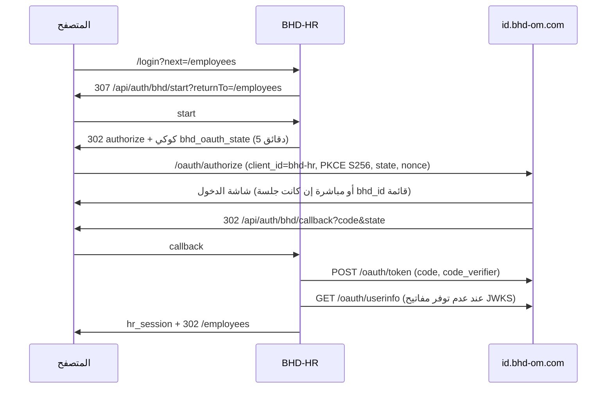

# المرجع التقني — BHD-HR

كل ما يحتاجه المطوّر لفهم النظام وتشغيله وصيانته وتطويره. دليل الاستخدام في [`BHD-HR-USER-GUIDE.md`](./BHD-HR-USER-GUIDE.md)، والدخول الموحّد في [`BHD-HR-SSO-INSTALL.md`](./BHD-HR-SSO-INSTALL.md)، وسجل النشر والحوادث في [`BHD-HR-DEPLOYMENT-LOG.md`](./BHD-HR-DEPLOYMENT-LOG.md).

---

## 1. التقنيات

| الطبقة | التقنية |
|---|---|
| الإطار | Next.js 15 (App Router، Server Components، Server Actions) |
| الواجهة | React 19، TypeScript 5، Tailwind CSS v4، أيقونات `lucide-react` |
| الخط والهوية | IBM Plex Sans Arabic للعربية وInter للإنجليزية والأرقام (عبر `next/font`)، ألوان BHD (`#092d24` حبر، `#075c45` زمردي، `#fbfaf7` رملي، حدود `#d7e2dc`؛ والفيروزي والكحلي والذهبي للتمييز فقط) |
| قاعدة البيانات | PostgreSQL على Neon عبر Prisma 6 — مشروع Neon مستقل **BHD HR** (`billowing-hat-97652194`)، الفرع `production`، القاعدة `neondb`، `aws-us-east-2`، Postgres 18. لا يشارك خادم ONE-BHD |
| الملفات | تُخزَّن داخل قاعدة البيانات في جدول `StoredFile` (لأن الاستضافة بلا قرص دائم)، وتُخدَم عبر `/files/[name]` بعد التحقق من الجلسة. الحد 4 ميغابايت للملف |
| الهوية | OIDC مع `https://id.bhd-om.com` (PKCE S256)، مكتبة `jose` |
| التصدير | `exceljs` (Excel من الخادم)، `jspdf` + `html2canvas-pro` (PDF في المتصفح) |
| الاستضافة | Vercel — المشروع `bhd-hr`، الرابط `https://bhd-hr.vercel.app`، ومربوط بمستودع GitHub فيُنشر تلقائياً عند كل دفع إلى `main` |
| التشغيل المحلي | Node.js ≥ 20، `npm run dev` (يتصل بقاعدة Neon نفسها) |

| الذكاء الاصطناعي | الترجمة الفورية (الأسماء والمسميات) عبر **Vercel AI Gateway** بحزمة `ai` (v5). النموذج الافتراضي `google/gemini-2.5-flash-lite`، ويُغيَّر بالمتغير `AI_TRANSLATE_MODEL`. على Vercel يتوثّق تلقائياً برمز OIDC للمشروع (لا مفتاح)؛ محلياً يلزم `VERCEL_OIDC_TOKEN` (من `vercel env pull`) أو `AI_GATEWAY_API_KEY`. بوابة Neon للذكاء الاصطناعي غير متاحة في الخطة المجانية |

لا توجد خدمات خارجية أخرى: لا طوابير، لا مدفوعات، لا بريد.

---

## 2. بنية المجلدات

```
prisma/
  schema.prisma          نموذج البيانات
  seed.ts                إنشاء المنشأة والمسؤول الأول (admin@bhd.local / admin123)
public/brand/            شعار BHD الرسمي (svg)
docs/                    هذا التوثيق + مستندات ONE-BHD المرجعية
src/
  app/
    (app)/               الصفحات الداخلية (تتطلب دخولاً) + layout فيه الرأس والمشغّل والفوتر
    (print)/             صفحات الطباعة (قسيمة، إيصال، كشف مسير، كشف حساب، جهات الاتصال)
    api/auth/            start / callback / logout / admin-entry للدخول الموحّد
    files/[name]/        تقديم الملفات المرفوعة بعد التحقق
    invite/[token]/      صفحة قبول الدعوة
    reports/export/      تنزيل التقرير الشهري Excel
    salaries/wps/        ملف تحويل الرواتب (WPS/SIF) CSV؛ salaries/spf/ كشف اشتراكات الحماية الاجتماعية Excel
    (print)/employees/[id]/hr-doc/  شهادة راتب، شهادة خبرة، رسالة تحويل راتب، تسوية نهاية الخدمة
    (app)/pay-items/     السلف والمكافآت والخصومات؛ (print)/pay-items/[id]/print إيصال استلام سلفة
    (app)/tasks/         لوحة المهام وقائمتها، و[id] تفاصيل المهمة
    (app)/letters/       الخطابات والإنذارات: القائمة، new، [id]؛ (print)/letters/[id]/print للطباعة
    letter/[token]/      نسخة الموظف العامة من الخطاب (بلا دخول) وتأكيد الاستلام
    portal/[token]/      بوابة الموظف (بلا دخول): «ملفي»، الحضور، الإجازات وطلبها، القسائم (payslip/[id]) ورسائل الراتب، المستندات، الخطابات، «بطاقتي»
    id/[token]/          صفحة التحقق العامة من رمز QR لبطاقة الموظف (بلا دخول): الصورة، الاسم، الوظيفة، القسم، جهة العمل، الحالة
    (print)/employees/[id]/badge/  طباعة بطاقة الموظف بمقاس CR80 (الوجه والظهر)
    (app)/approvals/     طلبات الموظفين: الموافقة على الإجازات ومراجعة المستندات المرسلة من البوابة
    (app)/org/           الهيكل التنظيمي حسب «المدير المباشر»
    (app)/assistant/     المساعد الذكي (محادثة)
    (app)/recruitment/   التوظيف: الشواغر، [id] الشاغر ومرشحوه، candidates/[id] المرشح
    apply/[token]/       صفحة التقديم العامة على شاغر (بلا دخول)
    (app)/performance/   جولات تقييم الأداء، [id] الجولة، reviews/[id] تقييم موظف
    (app)/assets/        العُهد والأصول، و[id] العهدة وسجلها
    (app)/expenses/      طلبات تعويض المصروفات والموافقة والصرف
    (app)/analytics/     لوحة المالك (تحليلات 12 شهراً + قراءة بالذكاء الاصطناعي)
    login/               غلاف الدخول + دخول الطوارئ المحلي
  components/
    bhd/                 BhdAppSwitcher و BhdAppIcon (منسوخان من ONE-BHD) و site-footer
    app-frame.tsx        هيكل الواجهة: الشريط الجانبي، الدرج والشريط السفلي للهاتف، الشريط العلوي
    nav-speed.tsx        الجلب المسبق وشريط التقدّم (انظر «سرعة التنقل» أدناه)
    get-form.tsx         نموذج بحث/فلترة بتنقل داخلي بلا إعادة تحميل
    phone-input.tsx      حقل الهاتف: رمز الدولة (كل الدول، عُمان افتراضياً) + الرقم
    employee-multi-select.tsx  اختيار موظف أو أكثر (شرائح + بحث)؛ لا يوضع داخل Field
    task-board.tsx task-list.tsx task-form.tsx  لوحة المهام (سحب وإفلات) والقائمة والنموذج
    employee-workspace.tsx     تبويبات الملاحظات والمهام والخطابات في ملف الموظف
    letter-form.tsx letter-sheet.tsx share-letter.tsx  نموذج الخطاب، ورقته الرسمية، أزرار المشاركة
    assistant-chat.tsx   واجهة المساعد: الرسائل، الروابط، بطاقات الاقتراح مع «تأكيد وحفظ»
    job-form.tsx         نموذج الشاغر (إضافة وتعديل)
    expense-claim.tsx    بطاقة طلب المصروف بخطوتها التالية (موافقة / رفض، ثم الصرف) — في المصروفات والطلبات وملف الموظف
    employee-hr-tab.tsx  تبويب «الأداء والعهد والمصروفات» في ملف الموظف (يحمّل بياناته بنفسه)
    owner-insights.tsx   زر «حلّل الأرقام بالذكاء الاصطناعي» في لوحة المالك
    ui.tsx               عناصر الواجهة المشتركة (انظر «نظام الواجهة» أدناه)
    ...                  النماذج والمطبوعات
  lib/
    bhd/apps.ts          كتالوج تطبيقات BHD المجمّد — منسوخ حرفياً، لا يُعدّل هنا
    bhd/identity.ts      إعدادات OIDC، PKCE، تبديل الرمز، التحقق من id_token
    auth.ts              جلسة المنتج، المنشأة النشطة، الأدوار، can / requireUser / requirePermission / requireAdmin
    permissions.ts       الوحدات والعمليات، قوالب الأدوار، normalizePermissions (آمن للمتصفح)
    report-data.ts       بيانات التقرير الشهري حسب صلاحيات المستخدم (للصفحة وملف Excel)
    workspace.ts         ربط الدعوات بالبريد، وإنشاء منشأة خاصة لكل حساب بلا عضوية
    salary.ts payroll.ts حساب الراتب والخصم
    pay-items.ts         تطبيق السلف والمكافآت والخصومات والعلاوات على الرواتب، وتقدّم كل بند
    allowances.ts        قواعد العلاوات: الاستحقاق حسب الدورية، المبلغ (ثابت / نسبة)، الوصف
    hr-catalog.ts        كتالوج المنشأة (مسميات، أقسام، إجازات، علاوات) والتهيئة الكسولة وترحيل البيانات القديمة
    hr-defaults.ts       القوائم الجاهزة للمسميات الوظيفية والأقسام (عربي/إنجليزي)
    nationalities.ts     كل جنسيات العالم برمز ISO (عربي/إنجليزي)، العماني أولاً
    phone.ts             رموز الاتصال الدولية لكل الدول وتوحيد الأرقام وعرضها (انظر «أرقام الهاتف» أدناه)
    ai.ts                الترجمة بالذكاء الاصطناعي (مفردة ودفعات)، صياغة الخطابات، اقتراح خطوات المهمة — عبر AI Gateway
    tasks.ts             حالات المهام وأولوياتها وأنواع الملاحظات و dueInfo (آمن للمتصفح)
    task-data.ts         تحميل المهام للوحة وخيارات الموظفين
    letters.ts           أنواع الخطابات، القوالب، تدرّج الإنذارات، حالة الخطاب، نص الرسالة (آمن للمتصفح، بلا prisma)
    delivery.ts          إرسال نسخ الخطابات بالبريد (Resend) وواتساب (Meta Cloud API) — يعمل عند ضبط المتغيرات فقط
    oman.ts              اشتراكات الحماية الاجتماعية، مكافأة نهاية الخدمة، مدة الخدمة، نسبة التعمين
    banks.ts             البنوك العاملة في عُمان ورموز BIC، تنظيف رقم الحساب
    payroll-check.ts     فحص الرواتب غير المصروفة قبل الصرف
    hr-docs.ts           نصوص شهادات الراتب والخبرة ورسالة تحويل الراتب (عربي/إنجليزي)
    portal.ts            رمز البوابة ورابطها، قراءة الموظف من الرمز، خيارات الإجازة في البوابة، حالات الطلب
    clock.ts             يوم مسقط ووقته، التأخير، المسافة (haversine)، التحقق من الإحداثيات
    assistant.ts         المساعد الذكي: التعليمات، أدوات القراءة حسب الصلاحية، أدوات الاقتراح، runAssistant
    recruitment.ts       حالات الشاغر ومراحل المرشح وأنواع التوظيف ورمز رابط التقديم
    performance.ts       معايير التقييم الافتراضية، الدرجات 1–5، المتوسط، وحقائق الفترة من ملف الموظف (reviewFacts)
    assets.ts expenses.ts  أنواع العهد وحالاتها وسجلها؛ أنواع المصروفات وحالاتها وطرق صرفها (آمنة للمتصفح)
    analytics.ts         بيانات لوحة المالك (loadAnalytics) ونصها للذكاء الاصطناعي (analyticsFacts)
    employee-number.ts   الرقم الوظيفي التالي (خارج ملفات "use server" حتى لا يصبح نقطة استدعاء)
    inline-logo.ts       تضمين الشعار data: للصفحات العامة (الخطاب والبوابة)
    search.ts            توحيد النص العربي للبحث (أ/إ/آ، ة/ه، ى/ي، التشكيل)
    leave.ts             أرصدة الإجازات حسب أنواع المنشأة وتنبيهاتها وخيارات الحضور
    alerts.ts            توليد التنبيهات
    alert-docs.ts        أنواع المستندات المشمولة في تنبيهات الانتهاء (`Company.alertDocTypes`)
    official-print.ts    ربط زر الطباعة بكشف رسمي PDF (طولي/عرضي)
    download-pdf.ts      تنزيل عنصر DOM كملف PDF
    calendar.ts          أحداث التقويم والتذكيرات
    contacts.ts          جهات الاتصال للعرض والطباعة
    i18n.ts lang.ts      الترجمة (عربي / إنجليزي)
  server/                Server Actions لكل عملية كتابة
```

### نظام الواجهة

- **الرموز** في `src/app/globals.css` داخل `@theme`: سلّم `teal` (الزمردي)، وسلّم `slate` المبني على الحبر والحدود (`slate-200` = `#d7e2dc`، `slate-900` = `#092d24`)، و`sand` و`gold` و`aqua` و`navy` للتمييز، والظلال `shadow-card` و`shadow-raised` و`shadow-float`، والحركة `animate-fade-up` (150–320 م.ث، وتتوقف مع `prefers-reduced-motion`). لا تُضف لوحة ألوان محلية.
- **الهيكل** `AppFrame`: شريط جانبي ثابت بمجموعات (عام، الموارد البشرية، المالية، النظام) على الشاشات الكبيرة؛ وعلى الهاتف والجهاز اللوحي درج جانبي وشريط علوي باسم الصفحة وشريط سفلي بأهم أربعة أقسام مسموحة وزر «المزيد». الفوتر وزر المشغّل خارج نطاق التعديل. على الكمبيوتر تُطوى القائمة إلى شريط أيقونات بعرض 5rem (زر أسفلها)؛ الحالة في الكوكي `hr_sidebar` (`SIDEBAR_COOKIE` في `utils.ts`) ويقرؤها `(app)/layout.tsx` فيبدأ العرض بالحالة الصحيحة بلا وميض، والعرض عبر `--sidebar-width` و`.app-shell[data-sidebar="collapsed"]`.
- **العناصر** في `ui.tsx`: `PageHeader` (عنوان + أيقونة + أزرار)، `Card`، `SectionTitle`، `Stat`، `EmptyState`، `Toolbar`، `InfoItem`، `ToneBadge`، وأنماط الأزرار `primaryBtn` / `secondaryBtn` / `dangerBtn` / `ghostBtn` و`linkAction` و`fieldClass` (ارتفاع 44px على الهاتف).
- **الجداول المتجاوبة:** غلّف الجدول بـ `div.table-shell` وأعطه `table-stack`، وضع `data-label` على كل خلية بيانات، و`cell-title` لخلية الاسم، و`cell-actions` لخلية الإجراءات. تحت 640px يتحوّل كل صف إلى بطاقة تعرض العناوين. لإخفاء عمود على الأجهزة المتوسطة فقط استخدم `hidden xl:table-cell` (يبقى ظاهراً في بطاقة الهاتف).
- **التبويبات والفلاتر:** `.segmented` مع `aria-current="page"` للعنصر النشط.
- **زخرفة «الأفق الأعلى»** `.higher-horizon` بشفافية لا تتجاوز 12% وعلى الطرف المقابل للنص.
- **صفحة بحجم الشاشة:** `.screen-fit` في `globals.css` يجعل العنصر بارتفاع الشاشة ناقص الشريط العلوي والحواف وشريط الهاتف السفلي وشريط التنبيه (`--banner-height`، يقيسه `AppFrame` فعلياً). يستخدمه التقويم: صفوف الأيام `minmax(0,1fr)` فتتقلص الخلايا لتتسع للشهر كاملاً، واللوحة الجانبية على xl تتمرر داخلياً.
- **الوضع الليلي والنهاري:** `<html data-theme="light|dark">`. الاختيار في الكوكي `hr_theme` (`THEME_COOKIE` و`normalizeTheme` في `utils.ts`)، وبلا كوكي يتبع إعداد الجهاز. سكربت صغير في `<head>` (`app/layout.tsx`) يضبط السمة قبل الرسم فلا يومض الضوء، ويتابع تغيّر إعداد الجهاز مباشرة. الزر `ThemeToggle` (حسب الجهاز ← نهاري ← ليلي) في رأس التطبيق والبوابة والدخول. في `globals.css` كتلة `:root[data-theme="dark"]` داخل `@media screen` تعيد تعريف الرموز نفسها: سلّم `slate` معكوس، و`sand` و`surface` داكنان، ودرجات 50–200 للألوان (`teal`، `red`، `amber`، `orange`، `emerald`، `sky`، `fuchsia`، `navy`، `gold`، `aqua`) صبغات داكنة، ونصوص الألوان (`text-teal-700` وما شابه) تُفتّح بقواعد صريحة بينما تبقى التعبئات الصلبة (`bg-teal-700` مع `text-white`) بلونها. الطباعة وملف PDF من التقارير (`onclone` في `report-toolbar.tsx`) نهاريان دائماً.
  - **القاعدة عند الكتابة:** خلفية البطاقات والحقول والقوائم `bg-surface` (لا `bg-white`)؛ والأسطح الداكنة دائماً (الشريط الجانبي، بطاقات الترحيب، الطبقات خلف النوافذ) `bg-ink-900` / `from-ink-900` / `bg-ink-950/50`؛ و`bg-white` فقط لما يجب أن يبقى أبيض (خلف شعار، زر أبيض على سطح داكن). لون جديد بدرجة 50–200 أو نص ملوّن بدرجة 500+ يحتاج سطراً في كتلة الليل.
- **عرض الصفحة:** غلاف الصفحة `page-wide` (`@utility` في `globals.css`: العرض كاملاً حتى 120rem) فتملأ الصفحات الشاشة على الكمبيوتر؛ النماذج الطويلة (إضافة موظف وتعديله) والمساعد الذكي تبقى بعرض قراءة `max-w-4xl`.
- **حجم الخط ووزنه:** على الشاشة تُعيد `globals.css` تعريف `--text-xs` / `--text-sm` / `--text-base` إلى 13 / 15 / 17px (بدل 12 / 14 / 16 في Tailwind) مع ارتفاعات سطر مناسبة، والنص العربي بوزن 500 (Plex Arabic بوزن 400 يبدو نحيفاً)، داخل `@media screen` فقط، فالطباعة وPDF بالأحجام الأصلية وتبقى الأوراق في صفحة A4. رؤوس الجداول وتسميات الجداول على الهاتف و`.segmented` وزر اختيار الملف تستخدم المتغيرات نفسها. شريط برامج BHD والتذييل بأحجامهما الثابتة كما في مستند الهوية.
- **التأكيد قبل الحذف والرفض:** `SubmitButton` بخاصية `confirm` يفتح نافذة `<dialog>` داخل الصفحة («إلغاء» / «تأكيد»، و«إلغاء» هو المحدد افتراضياً، وEsc أو الضغط خارجها يغلقها) ثم `form.requestSubmit(button)` مع نقل `name`/`value` في حقل مخفي. لا يُستخدم `window.confirm` لأنه يجمّد الصفحة طوال ظهوره ويُحسب تأخيراً في INP.
- **وضوح الخط:** أصغر نص مقروء 13px (`text-xs`)؛ الاستثناء أرقام الشارات وحروف الصور الرمزية، ونص 11px داخل خلايا التقويم على الهاتف، والتسميات الإنجليزية الفرعية في المطبوعات.
- **تنبيه:** `cn` يجمع الأسماء فقط بلا دمج، فلا تضف `px-0` أو `size-*` فوق `secondaryBtn` / `primaryBtn` (يبقى `px-4` و`min-h-11` ويُضغط المحتوى)؛ اكتب صنفاً مستقلاً.
- **الفحص:** كل صفحة بلا تمرير أفقي من 360px، وبالعربية والإنجليزية، وبالوضعين النهاري والليلي.

### أرقام الهاتف

- **التخزين:** كل رقم يُحفظ بصيغة واحدة `+968 91234567` (رمز الدولة، مسافة، الرقم المحلي بلا صفر بادئ إلا لإيطاليا وسان مارينو والفاتيكان).
- **الإدخال:** `PhoneField` / `PhoneInput` في `phone-input.tsx` — زر رمز الدولة (243 دولة، أسماؤها من `Intl.DisplayNames` بالعربية والإنجليزية، عُمان أولاً وافتراضياً) مع بحث بالاسم بأي لغة أو بالرمز، وحقل الرقم. لصق رقم يبدأ بـ `+` أو `00` يختار الدولة تلقائياً. القيمة المرسلة في حقل مخفي بالاسم المطلوب. لا تضعه داخل `Field` (وهو `<label>` فيسرق زر الدولة النقرات)؛ استخدم `PhoneField`.
- **الخادم:** كل Server Action يحفظ هاتفاً يمرّره على `normalizePhone` (الموظف، الكفيل، الكفيل الجديد من نموذج الموظف، المنشأة). الرقم بلا رمز يُعدّ عُمانياً.
- **العرض:** `formatPhone` للنص و`phoneHref` لروابط `tel:` في كل مكان (الملفات، دفتر العناوين وطباعته، رأس القسائم والإيصالات، ملف Excel)، فالأرقام القديمة المحفوظة بلا رمز تظهر بـ `+968`. داخل نص عربي مدمج يُحاط الرقم بـ LRI/PDI حتى لا ينقلب.

### سرعة التنقل

- **`NavSpeed`** (`src/components/nav-speed.tsx`، داخل `AppFrame`): بعد فتح أي صفحة يجلب في الخلفية كل الأقسام المسموحة للمستخدم كاملة (`router.prefetch` بنوع `full`)، ويجلب أي رابط داخلي عند مرور المؤشر أو اللمس، ويُظهر شريط تقدّم رفيعاً أعلى الصفحة فقط إن تأخرت الصفحة أكثر من 120 م.ث. لا يجلب مسبقاً `/api` و`/files` و`/reports/export` وصفحات الطباعة.
- **ذاكرة الموجّه** في `next.config.ts`: `staleTimes` = 30 ثانية للصفحات المزورة و120 ثانية للمجلوبة مسبقاً. كل حفظ يمسحها عبر `refreshAll()` (`revalidatePath("/", "layout")`)، فتظهر التعديلات فوراً. **أي Server Action جديد يغيّر بيانات يجب أن يستدعي `refreshAll()`.**
- **التحديث الحي بين الصفحات** (بلا إعادة تحميل):
  - **الإشارة** (`lib/live.ts`، مركّبة على عميل Prisma في `lib/prisma.ts` عبر `$extends`): كل كتابة (`create` / `update` / `upsert` / `delete` و`*Many`) تُعلِّم نطاقاتها في جدول `LiveSignal` (`scope` → `at`): `c:<companyId>` دائماً، `e:<employeeId>` إن كان للسجل موظف، `t:<taskId>` للمهام وما يتبعها، و`p:<companyId>` لما تعرضه كل بوابة (`Company`، `LeaveType`، `JobTitle`، `Department`، `Employer`، `AllowanceType`). السجلات بلا `companyId` تُنسب إلى أصلها (`PARENT`: خطوات المهمة وتعليقاتها، أحداث العهدة، بنود الراتب، بنود استمارة العهدة، إرسال الخطاب، مستندات الموظف وحضوره وأرصدته)، و`User` إلى منشآت عضوياته. تُكتب الإشارة **مرة واحدة بعد الرد** (`after()`، وخارج أي معاملة) باستعلام `INSERT … ON CONFLICT` واحد، وفشلها لا يُفشل الحفظ. لا إشارة لـ `AuditLog` و`DailyBrief` و`StoredFile`، ولا لـ `*Many` لم يغيّر شيئاً، ولا لتحديث يقتصر على `lastSeenAt` / `lastLoginAt` (كتابات أثناء العرض كانت ستُحدث حلقة). **لا حاجة لأي شيء في Server Action جديد**؛ كل كتابة عبر `prisma` تُرسل الإشارة تلقائياً.
  - **الفحص** `GET /api/live` (قراءة فقط، `no-store`، بلا `Set-Cookie`): بالجلسة ← `c:` للمنشأة النشطة؛ `?portal=<token>` ← `e:` الموظف و`p:` منشأته؛ `?task=<token>` (دعوة غير ملغاة) ← `t:` المهمة. يعيد `{ v }` = أحدث `at` بالمللي ثانية، أو `null` بلا صلاحية فيتوقف الفحص.
  - **العميل** `LiveUpdates` (`components/live-updates.tsx`) في تخطيط `(app)` و`/team` و`/portal/[token]` وصفحة المهمة للمدعوّ: يفحص كل 5 ثوانٍ والصفحة ظاهرة (`document.hidden` يُتخطّى، بلا مستمع `visibilitychange` / `focus`)، وعند تغيّر `v` يستدعي `router.refresh()` داخل `startTransition` (يبقى التمرير والحالة). إن كان المستخدم يكتب (حقل مركَّز، أو قيمة تختلف عن الافتراضية، أو ملف مختار، أو `dialog[open]`) يُظهر زر «وصلت تحديثات جديدة» ويحدّث عند انتهاء الكتابة. أكثر من 4 تحديثات في دقيقة ← الفحص كل 30 ثانية.
  - **سياسة الجلسة:** الفحص لا يقرأ الجلسة لتجديدها ولا يكتب كوكي، والتحديث يحدث لأن البيانات تغيّرت لا لأن التبويب عاد؛ حُذف من `NavSpeed` التحديث عند العودة إلى التبويب الذي كان يخالف `BHD-SESSION-POLICY.md` البند 4.
- **لا `loading.tsx`:** تبقى الصفحة الحالية ظاهرة حتى تجهز التالية، بلا وميض هيكل تحميل.
- **العودة إلى القسم بعد الإرسال:** إعادة توجيه Server Action في Next.js تُسقط `#القسم`. لذلك `go(path#id, flash)` في `lib/http.ts` يضيف `at=<id>` إلى الرابط، و`Flash` يركّب `SectionReturn` (`components/section-return.tsx`، عميل داخل `Suspense`) الذي يمرّر الصفحة إلى `#id` ويعيد `#id` إلى الرابط بـ `history.replaceState`، ويكرر الرسالة عائمة أسفل الشاشة 6 ثوانٍ (`aria-hidden` لأن `Flash` الأصلي يُعلنها). يكفي أن ينتهي مسار `go()` بـ `#id` موجود في الصفحة.
- **نماذج البحث والفلترة** تستخدم `GetForm` (`next/form`) بدل `<form method="get">`، فلا يُعاد تحميل الصفحة كاملة. وتبديل اللغة يستخدم `router.refresh()` بدل إعادة التحميل.
- **المنطقة:** `vercel.json` يضع الدوال في `cle1` (كليفلاند، AWS us-east-2)، نفس منطقة قاعدة Neon، فزمن كل استعلام قرابة 1 م.ث. لا تغيّرها دون نقل القاعدة معها.
- استعلامات `getAlerts` تعمل بالتوازي (`Promise.all`).

### المهام والملاحظات والخطابات

- **الموظفون لا يدخلون النظام.** المهام والملاحظات يديرها مستخدمو النظام وتُسند إلى سجلات الموظفين. الموظف يتعامل فقط مع رابط نسخته من الخطاب ورابط بوابته (انظر «بوابة الموظف» أدناه).
- **المهام** (`server/task-actions.ts`): `createTask` / `updateTask` (يستبدل المسندين) / `setTaskStatus` / `deleteTask`، والخطوات `addTaskItem` / `toggleTaskItem` / `deleteTaskItem`، و`suggestTaskItems` (اقتراح خطوات بالذكاء الاصطناعي)، والتعليقات. اللوحة تنقل البطاقة بالسحب والإفلات (HTML5) أو بقائمة «نقل إلى» على الأجهزة اللمسية، وتستدعي `moveTask(taskId, status, orderedIds)` مباشرة (يعيد `{error?}` ولا يحوّل) مع تحديث متفائل. `completedAt` يُضبط عند `DONE` أو `CANCELLED` ويُفرَّغ عند إعادة الفتح. المكتملة والمغلقة تظهر 30 يوماً فقط ما لم يُطلب `done=all`.
- **الحالات والأولويات** (`lib/tasks.ts`): `TODO`، `IN_PROGRESS`، `REVIEW`، `ON_HOLD` (معلّقة)، `DONE`، `CANCELLED` (مغلقة دون إنجاز). `CLOSED_STATUSES` = DONE وCANCELLED، و`ACTIVE_STATUSES` = الثلاث الأولى (ما يُحتسب متأخراً وينبَّه عنه). اللوحة بخمسة أعمدة `BOARD_STATUSES` (المغلقة في القائمة فقط). لكل حالة وأولوية لون `solid` يملأ الزر المختار والشارة وشريط أعلى المهمة؛ الألوان المحايدة من `ink-*` لأن `slate-*` ينعكس في الوضع الليلي. الأولوية `NORMAL` تُعرض «متوسطة».
- **أعمدة المهمة:** `statusNote` (سبب التعليق أو الإغلاق)، `resumeStatus` (ما تعود إليه المعلّقة عند `status=RESUME`)، `postponeCount`، `archivedAt`. `statusChange()` يضبط `completedAt` عند الحالتين المغلقتين ويفرّغه عند إعادة الفتح، ويحفظ `resumeStatus` عند التعليق. الإغلاق دون إنجاز يتطلب سبباً.
- **إجراءات صفحة المهمة** (`server/task-actions.ts`): `setTaskPriority`؛ `transferTask` (من مسند واحد `fromId` أو من الجميع إلى موظف نشط في المنشأة، ويلغي دعوات من خرج)؛ `addTaskAssignee` / `removeTaskAssignee`؛ `postponeTask` (أيام 1/3/7/14 من الأبعد بين الاستحقاق واليوم، أو تاريخ لا يسبق اليوم، يزيد `postponeCount` ويقدّم `startDate` إن تجاوز الاستحقاق الجديد)؛ `archiveTask` (`restore=1` للاستعادة)؛ `duplicateTask` (يتطلب `tasks.create`، نسخة في «للتنفيذ» بالأشخاص والخطوات غير مؤشّرة). المؤرشفة لا تُعدَّل (`liveTask`) إلا بالاستعادة، وتختفي من اللوحة والقائمة والتنبيهات والتقويم وعدّاد مهام ملف الموظف، وتظهر بفلتر `archived=1`. المغلقة لا تُحوَّل ولا تُؤجَّل قبل إعادة فتحها.
- **التحديث في المكان بلا وميض** (صفحة المهمة وصفحة المدعو): إجراءات الصفحة لا تحوّل (`go()`) بل تعيد `ActionResult` = `{error?, message?}` (`lib/action-result.ts`)، وتستدعي `refreshAll()` فتحمل استجابة الإجراء الصفحة المحدَّثة دون تنقّل: لا يتغير الرابط، ولا يُعاد تركيب الصفحة، ولا يقفز التمرير. داخل `task-actions.ts` يوقف `fail(msg)` الإجراء برسالة خطأ عبر `inPage()` (أخطاء الصلاحيات والتحويلات الأخرى تمر كما هي). `createTask` و`duplicateTask` و`deleteTask` تبقى بتحويل لأنها تغادر الصفحة، و`moveTask` كما هو. على الواجهة: `components/action-form.tsx` (`ActionForm` يعرض النتيجة إشعاراً عائماً `toast`/`Toaster` ويغلق النافذة عند النجاح؛ `FlashToast` يحوّل `?message`/`?error` القديمة إلى إشعار ثم يمسحها من الرابط)، و`task-live.tsx` (`TaskLive` بـ `useOptimistic` للحالة والأولوية: الشريط والشارات والعنوان والأزرار و«استئناف»/«إعادة فتح» تتغير لحظة الضغط، وتُظهر الأخطاء فقط)، و`task-checklist.tsx` (إضافة وتأشير وحذف متفائل)، و`comment-composer.tsx` (التعليق يظهر فوراً «جارٍ الإرسال…» حتى يُحفظ). `TaskForm` بخاصية `inPage` للتعديل. أي صفحة جديدة بإجراءات متكررة تتبع النمط نفسه.
- **سجل المهمة:** كل تغيير يُكتب صفاً في `TaskComment` بعمود `kind` (`STATUS`، `PRIORITY`، `ASSIGN`، `TRANSFER`، `INVITE`، `POSTPONE`، `ARCHIVE`؛ التعليق العادي `COMMENT`) بلغة من قام به، ويعرضه `components/task-timeline.tsx` سطراً بأيقونة، والتعليقات فقاعات. يُعرض آخر 40 وما قبلها بـ `?log=all`. لا يُحذف إلا `COMMENT`، وعدّاد التعليقات في البطاقات لا يحسب السجل.
- **الدعوة بالبريد** (جدول `TaskInvite`، `lib/task-invites.ts`): `inviteToTask` لأي بريد (حتى 30 دعوة مفتوحة للمهمة؛ بريد يطابق موظفاً نشطاً يجعله مسنداً أيضاً)، وخيار «أرسل له رابط المهمة» في التحويل والإضافة ينشئ دعوة لبريد الموظف. رمز عشوائي 24 بايت، فريد لكل (مهمة، بريد)، ويُجدَّد عند إعادة دعوة من أُلغيت دعوته. إن كانت قناة البريد مفعّلة (`channelReady("EMAIL")`) يُرسل فوراً (`emailStatus` = SENT أو FAILED)، وإلا تبقى PENDING ويشارك المستخدم الرابط بالنسخ أو `mailto:` أو واتساب من قائمة «المدعوّون بالبريد» (`InviteLink` بنص الدعوة). `revokeTaskInvite` يوقف الرابط فوراً.
- **صفحة المدعو `/task/<token>`:** خارج `(app)` بلا دخول (`noindex`، `no-referrer`، `force-dynamic`)، ورمز غير صالح أو ملغى ← 404. تعرض التفاصيل والخطوات والسجل، ويحدّث المدعو الحالة إلى `GUEST_STATUSES` فقط (للتنفيذ، قيد التنفيذ، للمراجعة)، ويؤشّر الخطوات، ويعلّق (`server/task-guest-actions.ts`، الاسم في السجل «… (مدعوّ بالبريد)»). المهمة المعلّقة أو المغلقة أو المؤرشفة للقراءة فقط. كل فتح أو إجراء يحدّث `lastSeenAt` الظاهر للإدارة.
- **التنبيهات والتقويم:** مهمة نشطة (`ACTIVE_STATUSES`) غير مؤرشفة متأخرة أو تستحق خلال `TASK_ALERT_DAYS` (يومان) تظهر في التنبيهات (`task-<id>`)، وكل مهمة لها استحقاق تظهر في التقويم (النوع `task`) عدا المؤرشفة والمغلقة دون إنجاز، والمعلّقة لا تُعلَّم عاجلة. كلاهما يتطلب `tasks.view`. تقييم الأداء يستبعد المغلقة دون إنجاز ولا يعدّ المعلّقة متأخرة.
- **الملاحظات** (`server/note-actions.ts`): إضافة، تعديل، تثبيت، حذف. المثبتة تظهر أعلى تبويب البيانات في ملف الموظف.
- **الخطابات** (`server/letter-actions.ts`):
  - `createLetters` يصدر خطاباً مستقلاً لكل موظف مختار. `refNo` يُولَّد `HR-<السنة>-<تسلسل>` داخل المنشأة ويُعاد المحاولة عند تعارض المفتاح الفريد. `token` عشوائي 24 بايت.
  - **المسودات والمعاينة والجدولة** (`lib/letter-drafts.ts`، النموذج `LetterDraft`): حقل `intent` من زر النموذج: `issue` (الافتراضي، وحده عند `requestId`)، `preview` و`draft` (يحفظان `LetterDraft` بحالة `DRAFT` دون تحقق المتصفح `formNoValidate`؛ الأول يفتح `/letters/drafts/<id>#preview` والثاني `/letters?view=drafts#drafts`)، و`schedule` (يوم بعد اليوم بتوقيت مسقط، ويُفحص النص الآن بـ `composeLetters`؛ إن فشل الفحص يُحفظ مسودة مع الخطأ بدل ضياع المكتوب). `draftId` يعدّل المسودة نفسها، وإصدارها يضعها `ISSUED` مع `letterIds`. `composeLetters` (مشترك بين الإصدار الفوري والمعاينة والمجدول) يبني نص كل موظف كما سيصدر أو يعيد أول مشكلة `{ar,en}`، و`issueComposed` يصدره عبر `issueLetter`. المسودة لا تأخذ `refNo` ولا `signatureNo` حتى تصدر.
  - **صفحة المسودة `/letters/drafts/<id>`** (`letters.view`؛ الإجراءات `letters.create`): `LetterSheet` بلا ختم (حالة «مسودة · Draft»، الرقم `HR-····-····`) لموظف مختار (`?e=`)، ومشكلة الإصدار إن وُجدت، و`issueLetterDraft` (يُؤرَّخ اليوم، يحجز المسودة بـ `ISSUING` قبل الإصدار)، و`scheduleLetterDraft` (تغيير اليوم، أو `unschedule=1`)، و`deleteLetterDraft`، و«تعديل» ← `/letters/new?draftId=`.
  - **الإصدار المجدول** (`issueDueLetterDrafts`): يصدر `SCHEDULED` التي حلّ يومها (`scheduledFor <= اليوم بتوقيت مسقط`) مؤرَّخة بيومها وموقّعة باسم من جدولها، بشرط أن عضويته ما زالت تملك `letters.create` (و`salaries.view` لأنواع الراتب)، وإلا `FAILED` مع السبب وتنبيه `letters-failed`. يُحجز كل خطاب بتحديث مشروط (`ISSUING`؛ ويُستعاد العالق أكثر من 10 دقائق) فلا يصدر مرتين. يُستدعى من المهمة اليومية `/api/cron/daily` (03:00 UTC = 07:00 مسقط) وعند كل فتح لـ `/letters`. `/letters?view=drafts` يعرض غير الصادرة والصادرة خلال 30 يوماً.
  - ترويسة الخطاب من الكفيل إن وُجد وإلا المنشأة (`headerFor` كالقسائم، ومعها `email`).
  - **ورقة الخطاب** (`components/letter-sheet.tsx`، الأنماط `.letter-doc` في `globals.css`): بأسلوب عقود BHD R (`.contract-doc` في `apps/web` هناك) بنفس الألوان والخط: ورق كريمي `#fffdf7` بإطار ذهبي مزدوج (`#a8834a` / `#d9c59c`)، حبر `#1f2a24`، أخضر `#10372a` للعناوين، وخط **Amiri** (`next/font/google`، المتغير `--font-letter`) للعناوين والأسماء. الترويسة: الاسم العربي يميناً والإنجليزي يساراً مع السجل التجاري والشعار بينهما (أو الحرف الأول في دائرة)، تحتها خط ذهبي مزدوج. العنوان: زخرفة «❖» بخطين متدرجين، نوع الخطاب بالعربية (أحمر للإنذارات مع «سري وشخصي») وبالإنجليزية بحروف ذهبية متباعدة، ومربع «رقم الخطاب / تاريخ الإصدار / الحالة». **في الأعلى ختم دائري مائل** «توقيع إلكتروني» برقم التوقيع الإلكتروني بالأحمر و`E-SIGNATURE No.` (أحمر عند الإلغاء)، وفي الجهة المقابلة رمز QR «امسح للتحقق». ثم المرسل إليه («الفاضل/الفاضلة … المحترم/المحترمة» حسب جنس الموظف، أو الجهة للشهادات)، والموضوع عنواناً بخط ذهبي تحته، والتحية والنص والختام: كل فقرة عربية بجانب ترجمتها الإنجليزية (`letter-doc__para`، عمود واحد بلا ترجمة أو تحت 40rem عبر `@container`). التوقيعات: «عن الإدارة» بصورة التوقيع أو ختم «موقّع إلكترونياً» وصفوف الاسم والصفة ورقم التوقيع الإلكتروني، و«استلام الموظف» (خانة الإقرار أو «تم الاستلام إلكترونياً»). ثم مربع التوثيق المنقّط «تم توثيق هذا الخطاب بتوقيع إلكتروني رقم …» مع QR ومن وقّع ووقته ورمز التحقق والرابط، وتذييل بنوع الخطاب ورقمه ورقم التوقيع والعنوان والهاتف والبريد. العلامة المائية للشعار (4.5%) وعلامة «ملغى» داخل طبقة `letter-doc__deco` المقصوصة، لأن قصّ الورقة نفسها يمنعها من التمدد مع النص (`aspect-ratio` حد أدنى فقط). الطباعة: `@page` A4 بهامش 8mm من داخل المكوّن، خلفية بيضاء وإطار ذهبي، `min-height: 280mm`؛ الخطاب المعتاد (إنذار أو شهادة بالنصين) في صفحة واحدة. ألوانها ثابتة فتبقى ورقاً فاتحاً في الوضع الليلي.
  - مستوى الإنذار المقترح من عدد الإنذارات غير الملغاة خلال 365 يوماً (`nextWarningKind`).
  - الصياغة: `draftLetter` (ذكاء اصطناعي، يعيد عربي وإنجليزي) أو `LETTER_TEMPLATES` مع `{reason}`.
  - لكل قناة مختارة تُنشأ `LetterDelivery` بحالة `PENDING` إن كان للموظف بريد صحيح / هاتف. ثم `sendPendingCopies` يرسل ما قناته مفعّلة فقط. «إرسال النسخ المنتظرة الآن» في الإعدادات (`sendPendingLetterCopies`، للمسؤول) يرسل المتراكم بعد التفعيل. **كود الإرسال (Resend و Meta) لم يُختبر على مزوّد حقيقي بعد؛ اختبره بخطاب لموظف تجريبي فور ضبط المتغيرات.**
  - المشاركة اليدوية تعمل دائماً: `wa.me` و`mailto:` ونسخ الرابط من صفحة الخطاب.
- **نسخة الموظف `/letter/<token>`:** خارج `(app)` و`(print)` فلا تتطلب دخولاً. الرمز هو المفتاح الوحيد (`noindex`، `no-referrer`). أول فتح يضبط `viewedAt`. زر «أقر باستلام الخطاب» (`acknowledgeLetter`) يضبط `acknowledgedAt` ويكتب في السجل. الشعار يُضمَّن `data:` من `StoredFile` لأن `/files` يتطلب دخولاً. الخطاب الملغى يُعرض بعلامة «ملغى» بلا زر تأكيد.

### ملخص اليوم والمهمة المجدولة وقراءة المستندات

- **ملخص اليوم** (`lib/brief.ts`، `components/daily-brief.tsx`): بطاقة في لوحة المعلومات تُحمَّل داخل `Suspense` فلا تؤخر الصفحة. الحقائق تأتي من `computeAlerts(company, permissions, lang)` (نفس التنبيهات، مقيدة بصلاحيات القارئ) وعدد الخطابات غير المؤكدة بعد 3 أيام، ثم `aiDailyBrief` يكتب سطراً عاماً و5 نقاط كحد أقصى من هذه الحقائق فقط. يُخزَّن في `DailyBrief` لكل (منشأة، يوم مسقط، لغة، `scope` = بصمة الصلاحيات)، فيُستدعى الذكاء الاصطناعي مرة يومياً لكل مجموعة صلاحيات. زر «تحديث» (`refreshDailyBrief`) يحذف نسخة اليوم ويعيد البناء. عند تعذر الذكاء الاصطناعي يظهر ملخص ثابت من التنبيهات ولا يُخزَّن.
- **المهمة المجدولة** `GET /api/cron/daily` (`vercel.json` → `crons`، يومياً 03:00 UTC = 07:00 مسقط): ترفض أي طلب بلا `Authorization: Bearer $CRON_SECRET`. لكل منشأة: ترسل نسخ الخطابات المنتظرة (`sendPendingCopies`)، وإذا كان البريد مفعّلاً ترسل ملخص اليوم (`sendEmailMessage`) لكل مسؤول ومدير قَبِل الدعوة، فقط إن كانت هناك تنبيهات. تعيد أعداداً بلا بيانات شخصية.
- **قراءة المستندات** (`components/document-scan.tsx`، `readDocumentFile` في `server/ai-actions.ts`، `aiReadDocument` في `lib/ai.ts`): يختار المستخدم صورة أو PDF (حتى 4 ميغابايت، يتطلب `employees.create/edit` أو `documents.create/edit`)، فيقرأ نموذج الرؤية (`AI_VISION_MODEL`، افتراضياً `google/gemini-2.5-flash`) النوع والرقم والانتهاء والاسمين والجنسية (ISO) والميلاد والجنس، ويُطلب منه ترك ما لا يُقرأ فارغاً. لا يُحفظ شيء في الخادم: المكوّن يعبئ حقول النموذج المحيط (بضبط القيمة وإطلاق `input`/`change` فتلتقطها الحقول المتحكَّم بها، و`SEARCH_SELECT_SET` لقائمة الجنسية) ويضع الملف نفسه في حقل المرفق المطابق (`DataTransfer`)، ثم يحفظ المستخدم بعد المراجعة. في نموذج الموظف: البطاقة العمانية → صف البطاقة، بطاقة المقيم → صف الإقامة، الجواز → صف الجواز؛ الاسم والميلاد والجنس تُعبأ إن كانت فارغة فقط، والجنسية تُستبدل.

### الامتثال العماني ومستندات الموارد البشرية وفحص ما قبل الصرف

- **الحماية الاجتماعية** (`spfContribution` في `lib/oman.ts`، الإعدادات ← «عُمان والبنك»، `updateSocialProtection` للمسؤول): معطّلة افتراضياً. النسب الافتراضية حسب صندوق الحماية الاجتماعية (يوليو 2026): العماني 8% على الموظف و14.5% على صاحب العمل، وغير العماني 2% على صاحب العمل فقط (تأمين الأمومة والمرض)، بسقف أجر 3000 ر.ع، على الإجمالي (الحزمة + العلاوات المتكررة) أو على الأساسي حسب `spfBase`. لا يتأثر الأجر المؤمَّن عليه بخصم الغياب. `syncSalaryLines` يضيف سطر خصم `SOCIAL` بحصة الموظف (فيدخل في `extraDeductions` ويظهر في القسيمة) ويحفظ `spfEmployee` و`spfEmployer` على الراتب؛ حصة صاحب العمل تكلفة لا تُخصم. حفظ الإعدادات يعيد حساب كل الرواتب غير المصروفة، وتغيير جنسية الموظف يعيد حساب رواتبه. **راجع النسب مع الصندوق قبل التفعيل**؛ نظام ادخار الوافدين (9%) لم يُطبَّق.
- **مكافأة نهاية الخدمة** (`gratuity`): لغير العماني فقط (العماني مشمول بالصندوق). قانون العمل م.61 (المرسوم 53/2023): أجر شهر أساسي عن كل سنة، والكسور بالنسبة. الخدمة قبل 31/7/2023 بالقاعدة السابقة: 15 يوماً عن كل سنة من الثلاث الأولى ثم شهر. الحساب بأيام كاملة (اليوم الأخير محسوب) على أساس 365 يوماً للسنة. تظهر المستحقة حتى اليوم في ملف الموظف وفي التسوية.
- **مستندات الموارد البشرية** `/employees/<id>/hr-doc?type=salary|experience|bank|settlement&to=&end=&leave=`: يتطلب `employees.view`، والأنواع الثلاثة التي فيها راتب تتطلب `salaries.view`. ترويسة الكفيل أو المنشأة (`HeaderBar`)، نص عربي يطابق جنس الموظف ونص إنجليزي، والهوية: البطاقة الشخصية للعماني ثم بطاقة المقيم ثم الجواز. رسالة تحويل الراتب تذكر بنك الموظف وحسابه وتعهد التحويل. التسوية: مدة الخدمة، المكافأة بتفصيلها، بدل الإجازات غير المستخدمة (الرصيد السنوي من النظام أو `leave`) × (الأساسي ÷ `salaryDays`)، الرواتب غير المصروفة، خصم السلف المتبقية، والصافي — حساب استرشادي يُراجع قبل الاعتماد.
- **ملف WPS** `GET /salaries/wps?year=&month=&employerId=` (يتطلب `salaries.pay`): CSV بتخطيط SIF الشائع لدى البنوك العمانية: صف الدافع (السجل التجاري للكفيل المختار أو للمنشأة، بنك المنشأة وحسابها، الإجمالي، العدد) ثم صف لكل موظف (نوع الهوية `C` مدنية / `P` جواز، الرقم، الرقم الوظيفي، الاسم الإنجليزي، BIC، الحساب، أيام العمل، الصافي، الأساسي، الإضافات، الخصومات، الحماية الاجتماعية). يُستثنى من بلا بنك أو حساب أو صافيه صفر. **تأكد من التخطيط مع البنك قبل أول رفع.** يُكتب `WPS_EXPORT` في السجل.
- **كشف الحماية الاجتماعية** `GET /salaries/spf?year=&month=` (يتطلب `salaries.view`): Excel بحصة الموظف وصاحب العمل لكل موظف والإجماليات.
- **فحص ما قبل الصرف** (`payrollIssues` في `lib/payroll-check.ts`، بطاقة «مراجعة قبل الصرف» في `/salaries` عند وجود رواتب غير مصروفة): خطر = صافٍ سالب؛ تنبيه = صافٍ أو أساسي صفر، تغيّر الصافي أكثر من 25% عن الشهر السابق، خصومات تتجاوز نصف المستحقات، موظف منتهي الخدمة أو غير نشط، أيام غياب تغيّرت بعد إنشاء الراتب؛ معلومة = موظفون بلا بنك أو حساب، موظفون نشطون بلا مسير. أول 12 ملاحظة بروابط.
- **التعمين** (`omanization`): نسبة العمانيين بين النشطين والإجازة، إجمالاً ولكل قسم؛ تلميح في بطاقة «الموظفون النشطون» في لوحة المعلومات، وقسم `#omanization` في التقارير. النسبة المطلوبة تختلف حسب النشاط وتحددها وزارة العمل.
- **البنوك** (`lib/banks.ts`): قائمة البنوك العاملة في عُمان برموز BIC (تحقق من الرمز مع البنك). بنك المنشأة وحسابها في الإعدادات، وبنك الموظف وحسابه في نموذج الموظف ضمن قسم الراتب (يحفظان فقط لمن لديه `salaries.edit`، ويُحتفظ بهما عند التعديل بدونها).

### بوابة الموظف والطلبات والهيكل التنظيمي وتسجيل الحضور

- **الرابط:** بطاقة «بوابة الموظف» في ملف الموظف (`#portal`، تتطلب `employees.edit`): `renewPortalLink` ينشئ `Employee.portalToken` (24 بايت base64url، فريد) أو يستبدله فيتوقف القديم فوراً، و`disablePortalLink` يفرّغه. المشاركة بواتساب والبريد ونسخ الرابط (`ShareLetter` مع `openLabel`). لا كلمة مرور: الرمز هو المفتاح، فيُعامل كسر.
- **الصفحة `/portal/<token>`:** خارج `(app)` فلا تتطلب دخولاً (`force-dynamic`، `noindex`، `no-referrer`). `portalEmployee` يرفض رمزاً أقصر من 20 حرفاً أو موظفاً منتهي الخدمة، فتظهر «الرابط غير صالح». الشعار مضمَّن (`inlineLogo`). التخطيط: `page-wide` (حتى 120rem) برأس وأقسام بالعرض الكامل؛ تحت `lg` شريط أقسام علوي ثابت (`data-spy-scroll`)، ومن `lg` قائمة جانبية `sticky` بأيقونات وعدّاد (البيانات الناقصة، استمارات التسليم غير المقرّ بها)، ومن `xl` عمودان (`@container`): ملفي، الحضور، الإجازات، الرواتب، المستندات، الأصول | الطلبات، المصروفات، الخطابات، التقييم، السيرة، البطاقة. داخل البطاقات تُستخدم استعلامات الحاوية (`@sm:` و`@md:`) لا نقاط الشاشة، في الصفحة و`PortalRequests` و`ResignationForm` و`SelfDataFields` و`LetterNeedsSwitch`، فيتكيّف كل نموذج مع عرض عموده. `SectionSpy` (عميل، تمرير فقط) يضع `aria-current="location"` على روابط `a[data-spy]` للقسم المقروء ويُظهره في الشريط العلوي. صفحات السيرة والشرح حتى `max-w-7xl`، والمستندات القابلة للطباعة تبقى بعرض A4. الأقسام: الحضور (إن فُعّل)، الإجازات (الأرصدة من `computeLeaveBalances`، نموذج الطلب، آخر 20 طلباً بحالتها وملاحظة الإدارة)، الرواتب المصروفة (آخر 12، والقسيمة `/portal/<token>/payslip/<id>` تعرض رواتب هذا الموظف المصروفة فقط وإلا 404)، المستندات وتواريخها مع إرسال نسخة محدّثة، الخطابات غير الملغاة.
- **«ملفي وبياناتي» `#profile`** (أول الأقسام): البيانات الشخصية، والوظيفة (الرقم، المسمى، القسم، المدير المباشر من `managerId` في المنشأة نفسها، جهة العمل، التعيين، نهاية العقد، الحالة)، وتفاصيل مطوية «راتبي وحسابي البنكي» (البنود غير الصفرية والإجمالي `packageGross`، والبنك، والحساب `•••• آخر 4` فقط — الرقم الكامل لا يُرسل إلى الصفحة)، مع رابط طلب تصحيح (`#requests`) و«طباعة ملفي الكامل» (`/portal/<token>/profile`).
- **«رواتبي ورسائل الراتب» `#payslips`:** كل شهر يفتح «القسيمة وإيصال الاستلام»، وتحتها `SALARY_CERTIFICATE` و`SALARY_TRANSFER` و`EMPLOYMENT_CERTIFICATE`: رابط آخر نسخة صادرة (`/letter/<token>`)، أو شارة «بانتظار الاعتماد» لطلب معلّق، أو نموذج `submitEmployeeRequest` (`type=LETTER`، `letterKind`، `section=payslips` فيعود `portalFor` إلى `#payslips`). الزر «إصدار الآن» للأنواع في `letterAutoKinds` و«طلب» لغيرها.
- **Server Actions البوابة** (`server/portal-actions.ts`): كلها تقرأ الموظف من الرمز في `FormData` (لا من جلسة) وتحوّل إلى `/portal/invalid` إن لم يصلح.
  - `requestLeave`: نوع من `portalLeaveChoices` (الأنواع التي تشمل وظيفته ثم «بخصم راتب»)، حتى 90 يوماً، ويرفض التداخل مع طلب معلّق أو موافق عليه. يُنشأ `LeaveRequest` بحالة `PENDING` ويُكتب في السجل.
  - `cancelLeaveRequest`: للمعلّق فقط.
  - `completeMyDetails` («أكمل بياناتك الناقصة» في `#profile`): `readSelfInput(formData, missingFields(employee), false)` ثم `saveSelfData`.
- **البيانات الناقصة وإقرار الموظف** (`lib/self-data.ts`): `SELF_FIELDS` الحقول التي يُكملها الموظف (الهاتف، العنوان، الجنسية، الجنس، الميلاد، البطاقة وانتهاؤها، الجواز وانتهاؤه، `bankBic`، `bankAccount`؛ لا البريد لأنه يربط حساب BHD). `LETTER_NEEDS`: `SALARY_TRANSFER` ← البنك والحساب، `BANK_ACCOUNT` ← العنوان، `EMBASSY` ← الجنسية والجواز وانتهاؤه. الحقول باسم `self_<field>` والإقرار `selfConfirm=1` (`SelfDataFields`)؛ `readSelfInput` يتحقق (بنك من `OMAN_BANKS`، حساب ≥ 6، جواز/بطاقة `[A-Z0-9-]{4,20}`، انتهاء لم يمضِ، عمر 14–100، جنسية معروفة، هاتف ≥ 7 أرقام). `saveSelfData` يعيد قراءة الموظف ويكتب **الحقول الفارغة فقط**، ويضع `Employee.selfProvided[field] = {at, via, ip}` ويكتب `EMPLOYEE_SELF_DATA`. في `submitEmployeeRequest` (خطاب) إن نقص ما يحتاجه النوع يُرفض الطلب حتى تُكمل الحقول ويُقرّ، ثم تُحفظ قبل إنشاء الطلب ويصدر الخطاب الفوري بها. في البوابة `lettersMissing` يحدد خانات كل نوع، و`LetterNeedsSwitch` (عميل) يعرض خانات النوع المختار فقط فتعمل `required`. `updateEmployee` يحتفظ بالعلامة ما لم تتغير القيمة (`keptSelfMarks`، و`Prisma.DbNull` إن لم يبقَ شيء). ملف الموظف وبطاقة الطلب (`EmployeeRequestCard`) يعرضان ملاحظة «أدخلها الموظف بنفسه… وأقرّ بصحتها».
  - `submitPortalDocument`: نوع من `EXTRA_DOC_TYPES` وملف إلزامي (4 ميغابايت)، وحد 10 مستندات غير مراجعة لكل موظف. يُنشأ `EmployeeDocument` مع `submittedAt`.
  - `clockPunch({token, lat, lng, accuracy})`: يعيد `{error|message}` ولا يحوّل. يتطلب `clockEnabled`. إن حُدد موقع العمل: يلزم الموقع، ويُرفض إذا كانت `المسافة − min(الدقة، 100) > workRadius`. أول تسجيل في يوم مسقط يُنشئ `ClockEntry` (مع `lateMinutes` بعد `workStart`)، والثاني يضع الانصراف، والثالث يُرفض.
- **الموافقات `/approvals`** (`server/request-actions.ts`): تظهر لمن لديه `attendance.view` أو `documents.view`.
  - `decideLeaveRequest` (يتطلب `attendance.create`): الرفض يضع `REJECTED` مع الملاحظة. الموافقة تتحقق من الرصيد (وتطلب `allowOverdraft=1` عند التجاوز)، ثم داخل معاملة ترفض أي يوم مسجّل مسبقاً في الحضور، وتنشئ صفوف `Attendance` بنفس `groupId` (خصم الراتب لـ «بخصم راتب» فقط، والملاحظة «طلب من البوابة: …»)، وتضع `APPROVED` و`attendanceGroupId`.
  - `reopenLeaveRequest` (نفس صلاحية القرار؛ ولمدير الفريق `team.leave.approve` ضمن فريقه): للطلب `APPROVED` أو `REJECTED` أو `REVOKED`. داخل معاملة يحذف صفوف `Attendance` ذات `attendanceGroupId` ويعيد الطلب `PENDING` مع تفريغ `attendanceGroupId` و`decided*` و`decisionNote`، ويكتب `LEAVE_REQUEST_REOPEN`. الزر «التراجع عن القرار» في «آخر القرارات» بـ `/approvals` وفي «طلبات الإجازة» بـ `/team/<id>`.
  - **ربط الطلب بالحضور:** `deleteAttendance` يضع `REVOKED` («ألغتها الإدارة») لطلب `APPROVED` مرتبط بالمجموعة المحذوفة داخل المعاملة نفسها. `updateAttendance` (استبدال الفترة) ينقل الطلب إلى `groupId` الجديد مع `choice` و`fromDate`/`toDate`/`days` إن بقيت إجازة (`leave:<key>` أو `UNPAID_LEAVE`، عدا نصف يوم)، وإلا يضع `REVOKED`. `REVOKED` لا يمنع `requestLeave` من طلب الأيام نفسها مجدداً.
  - `reviewPortalDocument` (يتطلب `documents.edit`): القبول يضع `reviewedAt`، والرفض يحذف المستند وملفه.
  - التنبيهات: كل طلب معلّق `request-<id>` (`attendance.view`)، والمستندات غير المراجعة `review-documents` (`documents.view`)؛ وتظهر في ملخص اليوم أيضاً لأنه مبني على التنبيهات.
- **`SubmitButton` بـ `name`/`value`:** نماذج Server Actions لا ترسل اسم الزر المضغوط وقيمته بشكل موثوق، فالزر ينسخهما عند الضغط إلى حقل مخفي (`data-submitter`). استخدمه لنموذج واحد بأكثر من نتيجة (موافقة / رفض).
- **المدير المباشر والهيكل:** `Employee.managerId` (علاقة ذاتية `ReportsTo`، تُفرَّغ عند حذف المدير). `resolveManager` في `employee-actions.ts` يرفض الموظف نفسه ومديراً من منشأة أخرى والحلقات (يصعد السلسلة حتى 100 خطوة). `/org` (`employees.view`) يبني شجرة غير المنتهية خدمتهم (عمق حتى 12)، ومن بلا مدير ولا فريق يُجمَّع حسب القسم.
- **تسجيل الحضور:** الإعدادات ← «تسجيل الحضور» (`updateClockSettings`، للمسؤول): `clockEnabled`، `workLat`/`workLng` (زر «موقعي الحالي» في `WorkSitePicker`)، `workRadius` (30–5000 م)، `workStart` (HH:MM بتوقيت مسقط). الأوقات تُعرض بتوقيت مسقط (UTC+4 بلا توقيت صيفي). السجل اليومي في `/attendance#clock` (اختيار اليوم، من سجّل ومن لم يسجّل ومن عليه غياب/إجازة مسجّلة)، وآخر 31 يوماً في تبويب الحضور بملف الموظف. تسجيل الحضور لا يُنشئ صفوف `Attendance` ولا يؤثر على الراتب.

### صورة الموظف وبطاقته برمز QR

- **الصورة:** `Employee.photoUrl` (`/files/<name>` في `StoredFile`). حقل `PhotoField` (عميل) في «البيانات الشخصية» بنموذج الموظف يقصّ الصورة مربعة من المنتصف ويصغّرها إلى 512px بصيغة JPEG (جودة 0.85، عادة 15–60 كيلوبايت) قبل الرفع، ويضعها في حقل الملف `photo` عبر `DataTransfer`؛ و«حذف الصورة» يرسل `photoRemove=1`. الخادم (`readDocFiles` في `employee-actions.ts`، مع البطاقة والجواز والإقامة) يقبل للصورة JPG / PNG / WebP فقط، ويحذف الملف القديم بعد الحفظ، و`deleteEmployee` يحذفها مع الموظف.
- **العرض:** `EmployeeAvatar` يعرض الصورة أو الحرف الأول كما كان: رأس ملف الموظف (`eager`)، قائمة الموظفين، موظفو صفحة الكفيل، الهيكل التنظيمي، المسندون في المهمة، `/team` و`/team/<id>`. البوابة وصفحة التحقق تضمّنان الصورة (`inlineLogo`) لأن `/files` للمستخدمين المسجّلين فقط. مسار `/files` يسمح بالصورة لمدير الفريق وصاحب العمل إن كان الموظف ضمن نطاقهما، وللأدوار الإدارية كأي ملف عام.
- **رمز البطاقة:** `Employee.badgeToken` (فريد، 16 بايت base64url = 22 حرفاً ليبقى رمز QR صغيراً سهل المسح) منفصل عن `portalToken`: البطاقة المطبوعة لا تفتح البوابة. يُنشأ مع الموظف (`createEmployee` والتعيين من التوظيف)، وللموظفين القدامى عند أول عرض (`ensureBadgeToken`). `lib/badge.ts`: `newBadgeToken`، `badgeUrl`، `qrSvg` (مكتبة `qrcode`، SVG بلون الحبر `#092d24` على أبيض، تصحيح أخطاء M)، `badgeEmployee`.
- **صفحة التحقق `/id/<token>`:** عامة (`force-dynamic`، `noindex`، `no-referrer`). تعرض فقط: الصورة، الاسم بالعربية والإنجليزية، المسمى الوظيفي، القسم، جهة العمل (الكفيل أو المنشأة) وعنوانها، الرقم الوظيفي، والحالة: «موظف حالي — بطاقة سارية»، أو «غير نشط»، أو «انتهت خدمة هذا الموظف — البطاقة غير سارية» (الصورة بالرمادي). لا هاتف ولا بريد ولا أرقام وثائق ولا راتب. رمز غير معروف أو مستبدل ← «البطاقة غير صالحة».
- **في ملف الموظف:** بطاقة «بطاقة الموظف» (`#badge`) فيها رمز QR، «طباعة البطاقة»، «فتح صفحة التحقق»، و«رمز جديد (إلغاء بطاقة مفقودة)» (`renewBadgeToken`، يتطلب `employees.edit`، مع تأكيد، ويُكتب `BADGE_RENEW` في السجل) فتتوقف البطاقة القديمة فوراً. وفي البوابة قسم «بطاقتي» بالرمز نفسه ليعرضه الموظف من هاتفه.
- **الطباعة `/employees/<id>/badge`:** وجه وظهر بمقاس ID-1 / CR80 (85.6 × 54 مم) على A4 بخط قص منقّط. الوجه: شريط الحبر والزمردي بشعار الجهة واسمها، الصورة 24 × 30 مم، الاسمان، الوظيفة، القسم، الرقم. الظهر: رمز QR بعرض 38 مم و«امسح الرمز للتحقق» وعبارة الإعادة بهاتف الجهة وعنوانها. الأحجام بالـ pt/mm فتتطابق الشاشة والطباعة.

### طلبات الموظفين والخطابات الموقّعة إلكترونياً

- **أنواع الطلب** (`lib/requests.ts`، جدول `EmployeeRequest`): `LETTER` (خطاب أو شهادة)، `RESIGNATION` (استقالة)، `ADVANCE` (سلفة)، `OTHER` (طلب آخر). الحالة `PENDING` → `APPROVED` / `REJECTED` / `CANCELLED`. صلاحية القرار لكل نوع (`REQUEST_TYPE[type].permission` و`requestPermissions`): الخطاب `letters.create` (ومعه `salaries.view` لشهادة الراتب ورسالة تحويل الراتب)، الاستقالة والطلب الآخر `employees.edit`، السلفة `salaries.create`. `decidableTypes(user)` يحدد ما يراه المستخدم في `/approvals` وفي الشريط الجانبي والتنبيهات.
- **التقديم من البوابة** (`server/employee-request-actions.ts`، `submitEmployeeRequest` / `cancelEmployeeRequest`، الموظف من رمز البوابة لا من جلسة): حد 8 طلبات مفتوحة (`MAX_OPEN_REQUESTS`). يُرفض طلب خطاب من نوع له طلب معلّق، واستقالة ثانية (معلّقة أو مقبولة)، وسلفة ثانية معلّقة. الاستقالة تشترط مربع التأكيد و`lastDay` ليس قبل اليوم (الافتراضي اليوم + 30، `RESIGNATION_NOTICE_DAYS`)؛ السلفة مبلغ موجب و1–24 قسطاً؛ الطلب الآخر موضوع وتفاصيل. الإلغاء للمعلّق فقط. التقديم يُكتب `EMPLOYEE_REQUEST` في السجل.
- **القرار** (`decideEmployeeRequest`، من بطاقة `EmployeeRequestCard` في `/approvals#requests`):
  - الرفض ذرّي (`updateMany` على `PENDING`) مع ملاحظة تظهر للموظف.
  - **خطاب جاهز** (شهادة راتب، شهادة بيانات موظف، شهادة خبرة، رسالة تحويل راتب، عدم ممانعة): `generateLetter` يكتب النص العربي والإنجليزي من بيانات الموظف (`lib/letter-docs.ts` فوق `certificateText` في `lib/hr-docs.ts`)، ثم `claim()` يحجز الطلب ذرّياً، ثم `issueLetter` يصدر الخطاب موقّعاً بكل القنوات ويربطه بالطلب (`letterId` فريد)، ثم `sendPendingCopies`. عند الفشل يُعاد الطلب `PENDING`. رسالة تحويل الراتب تُرفض بلا حساب بنكي للموظف، وعدم الممانعة بلا غرض. الجهة المرسل إليها من الإدارة أو من طلب الموظف، وإلا «إلى من يهمه الأمر» (رسالة التحويل: بنك الموظف).
  - **خطاب عام** يفتح `/letters/new?requestId=` لكتابته؛ و«مراجعة قبل الإصدار» يفتح النموذج نفسه للخطابات الجاهزة. `createLetters` مع `requestId` يشترط طلب خطاب معلّقاً لنفس الموظف المختار وحده، ثم يضع الطلب `APPROVED` مع `decisionNote`.
  - **الاستقالة:** يُضبط `Employee.contractEnd = lastDay` و`EmployeeRequest.approvedLastDay` (الإدارة يمكنها تعديل اليوم الأخير)، ويصدر «قبول استقالة» (`RESIGNATION_ACCEPTANCE`) موقّعاً. عند فشل الإصدار يُعاد `contractEnd` السابق و`approvedLastDay = null`. لا تُغيَّر حالة الموظف تلقائياً؛ ملف الموظف يعرض شريطاً بالاستقالة المقبولة (باليوم المعتمد) ورابط الاستقالة الموقّعة والتسوية (`hr-doc?type=settlement&end=<lastDay>`) وخطاب القبول.
- **الاستقالة الموقّعة إلكترونياً** (`components/resignation-form.tsx`، `components/signature-pad.tsx`، `lib/resignation.ts`، `lib/resignation-seal.ts`):
  - البوابة: آخر يوم عمل، وأسلوب النص (`RESIGNATION_STYLES`: رسمي، شكر وامتنان، فرصة جديدة، ظروف شخصية، دراسة، انتقال، نص خاص؛ `resignationText` يبني العربي بصيغة المذكر أو المؤنث والإنجليزي)، والنص قابل للتعديل (30–4000 حرف؛ تعديله يفرّغ `signedTextEn`)، والاسم كما يكتبه الموظف (3 أحرف فأكثر)، والتوقيع المرسوم على `canvas` (أحداث المؤشر، 12 نقطة على الأقل، يُصدَّر PNG بعرض 600px كحد أقصى)، ومربع التأكيد. الإرسال عبر `SubmitButton` بتأكيد (لا `window.confirm`).
  - الخادم (`submitEmployeeRequest` فرع `RESIGNATION`): `readSignature` يقبل `data:image/png;base64` فقط ويتحقق من توقيع PNG والحجم (200 بايت – 200 كيلوبايت). `createSignedResignation` يحجز `refNo` (`RS-YYYY-0001`، فريد على `companyId`+`refNo`، إعادة المحاولة عند تعارض) ويحفظ `signedText`/`signedTextEn`/`signedName`/`signature`/`signedAt`/`signedIp` (من `x-forwarded-for` أو `x-real-ip`) و`fingerprint`.
  - البصمة (`resignationFingerprint`): SHA-256 لمصفوفة JSON من المنشأة والموظف والرقم وآخر يوم والنصين والاسم وSHA-256 للتوقيع ووقت التوقيع؛ `resignationSeal` يعيد الرمز (`XXXX-XXXX-XXXX-XXXX`) و`intact`. الاستقالات الأقدم (بلا `signedAt`) تعرض بلا ختم.
  - المستند `ResignationSheet` (`components/resignation-sheet.tsx`، أنماط `.letter-doc`): الترويسة، «استقالة / Resignation» برقمها وتاريخها وحالتها، الموجّه والموضوع والنص (أو جملة مولّدة من التفاصيل للقديمة)، جدول آخر يوم مقترح ومعتمد وملاحظة الإدارة، توقيع الموظف (الصورة والاسم والوقت) وقرار الإدارة (بانتظار، قُبلت، رُفضت، سُحبت؛ ومن قرّر ومتى ورقم خطاب القبول)، ومربع السلامة (الوقت والعنوان والبصمة ومطابقتها).
  - الصفحات: `/portal/<token>/resignation/<id>` (نسخة الموظف، `noindex`، الطباعة وسحب المعلّقة)؛ `/approvals/resignation/<id>` (`employees.view`؛ للمعلّقة بطاقة القرار نفسها `EmployeeRequestCard` مع `returnTo` للصفحة و`docLink={false}`)؛ والطباعة `/approvals/resignation/<id>/print`. روابط من بطاقة الطلب و«آخر القرارات» و«طلباتي» وشريط ملف الموظف.
  - قوائم الطلبات (`/approvals` والبوابة) تستثني `signature` والنصوص بـ `omit` حتى لا تُحمَّل الصور مع كل طلب.
  - **السلفة:** داخل معاملة يُنشأ `PayItem` من نوع `ADVANCE` (المبلغ والأقساط قابلان للتعديل، وشهر البداية من النموذج أو الشهر التالي بتوقيت مسقط) ويُحفظ `payItemId` على الطلب، ثم `syncEmployeeSalaries`.
  - **الطلب الآخر:** موافقة مع ملاحظة فقط.
  - السجل: `EMPLOYEE_REQUEST_APPROVE` / `EMPLOYEE_REQUEST_REJECT`، و`LETTER_ISSUE` للخطاب.
- **التنبيهات** (`lib/alerts.ts`): كل استقالة معلّقة تنبيه خطر مستقل `emp-requests-RESIGNATION-<id>`، وبقية الأنواع مجمّعة `emp-requests-<TYPE>`؛ كل تنبيه يتطلب صلاحية نوعه.
- **الإصدار الموقّع** (`lib/letter-issue.ts` → `issueLetter`، يستخدمه `createLetters` والطلبات): الموقّع (الاسم والصفة) من المدخل ثم إعدادات المنشأة ثم اسم المستخدم. يُحفظ على الخطاب: `signedByName` (من اعتمد فعلاً)، `signedAt`، صورتا التوقيع والختم وقت الإصدار (`signatureUrl` / `stampUrl`)، `verifyToken` (18 بايت base64url، فريد)، و`fingerprint`، و`signatureNo`.
- **رقم التوقيع الإلكتروني** (`Letter.signatureNo`، `nextSignatureNo` في `lib/letter-seal.ts`): `ES-YYYY-000001` بصيغة BHD R، تسلسل لكل منشأة وسنة التوقيع بتوقيت مسقط، فريد على (`companyId`، `signatureNo`). يُحجز عند الإصدار مع الرقم المرجعي (إعادة المحاولة عند تعارض فريد). الخطابات الأقدم تأخذ رقمها عند أول عرض (`ensureLetterSeal`، `updateMany` حيث `signatureNo` فارغ). محفوظ لا محسوب، فحذف خطاب لا يغيّر أرقام غيره. ليس جزءاً من البصمة (البصمات السابقة تبقى صحيحة). يظهر في الختم أعلى الخطاب وصف التوقيع ومربع التوثيق والتذييل، وفي بطاقة «التوقيع الإلكتروني والتحقق» وصفحة التحقق، وفي رسالة `LETTER_ISSUE`.
- **البصمة** (`lib/letter-seal.ts`): `letterFingerprint` = SHA-256 لمصفوفة JSON من المنشأة والموظف والنوع والرقم والتاريخ والعنوانين والنصين والجهتين والموقّع ومن اعتمد ووقت التوقيع. «رمز التحقق» المعروض أول 16 حرفاً منها بصيغة `XXXX-XXXX-XXXX-XXXX`. أي تعديل مباشر في القاعدة يُكشف في صفحة التحقق. الخطابات القديمة تُختم عند أول عرض (`ensureLetterSeal`، `updateMany` حيث `verifyToken` فارغ).
- **صفحة التحقق `/verify/<token>`:** عامة (`force-dynamic`، `noindex`، `no-referrer`)، والصور مضمّنة `data:` (`sealedLetter(..., inline)`). الحالات: «مستند أصلي معتمد من <الجهة>»، أو «تعذّر التحقق من سلامة المحتوى» (البصمة لا تطابق)، أو «ملغى — غير ساري» (لا يُعرض النص)، أو «لم يُعثر على المستند». تعرض النوع والرقم والتاريخ والموظف والموقّع ووقت التوقيع ورقم التوقيع الإلكتروني والرمز، وزر «تحميل الأصل PDF / طباعة»، ثم الخطاب كاملاً.
- **`LetterSheet`** (`components/letter-sheet.tsx`): للشهادات والرسائل الرسمية (`LETTER_KIND[kind].document`): سطر الجهة المرسل إليها و«Dear Sir/Madam,» والتوقيع والختم جنباً إلى جنب بلا خانة إقرار. مع `seal`: ختم «توقيع إلكتروني» برقمه (`seal.serial`) وQR في الأعلى، صورة التوقيع والختم إن وُجدتا وإلا ختم «موقّع إلكترونياً · Signed electronically»، ومربع توثيق برمز QR (`qrSvg`) ورقم التوقيع والجهة ومن اعتمد والوقت والرمز والرابط. يظهر الختم في صفحة الخطاب والطباعة ونسخة الموظف `/letter/<token>` (حيث تحل علامة «موقّع إلكترونياً» محل زر الإقرار للمستندات).
- **التوقيع والختم** (الإعدادات ← «التوقيع الإلكتروني والختم» `#signature`، `updateSignatureSettings`، للمسؤول): `Company.signatoryName` / `signatoryTitle` / `signatureUrl` / `stampUrl`. صور PNG بخلفية شفافة مفضلة. الصورة القديمة لا تُحذف إن كان خطاب صادر يستخدمها (`sealImageInUse`) حتى تبقى الخطابات السابقة كما صدرت.
- **من الإدارة مباشرة:** `/letters/new` يعرض الأنواع الجاهزة بجانب الخطابات المكتوبة (أنواع الراتب معطّلة بلا `salaries.view`)، وملف الموظف يربط كل مستند في «مستندات الموارد البشرية» بإصداره الرسمي الموقّع (`/letters/new?employeeId=&kind=`).

### أنواع الخطابات الإضافية والإصدار التلقائي وعهدة المستندات الأصلية

- **الأنواع** (`lib/letters.ts`، `LETTER_KIND[kind].group`، والمكتوبة مرتبة في `WRITTEN_GROUPS`): خمس مجموعات في `/letters/new`:
  - **الإنذارات والجزاءات والتحقيق** (`discipline`): لفت نظر، استفسار عن غياب `ABSENCE_INQUIRY`، الإنذارات الثلاثة، استدعاء للتحقيق `INVESTIGATION`، إشعار جزاء بالخصم `DEDUCTION_NOTICE`.
  - **الشكر والتقدير والتهاني** (`recognition`): شكر وتقدير `APPRECIATION`، تهنئة `CONGRATULATIONS`، ترحيب بموظف جديد `WELCOME`، تعزية `CONDOLENCE`.
  - **الترقيات والرواتب والعقود** (`career`): ترقية، زيادة راتب، مكافأة `BONUS` (سري)، تثبيت بعد التجربة، نقل أو تكليف، ترشيح لتدريب `TRAINING`، تجديد العقد، عدم التجديد، إنهاء خدمة.
  - **الإجازات والتعاميم والإشعارات** (`hr`): الموافقة على إجازة، مباشرة عمل، تعميم `CIRCULAR`، تذكير `REMINDER`، خطاب عام.
  - **جاهزة من البيانات** (`ready`): الشهادات الثلاث، رسالة تحويل راتب، خطاب فتح حساب بنكي `BANK_ACCOUNT`، خطاب إلى سفارة `EMBASSY`، عدم ممانعة، شهادة إخلاء طرف `CLEARANCE`، قبول استقالة.
  - `confidential: true` يُظهر «سري وشخصي» لغير الإنذارات أيضاً (الترقية والزيادة والمكافأة وعدم التجديد والإنهاء والاستفسار). `LETTER_TEMPLATES` يعطي لكل نوع مكتوب الصيغة المعتمدة بالعربية والإنجليزية.
- **مكتبة النماذج** (`lib/letter-library.ts`): `LIBRARY` نحو 65 نموذجاً لكل الأنواع المكتوبة، لكل نموذج عنوان وأسلوب (`LETTER_STYLES`: رسمي، ودّي، مختصر، مفصّل، حازم) وموضوع ونص عربي وإنجليزي. `templatesFor(kind)` = الصيغة المعتمدة (`<kind>:standard`) ثم نماذج المكتبة. العناصر النائبة: `{reason}` تُستبدل دائماً (فارغة ← `[[التفاصيل]]`)، و`{reason?}` فقط إن كُتبت التفاصيل، و`[[...]]` فراغ يكمله المستخدم. `blanksIn` يستخرجها (حتى 80 حرفاً)، و`composeLetters` يرفض الإصدار والجدولة بوجودها إلا مع `allowBlanks` (صفحة المسودة تعرضها في تنبيه).
- **منتقي النماذج** (`components/letter-templates.tsx`): مرشّحات الأسلوب و«نماذج المنشأة»، بطاقات النماذج وبطاقة «كتابة يدوية»، استبدال النص مع «تراجع»، حذف نموذج المنشأة بخطوتين (لا `window.confirm`)، و«حفظ النص الحالي كنموذج للمنشأة» (`saveLetterTemplate`: `letters.create`، نوع مكتوب، حد 200، سجل `LETTER_TEMPLATE`؛ `deleteLetterTemplate`: سجل `LETTER_TEMPLATE_DELETE`). يُستدعى الإجراءان من العميل ويعيدان نتيجة دون إعادة توجيه حتى لا يضيع ما في النموذج.
- **النصوص الجاهزة** (`lib/letter-docs.ts`، `generateLetter`): الجهة المُصدِرة `issuerOf(employer, company)` = الكفيل إن وُجد (وعنوان المنشأة وهاتفها احتياطاً، والسجل من `Employer.idNumber`) وإلا المنشأة.
  - `BANK_ACCOUNT`: البنك من «الجهة المرسل إليها» أو بنك الموظف؛ يُرفض بلا بنك أو بلا عنوان للموظف أو للجهة. ثلاث فقرات: الوظيفة والراتب، طلب فتح الحساب مع عبارة «لا يُعد ضماناً»، وعنوانا الموظف والجهة وهاتفها وسجلها.
  - `EMBASSY`: يشترط الغرض (التفاصيل) ورقم الجواز.
  - `CLEARANCE`: يُرفض إن كانت لدى الموظف عهد مسلّمة (`Asset` بحالة `ASSIGNED`)، و«عمل من … إلى …» من `endDate` أو `contractEnd`.
  - العناوين والأرقام اللاتينية داخل النص العربي محاطة بعلامات العزل `U+2068`/`U+2069` حتى لا ينقلب ترتيب الكلمات.
- **الإصدار التلقائي** (`Company.letterAutoKinds`، JSON مصفوفة من `AUTO_ISSUE_KINDS` = أنواع الطلب عدا الخطاب العام): الإعدادات ← «إصدار الخطابات المطلوبة» `#letter-issuing` (`updateLetterIssuing`، للمسؤول). عند تقديم الموظف طلب خطاب من نوع مفعّل، `submitEmployeeRequest` يستدعي `issueRequestedLetter` (`lib/request-letters.ts`) فوراً بالفاعل `AUTO_ACTOR_NAME` («إصدار إلكتروني تلقائي») والموقّع من إعدادات التوقيع. إن تعذّر (بيانات ناقصة مثل الحساب البنكي) يبقى الطلب `PENDING` ويُخبَر الموظف بأنه أُحيل للإدارة. `issueRequestedLetter` يُستخدم أيضاً للموافقة اليدوية وقبول الاستقالة: يولّد النص، يحجز الطلب ذرّياً، يصدر الخطاب ويربطه، ويعيد الطلب عند الفشل. البوابة تعرض شارة «يصدر فوراً» للأنواع المفعّلة.
- **عهدة المستندات الأصلية** (`lib/custody.ts`، `server/custody-actions.ts`):
  - `HeldDocument`: مستند أصلي لدى المنشأة (جواز، بطاقة إقامة، بطاقة مدنية، رخصة قيادة، مؤهل، شهادة، شهادة خبرة، تقرير طبي، عقد زواج، شهادة ميلاد، أخرى) بحالة `HELD` (لدى المنشأة) أو `OUT` (لدى الموظف) و`dueBack`.
  - `CustodyForm` (`DC-YYYY-0001` لكل منشأة وسنة): `IN` استمارة استلام (من الموظف إلى المنشأة) أو `OUT` استمارة تسليم (من المنشأة إلى الموظف)، مع الغرض وموعد الإرجاع واسم المسلِّم والمستلِم ومن سجّلها، و`token` فريد، و`acknowledgedAt` (إقرار الموظف)، و`requestId` (فريد، طلب البوابة). `CustodyItem` لكل مستند في الاستمارة.
  - `createCustodyForm`: معاملة واحدة تنقل المستندات من الحالة المعاكسة (تعارض ← `CUSTODY_RACE`)، وتنشئ المستندات الجديدة عند الاستلام، والاستمارة وبنودها؛ إعادة المحاولة عند تعارض الرقم؛ السجل `CUSTODY_IN` / `CUSTODY_OUT`.
  - الصفحات: `/documents/custody` (الإحصاءات، استلام أصول جديدة أو مُعادة، تسليم بغرض وموعد، تبويبات «لدى المنشأة / لدى الموظفين / متأخرة / الاستمارات» مع آخر حركة: من سلّم ومن استلم)، `/documents/custody/<id>` و`/documents/custody/<id>/print` (`CustodySheet` بأنماط `.letter-doc`: الأطراف، جدول المستندات، الإقرار بالعربية والإنجليزية، توقيعا المنشأة والموظف)، و`/portal/<token>/custody/<id>` حيث يقرّ الموظف بالاستلام (`acknowledgeCustodyForm`، `CUSTODY_ACK`).
  - **طلب الموظف** (نوع `DOCUMENTS`، صلاحية `documents.edit`): من قسم «مستنداتي الأصلية» في البوابة يختار مستندات `HELD` لا تتداخل مع طلب معلّق، ويكتب الغرض (3 أحرف على الأقل) وموعد الإرجاع (من اليوم حتى 90 يوماً، `MAX_DOCUMENT_DAYS`). الموافقة في `/approvals` تحجز الطلب ثم تصدر استمارة تسليم مربوطة به (موعد الإرجاع قابل للتعديل)، وتُعيد الطلب عند الفشل.
  - **التنبيهات**: كل مستند خارج تجاوز موعد إرجاعه، أو ما زال لدى المنشأة لموظف منتهي الخدمة، تنبيه خطر `custody-<id>` بصلاحية `documents.view`.

### السيرة الذاتية والملف الشخصي المطبوع والوصف الوظيفي وبطاقة العمل

- **السيرة الذاتية** (`lib/cv.ts`): `Employee.cv` JSON بنسختين `{ar?, en?}`، كل نسخة `CvContent`: `headline`، `summary`، `experience[]` (`title`، `company`، `location`، `from`/`to` بصيغة `YYYY-MM`، `current`، `description`)، `education[]` (`degree`، `field`، `institution`، `from`، `to`، `grade`)، `skills[]`، `languages[]` (`name`، `level`: `NATIVE`/`FLUENT`/`GOOD`/`BASIC`)، `certifications[]` (`name`، `issuer`، `year`)، `achievements[]`، `linkedin`، `website`. `sanitizeCv` يقصّ النصوص ويطبّق الحدود (`CV_LIMITS`)، ويتحقق من صيغ التواريخ والروابط، ويحذف الصفوف الفارغة. `cvFor(cv, lang)` يعيد النسخة المطلوبة أو الأخرى إن لم توجد. `cvCompleteness` يحسب النسبة: الصورة 10، المسمى 10، النبذة 20، الخبرات 20، المؤهلات 15، المهارات 15، اللغات 10. الاسم والصورة والتواصل والوظيفة الحالية تُؤخذ من ملف الموظف ولا تُكتب في السيرة.
- **المحرّر** (`components/cv-editor.tsx`، عميل): تبويب لكل لغة (`?lang=`)، شريط الاكتمال وما ينقص، أقسام النبذة والخبرات (ترتيب وحذف، «ما زلت أعمل هنا») والمؤهلات والمهارات (Enter أو فاصلة) واللغات بمستوى والشهادات والإنجازات والروابط، وشريط حفظ ثابت أسفل الصفحة مع تحذير عند المغادرة قبل الحفظ. الصفحتان: `/portal/<token>/cv` (الموظف بنفسه) و`/employees/<id>/cv` (`employees.edit`).
- **الحفظ والذكاء الاصطناعي** (`server/cv-actions.ts`): `saveCv` يحدد الموظف من رمز البوابة أو من الجلسة مع `employees.edit` داخل المنشأة، ويحفظ النسخة المعدّلة فقط ويضبط `cvUpdatedAt`، ويكتب `CV_UPDATE` في السجل. `polishCv` (`mode: "polish"` لمحتوى النموذج، أو `"translate"` من النسخة الأخرى المحفوظة) يستدعي `aiPolishCv` (نموذج الرؤية مع النماذج الاحتياطية): صياغة احترافية بلغة النسخة دون اختراع خبرات أو شهادات. يُعاد بعدها من المصدر الروابط والتواريخ و«ما زلت أعمل هنا» ومستويات اللغات، ويُرفض الرد الفارغ. النتيجة تظهر في النموذج ولا تُحفظ إلا بضغط «حفظ السيرة».
- **الملف الشخصي المطبوع** (`lib/profile.ts` → `loadProfile`، `components/profile-sheet.tsx`): صفحة A4 بأسلوب السيرة: رأس متدرّج بالصورة والاسمين والمسمى المهني وجهة العمل والرقم ورمز QR للبطاقة (`/id/<token>`)؛ عمود جانبي للتواصل والبيانات الشخصية والمهارات واللغات (نقاط المستوى)؛ والعمود الرئيسي للنبذة و«الوظيفة الحالية» من الملف (المسمى، القسم، الالتحاق، مدة الخدمة، الكفيل، نهاية العقد، الحالة) والخبرات (خط زمني) والمؤهلات والشهادات والإنجازات. اختيارياً `?docs=1` للوثائق الرسمية (المستندات المعتمدة فقط، بلا ملفاتها) و`?salary=1` للراتب والبدلات. صفحة الإدارة `/employees/<id>/profile` (`employees.view`، والراتب يتطلب `salaries.view`)، وصفحة الموظف `/portal/<token>/profile` (الصور مضمّنة `data:`). إن لم توجد السيرة باللغة المطلوبة تُعرض الأخرى مع تنبيه.
- **الوصف الوظيفي** (`lib/job-description.ts`، `server/job-description-actions.ts`): يُحفظ على المسمى `JobTitle.description` (JSON: `purposeAr`/`purposeEn` وقوائم `responsibilities` و`qualifications` و`skills` و`kpis` بالعربية والإنجليزية)، فيشترك فيه كل من يحمل المسمى، مع `descriptionAt` و`descriptionBy`. `generateJobDescription` (`employees.edit`) يستدعي `aiJobDescription` بالمسمى والقسم والمنشأة ووظيفة المدير المباشر (8–12 مهمة، 3–6 مؤهلات، 5–8 مهارات، 4–6 مؤشرات أداء، متوافقة مع قانون العمل العُماني)؛ و`saveJobDescription` يحفظ التعديل اليدوي (سطر لكل بند). كلاهما يكتب `JOB_DESCRIPTION` في السجل. الموظف بلا مسمى من القائمة يُطلب منه تحديده أولاً. صفحة `/employees/<id>/job-description`: ترويسة الجهة، بيانات الوظيفة والموظف، الأقسام بالعربية والإنجليزية جنباً إلى جنب، وخانات توقيع الموظف والمدير والموارد البشرية.
- **بطاقة العمل** (`lib/business-card.ts`، `lib/vcard.ts`، `components/business-card.tsx`): المقاس الخليجي 90 × 50 مم. الوجه: شعار الجهة واسمها، الاسمان، المسمى بالعربية والإنجليزية، الجوال وهاتف الجهة والبريد والعنوان. الظهر: تدرّج الحبر والزمردي ورمز QR يحمل بطاقة اتصال vCard 3.0 (الاسم، الجهة، المسمى، الهواتف، البريد، العنوان) تُحفظ في الهاتف عند المسح. `?layout=sheet` (الافتراضي) يطبع صفحة A4 من 10 وجوه ثم صفحة من 10 ظهور؛ `?layout=single` بطاقة واحدة. الصفحتان `/employees/<id>/business-card` (تنبيه إن لم يكن للموظف هاتف أو بريد) و`/portal/<token>/business-card`.
- **ملصق الجواز** (`lib/passport-sticker.ts`، `components/passport-sticker.tsx`): 82 × 118 مم (داخل غلاف جواز ICAO 88 × 125 مم بهامش ~3 مم). `passportStickerData` يأخذ الجهة من `headerFor` (الكفيل أو المنشأة: الاسم، الشعار، الهاتف)، والجنسية بالعربية والإنجليزية، وصفوف المستندات: `passportNumber/Expiry` ثم `residence*` ثم `id*`، ثم `EmployeeDocument` من غير هذه الأنواع ذات `expiryDate` (المعتمدة فقط؛ لكل نوع الأحدث انتهاءً) و`contractEnd` إن لم يوجد مستند `CONTRACT`، مرتبة بالأقرب انتهاءً، حتى 7 صفوف. اللون من `describeExpiry` بحدود المنشأة: `expired/today` أحمر، `urgent/warning` برتقالي، مع كلمة «منتهٍ/قريباً» للطباعة بالأبيض والأسود. رمز QR هو رابط بطاقة الموظف `/id/<badgeToken>` (`ensureBadgeToken`). `PassportStickerToolbar` يضع `@page` حسب `?layout`: A4 بهامش 12 مم (`PassportStickerSheet` يقسّم 4 في كل صفحة بشبكة 82 مم × 2 و`break-before-page`)، أو `label` بصفحة 82 × 118 مم بلا هامش وملصق في كل صفحة. الصفحات: `/employees/<id>/passport-sticker` (تنبيه بالصورة ورقم الجواز وانتهائه والجنسية الناقصة)، و`/employees/passport-stickers` بفلاتر القائمة نفسها (`lib/employee-filter.ts`: `readEmployeeFilter` و`employeeWhere` و`employeeFilterQuery`، مشتركة مع `/employees`؛ «كل الحالات» تستثني `TERMINATED`، وحتى 200 ملصق). كلاهما `employees.view` داخل `(print)`.
- **الروابط:** في ملف الموظف بطاقة «الملف الشخصي والمطبوعات» (`#profile-prints`) باكتمال السيرة وروابط الطباعة وتعديل السيرة والوصف الوظيفي وبطاقة العمل وملصق الجواز، وزر «طباعة الملف» في الرأس. وفي قائمة الموظفين زر «ملصقات الجوازات» بفلاتر القائمة. وفي البوابة قسم «سيرتي» (`#cv`) بالاكتمال وما ينقص وأزرار التعديل والطباعة وبطاقة العمل.

### مركز المساعدة

- **المحتوى** (`lib/help.ts`): `HELP_TOPICS` مسار واحد من الألف إلى الياء (35 موضوعاً) في ثماني مجموعات `HELP_GROUPS` (البداية، العمل اليومي، الموظفون، التوظيف والأداء والعهد، الرواتب والمالية، الإدارة، بوابة الموظف، مدير الفريق وصاحب العمل). كل موضوع ثنائي اللغة: `title`، `summary`، `steps[]` (خطوات مرقّمة)، `sections[]` اختيارية، `tips[]`، `related[]`، `keywords` للبحث، `audience[]` (`staff` / `employee` / `team`)، ورابط الصفحة لكل جمهور (`href` للإدارة، `portalHref` يُلحق بـ `/portal/<token>`، `teamHref`)، و`video` و`shots[]` (`{file, caption, phone?}`). `topicsFor(audience)` يرتّب المسار لكل جمهور، و`helpCorpus(audience, lang)` نص الدليل كاملاً للذكاء الاصطناعي.
- **الوسائط** (`public/guide/`): صور JPEG في `shots/<file>.jpg` وفيديوهات WebM (VP9، بلا صوت) في `videos/<id>.webm` مع صورة غلاف `videos/<id>.jpg`. الملف `lib/help-media.json` هو الفهرس: `shots[]` أسماء الصور الموجودة، و`videos[id] = {duration, phone?, cues[]}` حيث كل `cue` جملة `{start, end, ar, en}` بالثواني. `helpVideo(id)` و`shotsOf(topic)` لا يعرضان إلا ما في الفهرس، فالموضوع بلا وسائط يبقى شرحاً مكتوباً. الوسائط سُجّلت آلياً بـ Playwright من منشأة تجريبية وهمية (لا بيانات حقيقية) على فرع Neon مؤقت؛ لإعادة التسجيل: بذرة المنشأة التجريبية، ثم سكربت يفتح كل صفحة بمؤشر ظاهر ويسجّل توقيت كل جملة، ثم إعادة الترميز بـ ffmpeg وكتابة الفهرس.
- **المشغّل** (`components/help/help-video.tsx`، عميل): `<video>` بغلاف وزر تشغيل، ترجمة مكتوبة فوق الفيديو بلغة الواجهة من `cues`، وشرح صوتي بـ `speechSynthesis` في المتصفح (يختار صوتاً خليجياً ثم «طبيعياً» إن وُجد؛ يوقف الفيديو حتى تنتهي الجملة ثم يكمل؛ التقديم أو الإيقاف يلغي الكلام)، وقائمة فصول بجانبه تقفز إلى كل جملة، وملء الشاشة. زر الصوت معطّل مع تلميح إن لم يكن في الجهاز صوت للغة.
- **«اسأل عن طريقة الاستخدام»** (`components/help/help-ask.tsx` ← `askHelp` في `server/help-actions.ts`): سؤال 3–500 حرف؛ الإدارة بجلسة `isStaffRole`، والفريق بـ `isTeamRole`، والموظف برمز بوابة صالح. `aiHelpAnswer` (`lib/ai.ts`، نموذج الرؤية مع الاحتياطية، `temperature: 0.2`) يجيب من نص الدليل فقط بخطوات قصيرة مرقّمة وأسماء الأزرار بين «»، ويعيد حتى 3 مواضيع تظهر روابط تحت الإجابة. لا يقرأ بيانات المنشأة.
- **الصفحات:** `/help` و`/help/<slug>` (الإدارة، داخل `AppFrame`؛ في مجموعة «عام» ومتاحة لكل الأدوار `ALWAYS`)، `/portal/<token>/help` و`/help/<slug>` (الموظف، `noindex` و`no-referrer`، 404 للرمز غير الصالح)، `/team/help` و`/help/<slug>` (مدير الفريق وصاحب العمل). الصفحة الرئيسية (`HelpHome`): الفيديو المميّز، مربع السؤال، وفهرس المواضيع مرقّماً ومجمّعاً مع بحث فوري يتجاهل التشكيل وصور الألف والتاء المربوطة (`lib/help-search.ts` → `normalizeSearch`). صفحة الموضوع (`HelpTopicView`): المسار، العنوان والملخص، «افتح الصفحة»، الفيديو، «خطوة بخطوة»، الأقسام، الصور (صور الهاتف أضيق، تحميل كسول، تفتح بالحجم الكامل)، النصائح، المواضيع المرتبطة، والسابق والتالي.
- **الوصول من كل مكان:** زر «؟» في رأس النظام (`helpHrefFor(pathname)` يربط كل قسم بموضوعه)، رابط «مركز المساعدة» في القائمة، زر «شرح» في رأس البوابة، و«المساعدة» في شريط صفحة الفريق.

### المساعد الذكي

- **الصفحة `/assistant`** (لكل مستخدم مسجّل، في مجموعة «عام» وفي الشريط السفلي للهاتف): `AssistantChat` يحفظ المحادثة في `sessionStorage` (`bhd-hr-assistant`) فقط؛ لا شيء في القاعدة. «محادثة جديدة» يمسحها. الاقتراحات الجاهزة تُختار حسب صلاحيات المستخدم.
- **`askAssistant(history)`** (`server/assistant-actions.ts`): يتحقق من الجلسة، يأخذ آخر 12 رسالة (4000 حرف لكل رسالة)، ويشترط أن تكون الأخيرة من المستخدم، ثم `runAssistant`.
- **`runAssistant`** (`lib/assistant.ts`): `generateText` من حزمة `ai` عبر AI Gateway، بالنموذج `AI_ASSISTANT_MODEL` (افتراضياً `google/gemini-2.5-flash`) مع نماذج احتياطية في `providerOptions.gateway.models` (`openai/gpt-4.1-mini` ثم `anthropic/claude-haiku-4.5`) لأن حد البوابة 5 طلبات في الدقيقة لكل نموذج. حتى 8 خطوات، `temperature: 0`، والخطوة الأولى تُجبر على استدعاء أداة (`toolChoice: "required"`؛ للتحية ونحوها أداة `no_lookup_needed`) فلا يجيب النموذج من خياله. التعليمات: الإجابة من نتائج الأدوات فقط، العربية أو الإنجليزية حسب الواجهة، نقاط «• » بلا Markdown.
- **أدوات القراءة** (كل أداة تُبنى فقط إن كان لدى المستخدم صلاحيتها، وكلها مقيدة بالمنشأة النشطة): `company_overview`، `current_alerts` (`computeAlerts` بصلاحيات المستخدم)، `find_employees` و`employee_profile` (`employees.view`؛ المستندات بـ `documents.view`، الأرصدة والحضور بـ `attendance.view`، الراتب بـ `salaries.view`)، `attendance_on_day` و`pending_leave_requests` (`attendance.view`)، `payroll_summary` (`salaries.view`). الروابط التي تعيدها الأدوات تظهر شرائح تحت الرد (حتى 12).
- **الكتابة بالتأكيد فقط:** المساعد لا يكتب في القاعدة. `propose_task` و`propose_note` (`tasks.create`) و`propose_reminder` (`calendar.create`) تتحقق من المدخلات وتحل الموظف بالاسم أو الرقم (وتسأل عند التشابه)، ثم تضيف «اقتراحاً» يظهر بطاقة بزر «تأكيد وحفظ». إذا حاول النموذج الاقتراح ولم يُجهَّز شيء يُضاف تنبيه للمستخدم. `confirmAssistantProposal` يعيد التحقق من الصلاحية والموظفين والقيم كاملة ثم ينشئ `Task` أو `EmployeeNote` أو `Reminder`، ويكتب في السجل «… عبر المساعد الذكي»، ويستدعي `refreshAll()`.
- **الأعطال:** حد الطلبات يعيد «المساعد مشغول الآن. حاول بعد دقيقة.»، وأي خطأ آخر «المساعد غير متاح الآن…» مع تسجيله في سجلات الخادم.

### الترجمة الفورية ومساعدة الكتابة بالذكاء الاصطناعي

- **قراءة ما كتبه الآخرون** (`components/ai-translate.tsx`): `TranslateProvider` في `app/layout.tsx` يحفظ التشغيل في `localStorage` (`hr_translate`). زر «ترجمة فورية» (`TranslateToggle`) في رأس النظام ورأس صفحة الفريق والبوابة وصفحة المدعو. كل نص مكتوب يُغلَّف بـ `<Tr text>`: عند التشغيل تظهر ترجمته تحته (العربية ⇄ الإنجليزية، `dir="auto"`، خط جانبي) وتُخفى إن طابقت الأصل. النصوص تُجمع (40 نصاً أو 12000 حرف كل 40 م.ث) في طلب واحد `translateTexts` وتُخزَّن في الذاكرة طوال الجلسة. مستخدم الآن في: عنوان المهمة ووصفها وملاحظة حالتها وخطواتها وسجلها وتعليقاتها (صفحة المهمة وصفحة المدعو)، ملاحظات الموظف ومستنداته، ملاحظات مساحة الموظف، أسباب الطلبات وتفاصيلها وملاحظات القرار (الموافقات، البوابة، الفريق، طلبات الخطابات)، المصروفات، العهد وسجلها، المرشحين، وصف الوظيفة، ملاحظات الراتب. صفحات الطباعة لا تُترجم.
- **الكتابة** (`components/ai-write.tsx`): `AiWriteAssist` مركّب مرة في `(app)/layout` و`team/layout` و`portal/[token]/layout` وصفحة المدعو، ويستمع لـ `focusin`. الحقول المؤهلة: كل `textarea`، و`input[type=text]` باسم `title|text|note|notes|reason|subject|body|description|message|comment|details|remarks|purpose` أو بـ `data-ai="on"`؛ وتُستثنى بأب يحمل `data-ai="off"` (المساعد الذكي). عند التركيز تظهر شريحة «ذكاء» على زاوية الحقل (داخل `dialog` إن وُجد، وتتبع الحقل بـ `requestAnimationFrame`) بقائمة: ترجم إلى الإنجليزية/العربية، حسّن الصياغة والإملاء، اقترح (3 صيغ، أو ما يُكتب في حقل فارغ). النتيجة تُوضع بمُعيِّن القيمة الأصلي مع حدث `input` فيلتقطها React والنماذج العادية، مع «تراجع»؛ لا يُحفظ شيء حتى يُرسل النموذج. السياق: أقرب `[data-ai-context]` (صفحة المهمة تضع العنوان والوصف والحالة والاستحقاق والمكلفين) وعنوان النافذة وعنوان الصفحة وتسمية الحقل.
- **الخادم** (`server/ai-write-actions.ts` → `lib/ai.ts`): `translateTexts` (حتى 60 نصاً، 2000 حرف لكل نص، 16000 إجمالاً) → `aiTranslateTexts` (مصفوفة JSON، `temperature: 0`، يحافظ على الأسماء والأرقام والتواريخ). `writeHelp` → `aiWrite` (الترجمة والتحسين `temperature: 0`، الاقتراحات 0.5، يحترم `maxLength` للحقل). الوصول: مستخدم بجلسة، أو مسار `/task/<token>` بدعوة صالحة، أو `/portal/<token>` برمز صالح. النموذج `AI_TRANSLATE_MODEL`؛ حد الطلبات يعيد «الذكاء الاصطناعي مشغول الآن».

### المسؤول الرئيسي والإشارة @ والردود وتعليقات الخطوات في المهام

- **المسؤول الرئيسي** (`Task.leadId`، `SetNull` عند حذف الموظف): نجمة بجانب كل مكلَّف في بطاقة «الأشخاص» (`setTaskLead`، `tasks.edit`) تعيّنه أو تلغيه؛ يجب أن يكون من المكلَّفين. يُكتب حدث `LEAD` في السجل (نجمة ذهبية) ويصله تنبيه. يبقى متسقاً: `updateTask` يمسحه إن أُزيل من المكلَّفين، `transferTask` ينقله إلى المستلم إن كان هو المحوَّل منه، `removeTaskAssignee` يمسحه، `duplicateTask` ينسخه. يظهر أولاً في الأشخاص (بخلفية ذهبية) وفي «التفاصيل» وصفحة المدعو، وأول الوجوه في بطاقة اللوحة.
- **الأعضاء** (`lib/task-members.ts` → `taskMembers(task, lang, forGuest)`): المسؤول الرئيسي ثم المكلَّفون (`e:<employeeId>`)، ثم المدعوون بالبريد غير المرتبطين بموظف (`i:<inviteId>`)، ثم الإدارة التي تملك `tasks.view` (`u:<userId>`، حتى 300). للمدعو تُقصر الإدارة على من شارك في المهمة (كتب فيها أو أنشأها أو دعا أحداً) فلا تنكشف قائمة موظفي المنشأة.
- **الكتابة** (`components/comment-composer.tsx`): كتابة `@` أو زر «إشارة» يفتح قائمة الأعضاء فوق الحقل (تصفية بالكتابة، الأسهم، Enter/Tab، Esc) فتُدرج `@الاسم `. تحت الحقل: «سيصل تنبيه إلى …، ويبقى التعليق ظاهراً للجميع». الإرسال متفائل (فقاعة «جارٍ الإرسال…»)، والإشعار العائم يذكر من وصله التنبيه أو من لا وسيلة لتنبيهه.
- **الخادم:** `addTaskComment` (الإدارة) و`guestAddTaskComment` (المدعو، `TaskComment.inviteId`) يحددان الموقع بـ `commentThread`: `parentId` يُردّ دائماً إلى التعليق الأعلى (مستوى واحد من الردود) و`itemId` للخطوة (الرد يرث خطوة أصله). `mentionedIn(body, members)` يجد `@الاسم` لأعضاء المهمة (الأطول أولاً حتى لا يُحسب «@علي» داخل «@علي حسن»)؛ لا يُحمَّل الأعضاء إن لم يكن في النص `@`. `notifyTask` يحوّل كل مفتاح إلى من يصله: الإدارة بحسابها، والمدعو بدعوته، والموظف المكلَّف بدعوته — وإن لم تكن له دعوة وكتبت الإدارة يُنشأ له رابط تلقائياً من بريده (`canInvite`)، ومن لا حساب له ولا بريد يُذكر في الإشعار. لا يُنبَّه الكاتب عن نفسه، ولا يتكرر الشخص، والرد يُنبّه صاحب التعليق الأصلي (`REPLY`). عند `channelReady("EMAIL")` يُرسل بريد ثنائي اللغة برابط `#c-<commentId>`.
- **`TaskMention`:** صف لكل تنبيه شخصي `kind` (`MENTION` / `REPLY` / `LEAD`)، `userId` أو `inviteId` أو `employeeId`، `name` (كما كُتب بعد @)، `byName`، `readAt`. الإدارة: `taskNotices` في `lib/alerts.ts` يضيف غير المقروء إلى الجرس وصفحة التنبيهات في مجموعة أولى «لك» (`AlertItem.personal`) برابط `/tasks/<id>#c-<commentId>`، ويُعلَّم مقروءاً عند فتح المهمة. المدعو: شريط في أعلى `/task/<token>` بآخر 5 تنبيهات ثم تُعلَّم مقروءة.
- **العرض** (`components/task-timeline.tsx`، `mention-text.tsx`): كل تعليق `li#c-<id>`؛ `@الاسم` مميّز، وتحت التعليق «موجّه إليك / إلى … · يراه الجميع»، والتعليق الموجّه إليك بخلفية مميزة. الردود متداخلة تحت أصلها مع زر «رد» يفتح نموذجاً مطوياً، وحذف التعليق يحذف ردوده (`Cascade`) بتأكيد يذكر ذلك. تعليق الخطوة يحمل في السجل رابط «على الخطوة: …» إلى `#step-<id>`.
- **تعليقات الخطوات** (`components/task-checklist.tsx`): زر بعدد التعليقات بجانب كل خطوة يفتح نقاشها ونموذجاً مضغوطاً يدعم @؛ يُفتح تلقائياً عند الوصول برابط `#step-<id>`. حذف الخطوة يُبقي تعليقاتها في السجل (`SetNull`).

### التوظيف وتقييم الأداء والعهد والمصروفات ولوحة المالك

- **الشواغر** (`server/recruitment-actions.ts`، `recruitment.*`): `saveJob` (المسمى والقسم من الكتالوج، العدد، الراتب المتوقع، آخر موعد، الحالة `OPEN`/`ON_HOLD`/`CLOSED`)، `setApplyLink` (`renew` يولّد `applyToken` جديداً 18 بايت فيتوقف القديم، `off` يفرّغه)، `deleteJob`. مراحل المرشح: `NEW` → `SCREENING` → `INTERVIEW` → `OFFER` → `HIRED` / `REJECTED`.
- **التقديم العام `/apply/<token>`** (`server/apply-actions.ts`، `submitApplication`): بلا دخول (`noindex`). يرفض الشاغر غير المفتوح أو بعد `closesAt`، ويشترط اسماً (3 أحرف) وبريداً أو هاتفاً وسيرة (صورة أو PDF، 4 ميغابايت). حقل فخ `website` للروبوتات، وحد 300 طلب لكل رابط، والتكرار بنفس البريد أو الهاتف يُقبل بصمت دون إنشاء مرشح ثانٍ.
- **تقييم السيرة بالذكاء الاصطناعي** (`aiScreenCandidate` في `lib/ai.ts`، `screenCandidate` / `screenJobCandidates` بدفعات 5): يقرأ نموذج الرؤية ملف السيرة من `StoredFile` ويقارنه بوصف الشاغر، فيعيد درجة 0–100 وملخصاً ونقاط قوة وفجوات، ويعبئ البريد والهاتف والخبرة إن كانت فارغة. التعليمات تمنع استخدام العمر والجنس والجنسية والديانة والحالة الاجتماعية. استبدال السيرة يمسح التقييم السابق.
- **المقابلة:** `interviewAt` من حقل `datetime-local` يُقرأ بتوقيت مسقط (`+04:00`) ويُعرض بـ `muscatDateTime`؛ تظهر في التقويم (النوع `interview`، `recruitment.view`) وفي التنبيهات إن كانت خلال 48 ساعة (`interview-<id>`).
- **التعيين** `hireCandidate` (يتطلب `employees.create`؛ الراتب يُحفظ فقط مع `salaries.edit`): ينشئ `Employee` بالرقم التالي والاسم والتواصل والمسمى والقسم وتاريخ المباشرة، ويضيف السيرة مستنداً (`CERTIFICATE`) في ملفه، ويضع المرشح `HIRED` مع `employeeId`، ويغلق الشاغر تلقائياً عند اكتمال العدد، ثم يفتح تعديل الموظف لإكمال بياناته. حذف المرشح لا يحذف السيرة إن كانت مستنداً لموظف.
- **تقييم الأداء** (`server/performance-actions.ts`، `performance.*`): `createCycle` بالاسم والفترة والموعد والمعايير (7 جاهزة + حتى 5 إضافية بمفاتيح `custom1..5`) ونطاق القسم، وينشئ `PerformanceReview` لكل موظف نشط أو في إجازة؛ `addMissingEmployees` للمنضمين لاحقاً؛ `setCycleStatus` يغلق الجولة (لا تعديل بعدها) أو يعيد فتحها. `saveReview` يقرأ `score_<key>` (1–5) والنصوص؛ `decision=finish` يشترط كل الدرجات ويضع `DONE` و`overall` (المتوسط لأقرب 0.1)، و`draft` يعيده مسودة ويخفيه من البوابة. `draftReview` (`aiDraftReview`) يكتب نقاط القوة والتحسين والأهداف من `reviewFacts` (الغياب والإجازات، التأخير في تسجيل الحضور، المهام المنجزة والمتأخرة، الملاحظات حسب النوع، الخطابات والإنذارات، التقييم السابق) في الحقول الفارغة فقط. `shareReview` يضبط `sharedAt` فيظهر في البوابة (الدرجات والنصوص دون التعليق الداخلي). التنبيه `cycle-<id>` عند اقتراب `dueDate` وبقاء تقييمات غير معتمدة.
- **العهد** (`server/asset-actions.ts`، `assets.*`): `saveAsset` (مع تسليم فوري اختياري)، `assignAsset` (للمتاحة أو في الصيانة، لا لموظف منتهي الخدمة)، `returnAsset` (الحالة عند الاستلام، ثم متاحة أو صيانة)، `setAssetStatus` (متاحة / صيانة / مستبعدة، فقط إن لم تكن مع موظف)، `deleteAsset` (لا تُحذف وهي مع موظف). كل حركة تُضاف إلى `AssetEvent`. التنبيه `asset-<id>` (خطر) لكل عهدة مع موظف منتهي الخدمة. `/approvals` تُفتح أيضاً بـ `expenses.view`.
- **المصروفات** (`server/expense-actions.ts`، `expenses.*`): من البوابة `submitExpense` (الإيصال إلزامي، حد 10 طلبات معلّقة لكل موظف) و`cancelExpense` للمعلّق، أو من الإدارة `addExpense` (الإيصال اختياري، ويمكن اعتماده مباشرة). `decideExpense` (`expenses.edit`) يوافق أو يرفض (السبب إلزامي عند الرفض). `payExpense` (`expenses.pay`): `SALARY` (يتطلب أيضاً `salaries.create`) ينشئ `PayItem` من نوع `ENTITLEMENT` لشهر واحد بعنوان «تعويض مصروف: …» في أول شهر غير مصروف (الشهر الحالي بتوقيت مسقط، أو التالي إن صُرف راتبه) ثم `syncEmployeeSalaries`، فلا يدخل في الحماية الاجتماعية؛ أو `CASH` / `BANK_TRANSFER` / `CHEQUE` فيُسجَّل مصروفاً فوراً. `deleteExpense` يرفض المصروف الذي دخل راتباً مصروفاً، وإلا يحذف بنده ويعيد احتساب الرواتب. الإيصالات في `/files` تتطلب `expenses.view`. التنبيهات `expenses-pending` و`expenses-approved`.
- **لوحة المالك `/analytics`** (`reports.view`؛ كل المبالغ تتطلب `salaries.view`): `loadAnalytics` يحسب لآخر 12 شهراً بتوقيت مسقط: عدد الموظفين في نهاية كل شهر (من `joiningDate` أو تاريخ الإنشاء، و`terminatedAt`)، التعيين والخروج، معدل الدوران = الخارجون ÷ متوسط العدد، الغياب (نصف يوم = 0.5) والمرضية والإجازات شهرياً، تكلفة الرواتب الشهرية = الصافي + حصتي الحماية الاجتماعية، الأقسام (العدد، العمانيون، إجمالي الرواتب)، التعمين، مكافأة نهاية الخدمة المستحقة اليوم لغير العمانيين، العقود المنتهية أو التي تنتهي خلال 90 يوماً، مسار التوظيف، المصروفات حسب النوع، العهد، ومتوسط تقييم الأداء. الرسوم CSS بلا مكتبة. زر «حلّل الأرقام» يستدعي `ownerInsights()` (يعيد `{text|error}`) الذي يرسل `analyticsFacts` فقط (بلا أسماء ولا بيانات شخصية) إلى `aiOwnerInsights`.
- **`Employee.terminatedAt`:** يُضبط عند تحويل الحالة إلى «منتهي الخدمة» (ويُحفظ إن كان موجوداً) ويُفرَّغ عند إعادته؛ تعتمد عليه لوحة المالك في الخروج والدوران.

### حسابات الموظفين وأصحاب العمل والأدوار

- **فتح الحساب تلقائياً** (`lib/accounts.ts`، `openAccount` / `openAndSend`): عند `createEmployee` (حقل `accountRole`: `EMPLOYEE` افتراضياً، `TEAM_MANAGER`، أو `NONE`؛ لا حساب لمنتهي الخدمة)، و`createEmployer` (مربع `openAccount=1`، مؤشَّر افتراضياً)، والكفيل الجديد من نموذج الموظف (`resolveEmployer`)، و`hireCandidate`. العضوية مربوطة بالشخص: `Membership.employeeId` أو `Membership.employerId` (فريدان، حذف متسلسل مع الموظف أو الكفيل).
- **الربط بحساب BHD:** الحساب المولّد يتبنّاه حساب BHD الذي بريده الموثّق هو بريد الموظف أو صاحب العمل في ملفه، فيتوقف اسم المستخدم (انظر «ربط المستخدم» في §5).
- **من لديه حساب BHD بالبريد نفسه** (بريد موثّق، `bhdSub`) يُربط بحسابه (عضوية جديدة أو ربط دعوة قائمة غير مربوطة) ولا تُنشأ له كلمة مرور. **غيره** يحصل على `User.username` (`u` + 6 أرقام، فريد) وكلمة مرور مؤقتة من 10 أحرف بلا أحرف ملتبسة: تُحفظ مجزّأة scrypt في `password`، ومشفّرة AES-256-GCM في `tempPassword` بمفتاح `sha256(AUTH_SECRET:account-temp-password)` حتى يعرضها الموارد البشرية ويعيد مشاركتها، مع `mustChangePassword: true`. بريد الحساب المولّد نفسه (`User.email`) دائماً بديل `<username>@accounts.bhd-hr.invalid` لا يستقبل شيئاً (`isPlaceholderEmail`؛ المهمة اليومية تتجاهله)، والبريد الحقيقي على العضوية وملف الشخص فقط، ولا يستطيع صاحبه تغييره من «بياناتي». **العزل بين المنشآت:** البريد غير الموثّق لا يمنح أي ربط: لا تُربط عضوية أو دعوة بحساب بمطابقة البريد إلا لحساب BHD، ولا تُربط الدعوات عند الدخول المحلي (عند دخول BHD أو بفتح رابط الدعوة فقط)، و«إعادة الإرسال» و«كلمة مرور جديدة» ممنوعتان لحساب مستخدم في أكثر من منشأة — فلا تستطيع منشأة أن تنشئ حساباً ببريد شخص في منشأة أخرى ثم تستولي على مقعده أو كلمة مروره. تغيير `AUTH_SECRET` يجعل كلمات المرور المؤقتة غير قابلة للعرض؛ «كلمة مرور جديدة» تنشئ غيرها.
- **الإرسال** (`sendCredentials`، لا يرمي خطأ): بالبريد إن كان `channelReady("EMAIL")` وللشخص بريد حقيقي، وبواتساب إن كان `WHATSAPP_ACCOUNT_TEMPLATE` مضبوطاً مع إعدادات واتساب (قالب بـ 4 متغيرات: الاسم، اسم المستخدم، كلمة المرور، الرابط). الرابط `{الأصل}/login?local=1`. بطاقة «حساب الدخول» (`components/account-card.tsx`) في ملف الموظف والكفيل تعرض اسم المستخدم وكلمة المرور (زر إظهار) وروابط `wa.me` و`mailto` ونسخ للمشاركة اليدوية، وتغيير الدور، و«إرسال تلقائي»، و«كلمة مرور جديدة» (`resetAccountPassword`؛ للحسابات المولّدة غير المستخدمة في منشأة أخرى)، و«إيقاف الحساب» (`closeAccount` يحذف العضوية). `ACCOUNT_OPEN` / `ACCOUNT_ROLE` / `ACCOUNT_PASSWORD` / `ACCOUNT_CLOSE` في السجل.
- **من يدير الحساب** (`server/account-actions.ts`): المسؤول دائماً؛ ومن يملك `employees.edit` / `employers.edit` لحسابات غير إدارية فقط (موظف، مدير فريق، صاحب عمل). الأدوار الإدارية (`VIEWER` / `MANAGER` / `ADMIN`) للمسؤول وحده، ولا أحد يعدّل حسابه.
- **الترقية التلقائية** (`ensureTeamManager`): اختيار موظف مديراً مباشراً لغيره (عند الإضافة أو التعديل أو الفتح الجماعي) يرقّي حسابه من `EMPLOYEE` إلى `TEAM_MANAGER`، أو يفتح له حساب مدير فريق إن لم يكن له حساب. لا يُنزَّل دور أعلى أبداً. **إنهاء الخدمة** يحذف عضوية `EMPLOYEE` / `TEAM_MANAGER` للموظف.
- **الفتح الجماعي** (`openAccountsForAll`، المسؤول، الإعدادات ← الأدوار): لكل موظف غير منتهي الخدمة وكل كفيل بلا حساب، 60 في كل ضغطة؛ من له مرؤوسون يُفتح له مدير فريق.
- **الموظفون بلا حساب** (`/employees`، لمن يملك `employees.edit`): الصفحة تجلب `account: { select: { id } }` لكل موظف، فتعرض شارة «بلا حساب دخول» على صف غير المنتهية خدمته (تفتح `/employees/<id>#account`)، وشريطاً بعددهم وزر «فتح حساباتهم الآن» (`openMissingEmployeeAccounts`، `employees.edit`): الموظفون فقط، 60 في كل ضغطة، `TEAM_MANAGER` لمن له مرؤوسون نشطون وإلا `EMPLOYEE`، عبر `openAndSend` (يرسل البيانات إن أمكن). يغطي الموظفين المضافين قبل الفتح التلقائي.
- **الدخول** (`login`): الحقل يقبل اسم المستخدم أو البريد. الحساب المولّد بلا عضويات يُرفض «هذا الحساب موقوف»، ولا يُنشأ له `ensureWorkspace`، ولا يمنعه قيد `mustChangePassword` على الإنتاج؛ بدلاً من ذلك يُحوَّل إلى `/password` (`changeOwnPassword`: 8 أحرف على الأقل، مطابقة التأكيد، مختلفة عن المؤقتة؛ ثم يُمسح `tempPassword` و`mustChangePassword` ويُضبط `acceptedAt`). الخروج لحساب مولّد بلا `bhdSub` يذهب إلى `/login?local=1` لا إلى خروج الهوية الموحّدة.
- **الوجهة حسب الدور** (`homePath`): الأدوار الإدارية `/`، الموظف `/me` (ينشئ `portalToken` إن لم يوجد ويحوّل إلى `/portal/<token>`)، مدير الفريق وصاحب العمل `/team`. تخطيطا `(app)` و`(print)` يحوّلان غير الإداريين إلى وجهتهم، و`requirePermission` / `requireAdmin` كذلك. المساعد الذكي للأدوار الإدارية فقط. في البوابة، صاحبها المسجّل يرى «خروج» و«كلمة المرور» ورابط «فريقي / عمّالي» أو «النظام».
- **منطقة الفريق** `/team` و`/team/[id]` (`lib/team.ts` → `requireTeam`): النطاق من `teamEmployeeIds` (مخزّن لكل طلب): لمدير الفريق كل من تحته في الهيكل التنظيمي بكل المستويات (بحث بالعرض على `managerId`)، ولصاحب العمل الموظفون الذين `employerId` لهم هو كفيله؛ منتهو الخدمة مستبعدون دائماً. موظف خارج النطاق ← 404. الصفحة الرئيسية: إحصاءات، طلبات الإجازة بموافقة/رفض، طلبات المصروفات، تسجيل غياب أو إجازة، وبطاقات الأشخاص (حالة اليوم وأقرب وثيقة منتهية). صفحة الشخص: البيانات، الأرصدة، آخر الغياب، الطلبات، الوثائق، الرواتب، التقييمات المشارَكة — كل قسم حسب صلاحية الفريق.
- **العمليات المشتركة** تقبل الطرفين عبر `requireActor(perm, teamPerm, back)` الذي يعيد `scope` (`null` للإداري، أو قائمة النطاق): `decideLeaveRequest` (`team.leave.approve`)، `decideExpense` (`team.expenses.approve`)، `saveAttendance` (`team.attendance.create`، إضافة فقط لا تعديل). الطلب لموظف خارج النطاق ← «غير موجود». `/files/<name>`: الموظف 403؛ الفريق يرى وثائق ونسخ هويات من في نطاقه (`team.documents.view`) وإيصالاتهم (`team.expenses.approve`)، ولا يرى السير الذاتية.

### الاختبارات والتكامل المستمر

- **وحدة** (`vitest`، `tests/unit/*.test.ts`): الرواتب، التواريخ، النسخ الاحتياطي (الختم والفتح والاحتفاظ)، المراقبة (تنظيف المسار والبصمة)، مراحل المسير، الدوام والإضافي، دورات الإجازة، الاستيراد، التحقق من الجهاز وحدود المحاولات. `npm test`، وسكربت `build` يشغّلها قبل `next build` فيفشل البناء على Vercel إن فشلت.
- **متصفح** (`@playwright/test`، `tests/e2e/smoke.spec.ts`): الدخول والحماية، `/api/live` بلا `Set-Cookie`، الصفحات الرئيسية والجديدة، 360px بلا تمرير أفقي، البوابة المفتوحة مباشرة، التحقق من الجهاز الجديد (خطأ ثم صحيح ثم التذكر)، حظر تخمين الروابط، وقفل الحساب بعد 8 محاولات. البيانات من `npm run e2e:seed` (`tests/e2e/seed.ts`، وهمية فقط، ويرفض العمل على غير قاعدة محلية). محلياً: قاعدة Postgres محلية في `DATABASE_URL`، ثم `npx next build` و`PW_CHANNEL=msedge npm run test:e2e` (`playwright.config.ts` يشغّل `next start -p 3100` أو يستخدم خادماً قائماً). الاختباران الأخيران يرسلان `x-forwarded-for` عشوائياً حتى لا يُحظر عنوان المختبِر.
- **CI** (`.github/workflows/ci.yml`، كل دفع إلى `main` وكل طلب دمج): حاوية Postgres 16 مؤقتة، `db push`، `typecheck`، `npm test`، `next build`، البذر، Playwright (Chromium). عند الفشل يُرفع تقرير Playwright فقط (لا بيانات ولا نسخ).

### النسخ الاحتياطي اليومي المشفّر

- **الدالة** `neon/backup/index.ts` (Neon Function `backup` على فرع `production`، معرّفة في `neon.ts` مع الحاوية الخاصة `backups` والمشغّل `daily-backup` بجدول `0 22 * * *` UTC = 02:00 مسقط). تقبل فقط تسليم المشغّل الموقّع (`parseTriggerDelivery`، نوع `schedule`)؛ أي طلب آخر 401/404.
- **المحتوى** (`lib/backup-dump.ts`): كل جداول `public` (عدا `_prisma_migrations` و`LiveSignal` و`RateLimit`) صفاً صفاً، بما فيها `StoredFile` (الملفات المرفوعة). **الصيغة** (`lib/backup-format.ts`): NDJSON (رأس، `[table, row]` لكل صف، تذييل بعدد الصفوف لكل جدول) ← gzip ← AES-256-GCM بمفتاح `BACKUP_KEY` (32 بايت base64). الملف `daily/<ISO>.bhdb` = MAGIC + IV 12 + tag 16 + النص المشفّر. التذييل يثبت اكتمال الملف.
- **الاحتفاظ:** بعد كل نسخة تُحذف من الحاوية النسخ الأقدم من 30 يوماً (`expiredBackups`، ولا يمس ما ليس باسم نسخة).
- **السجل:** كل تشغيل يُكتب في `BackupRun` (البداية، النهاية، النجاح، المفتاح، الحجم، الجداول، الصفوف، المحذوف، الخطأ). المهمة اليومية `/api/cron/daily` تسجّل خطأ `BACKUP` إن لم تنجح نسخة خلال 36 ساعة (`BACKUP_GRACE_HOURS`)، و`/settings/system` يعرض آخر النسخ لمسؤولي أقدم منشأة (`platformCompanyId`، مشغّل المنصة).
- **الأسرار:** `BACKUP_KEY` في `.env.local` المحلي (مستثنى) وفي بيئة الدالة فقط، لا في Vercel ولا في Git. **المالك يحفظ نسخة منه في مدير كلمات المرور؛ ضياعه = لا استرجاع.** اعتمادات الحاوية (`AWS_*`) يكتبها `neon deploy` / `neon env pull` في `.env` المحلي.
- **الاسترجاع** (`scripts/backup.ts`):
  ```bash
  npx tsx --env-file=.env --env-file=.env.local scripts/backup.ts list            # النسخ في الحاوية
  npx tsx --env-file=.env --env-file=.env.local scripts/backup.ts pull [key]      # ← backups/<file> (مستثنى من Git)
  npx tsx --env-file=.env.local scripts/backup.ts verify backups/<file>           # فك التشفير وفحص التذييل والأعداد
  # قاعدة فارغة بالمخطط الحالي (prisma db push عليها)، ثم:
  RESTORE_DATABASE_URL=<رابط القاعدة الفارغة> npx tsx --env-file=.env.local scripts/backup.ts restore backups/<file>
  ```
  `restore` يرفض قاعدة فيها بيانات. للرجوع على الإنتاج: استرجع إلى فرع Neon جديد أو قاعدة جديدة، تحقق، ثم بدّل الروابط — لا تكتب فوق `production` مباشرة. احذف ملف `backups/` المحلي بعد الانتهاء.
- **النشر:** `neon deploy --env .env.local` (يقرأ `BACKUP_KEY` من الملف؛ `neon config plan` يحتاج المتغير في الجلسة). لا مشغّل يدوي؛ للتجربة أنشئ مشغّلاً مؤقتاً `--cron "*/2 * * * *"` ثم احذفه.

### مراقبة الأخطاء

- `src/instrumentation.ts` (`onRequestError`) يلتقط كل خطأ خادم في صفحة أو إجراء أو مسار. `components/error-reporter.tsx` يلتقط أخطاء المتصفح (`error` و`unhandledrejection`) ويرسلها إلى `POST /api/errors` (نفس الموقع فقط، حد حجم، 30 في الساعة لكل عنوان، بلا كوكي). المهمة اليومية والنسخ الاحتياطي يسجّلان `CRON` / `BACKUP`.
- `lib/errors.ts` → `recordError`: `cleanPath` يحوّل كل مقطع طويل (رموز البوابات والبطاقات والدعوات والمعرّفات) إلى `:id` ويحذف الاستعلام؛ `errorFingerprint` يجمع التكرارات (الأرقام مقنّعة) في صف `ErrorEvent` واحد مع `count` و`firstAt` و`lastAt`؛ المنشأة من كوكي الجلسة. خطأ جديد أو عائد بعد الحل يرسل بريداً للمسؤولين مرة في الساعة على الأكثر (عند تفعيل البريد). لا يرمي أبداً.
- `/settings/system` (للمسؤول): الأخطاء المفتوحة لمنشأته، ومعها أخطاء بلا منشأة والنسخ الاحتياطية لمسؤولي المنشأة المشغّلة. `resolveErrors` يعلّم خطأً أو الكل محلولاً؛ التكرار يعيد فتحه.

### اعتماد مسير الشهر وقفله

- `PayrollPeriod` لكل (منشأة، سنة، شهر)؛ غياب الصف = `DRAFT`. `lib/payroll-period.ts`: `nextStatus(from, move, approvalRequired)` للتنقل `submit` / `approve` / `return` / `lock` / `unlock`؛ `canEditPeriod` (المسودة فقط)؛ `canPayPeriod` (المسودة أو المعتمد، أو المعتمد فقط إن كان `Company.payrollApproval`)؛ `nextOpenMonth` أول شهر مسودة من شهر معيّن.
- `server/payroll-period-actions.ts` → `movePayrollPeriod` (الإرسال `salaries.edit`، الاعتماد والقفل `salaries.pay`، فك القفل للمسؤول بسبب إلزامي؛ `PAYROLL_<MOVE>` في السجل) و`addPayrollCorrection` (بند `ENTITLEMENT` / `DEDUCTION` لشهر واحد في `nextOpenMonth` بعنوان الشهر المصحَّح، `notes: PAYROLL_CORRECTION:<salaryId>`).
- الفرض مركزي في `server/salary-actions.ts` (`guardPeriod`): الإنشاء والتعديل والحذف وإعادة الحساب للمسودة فقط، الصرف حسب `canPayPeriod`، ولا إلغاء صرف ولا شيء في شهر مقفل. `components/payroll-period-bar.tsx` أعلى `/salaries`.

### جداول الدوام والإضافي والتأخير

- `lib/work-time.ts` (منطق صافٍ مختبَر): `dayFigures(day, inAt, outAt, schedule)` — التأخير بعد السماح فقط ثم من البداية؛ الخروج المبكر قبل النهاية؛ الإضافي بعد النهاية فقط؛ الليلي 21:00–06:00؛ كل يوم الراحة إضافي راحة؛ الاستراحة تُطرح إن زاد اليوم عن 6 ساعات؛ الورديات بعد منتصف الليل. `hourlyRate` = الأساسي ÷ `salaryDays` ÷ ساعات الجدول. `monthAmounts` بمعاملات المنشأة.
- `lib/timesheet.ts`: `scheduleFor` (جدول الموظف أو `Company.defaultScheduleId`)، `monthTimesheet` من `ClockEntry`. `clockPunch` في البوابة يحسب `lateMinutes` من الجدول (أو `workStart` إن لم يوجد).
- `server/work-actions.ts`: `saveSchedule` / `deleteSchedule` / `saveOvertimeSettings` (المسؤول)؛ `approveTimesheets` (`salaries.edit`) ينشئ `PayItem` (`ENTITLEMENT` للإضافي، `DEDUCTION` للتأخير إن `latenessDeduct`) في `nextOpenMonth` بملاحظة `TIMESHEET:y-m` ثم `TimeSheet` ثم `syncEmployeeSalaries`؛ `withdrawTimesheet` يرفض إن صُرف الراتب أو لم يعد الشهر مسودة.

### دورات الإجازة والترحيل

- `LeaveType.cycle`: `ONCE` (السلوك السابق)، `YEARLY`، `MONTHLY`؛ و`carryCap`. `lib/leave.ts` → `cycleFigures` يمشي سنة بسنة من سنة الالتحاق: نسبة الأشهر في السنة الأولى، الشهري يشمل الشهر الحالي، الترحيل حتى `carryCap` والزائد `forfeited`. الاستخدام يُنسب إلى سنة تاريخه (`Attendance.date`). `LeaveBalance` يضيف `cycle` و`carried` و`earned` و`forfeited`. كل مستدعي `computeLeaveBalances` يمرّر `joiningDate` و`date`.

### تصريح العمل والتأشيرة

`WORK_PERMIT` و`VISA` في `DOC_LABEL` و`EXTRA_DOC_TYPES` (التنبيهات، الملصق، المستندات)، وفي `READ_DOC_TYPES` لقراءة الذكاء الاصطناعي.

### إشعارات الموظف والبوابة القابلة للتثبيت

- `lib/notify.ts` → `notifyEmployee(employeeId, {ar, en, path}, origin, once?)`: إشعار Web Push لكل `PushSubscription`، ثم بريد (`channelReady("EMAIL")` وبريد حقيقي)، ثم واتساب (`WHATSAPP_NOTICE_TEMPLATE`، 3 متغيرات: الاسم، الرسالة، الرابط). لغة الرسالة من الجنسية (`noticeLang`). لا يرمي. مع `once` يُكتب `NoticeLog` (فريد على الموظف والنوع والمرجع) فلا يتكرر.
- المستدعون (بعد الاستجابة عبر `after()`): قرار الإجازة (`decideLeaveRequest`)، صرف الراتب (`paySalary` / `payAll`، `PAYSLIP`)، تأكيد جهاز جديد، و`remindExpiringDocuments` من المهمة اليومية (30 و7 أيام، 200 في التشغيل).
- مفاتيح VAPID تُنشأ مرة وتُحفظ في `AppSecret` (`vapid`)، فلا متغيرات بيئة. `public/portal-sw.js`: `push` و`notificationclick` فقط (لا `fetch` ولا تخزين مؤقت). `manifest.webmanifest` لكل بوابة (`/portal/<token>/manifest.webmanifest`، `start_url` البوابة)، والأيقونات `/pwa-icon/<96|192|512>`. `components/portal-app.tsx`: «تثبيت» و«تفعيل / إيقاف الإشعارات» (`savePushSubscription` حتى 10 لكل موظف، `removePushSubscription`).

### استيراد الموظفين والإجراءات الجماعية

- `lib/employee-import.ts`: `IMPORT_COLUMNS` (العناوين بالعربية أو الإنجليزية + `aliases` لأسماء أعمدة وزارة العمل، وأعمدة `workPermitNumber/Expiry` و`visaNumber/Expiry` و`residenceNumber/Expiry` و`address` و`jobTitleEn` و`employerName/NameEn/IdNumber/Kind`)، `readDate`، `checkRow`، `readEmployerKind`، `headerKeys` (كل حقل لعمود واحد)، `findHeaderRow` (الصف الأكثر تطابقاً من أول 15)، `readTable(table, {headerRow, keys})` (يتخطى تكرار صف العناوين والصفوف بلا اسم، ويقبل الاسم الإنجليزي وحده، والتكرار داخل الملف للبطاقة والجواز والتصريح).
- `lib/employee-intake.ts` (مشترك بين Excel وPDF): `findExistingEmployees` (البطاقة/الجواز/الإقامة/رقم وثيقة WORK_PERMIT، ثم الاسم + الميلاد، ثم الاسم وحده لصف بلا أي رقم)، `intakeContext`، `resolveSponsor` (بالرقم ثم الاسم، وإلا `Employer` جديد إن كان لديه `employers.create`؛ بلا فتح حساب)، `saveIntake` (إنشاء أو تحديث بالقيم غير الفارغة فقط؛ الراتب والبدلات والبنك بـ`salaries.edit`؛ العنوان مع الحقول النصية؛ `keptSelfMarks`؛ `syncEmployeeSalaries` إن تغيّر الأجر أو الجنسية؛ تصريح العمل والتأشيرة كوثيقتي `WORK_PERMIT` و`VISA` برقمهما وانتهائهما)، و`attachLabourFile(employeeId, {url, note})` (ملف الوزارة وثيقة `MOL_FILE` «مرفق بيانات وزارة العمل»، مرة واحدة لكل موظف وملف). `MOL_FILE` في `DOC_LABEL` و`EXTRA_DOC_TYPES` (`lib/constants.ts`).
- **الملف المشترك:** ملف فيه عدة عمال يُحفظ مرة واحدة وتشير إليه وثيقة لكل عامل؛ لذلك حذف الوثيقة أو تبديل ملفها أو حذف الموظف أو رفض مستند البوابة يستدعي `removeDocumentFileIfUnused(url)` (`lib/uploads.ts`) الذي لا يحذف `StoredFile` إلا إن لم تبقَ وثيقة تشير إليه.
- `server/import-actions.ts`: `previewEmployeeImport` (exceljs أو CSV؛ `findHeaderRow`؛ عند `aiOpen` تُرسل العناوين غير المعروفة وعينات منها إلى `aiMapImportColumns` وتُعاد `aiColumns`؛ `row.existing`) ثم `importEmployees` يعيد الفحص و`findExistingEmployees` على الخادم، و`updateExisting` (يحتاج `employees.edit`)، و`fitsLimit` للجدد فقط، ثم `go("/employees/complete?since=<ms>")` (`EMPLOYEE_IMPORT`). القالب `/employees/import-template`. حد 500 صف، `employees.create`.
- `lib/ai.ts`: `aiMapImportColumns` (نموذج النصوص، مفاتيح معروفة فقط)، `LABOUR_FIELDS` (كل حقول ملف الوزارة التي تُحفظ في ملف الموظف: الهوية والجواز والإقامة والتأشيرة وتصريح العمل والمهنة والراتب وبدل السكن والنقل والعنوان والكفيل)، `aiReadLabourFile` (نموذج الرؤية مع البدائل؛ `{title, workers[]}` حتى 50 عاملاً) و`normalizeLabourWorker` (تواريخ ISO صحيحة، رمز جنسية حرفان، MALE/FEMALE، COMPANY/PERSON، مبالغ رقمية؛ وللوافد إن خلا رقم الإقامة يُنسخ الرقم المدني إليه).
- `server/labour-file-actions.ts`: `readLabourFile` (لا يحفظ شيئاً؛ PDF/JPG/PNG ≤ 4MB؛ `aiOpen`؛ يعيد لكل عامل `values` بعد `checkRow` و`existing` و`sponsor` المطابق) و`saveLabourFile` (يعيد الفحص والبحث عن المكرر على الخادم؛ المسجل بلا `update` (أو بلا `employees.edit`) يُرفق به الملف فقط دون تغيير بياناته إن كان لديه `employees.edit` أو `documents.create`، وإلا يُرفض؛ `fitsLimit` للجدد فقط؛ يحفظ الملف مرة واحدة `saveUpload` ويرفقه بكل موظف `MOL_FILE`؛ يعيد `saved[{id, created, attached, gaps}]` و`failed`). الواجهة `components/labour-file-import.tsx` (ملفان في وقت واحد، بطاقات قابلة للتعديل بكل الحقول أعلاه، حفظ جزئي يعيد غير المحفوظ فقط).
- `lib/employee-gaps.ts`: `profileGaps` (أساسيات للجميع، ولغير العماني الجواز والكفيل وتصريح العمل إن عُرف `hasWorkPermit`). الصفحة `/employees/complete` (`?since=` لمن حُدّث بعد وقت)، وشريط `?complete=1` في `/employees/[id]/edit`، وعدّاد «بيانات ناقصة» في `/employees`. فجوات الراتب والبنك لا تظهر لمن لا يملك `salaries.edit`.
- `components/employee-bulk-bar.tsx` ومربعات `form="employee-bulk"` (`BULK_FORM` في `lib/employee-filter.ts`، والمرشّح يقبل `ids`). `bulkEmployees`: `stickers` (يحوّل إلى `/employees/passport-stickers?ids=`)، `status` (مع `terminatedAt` وحذف عضويات الموظف عند الإنهاء)، `employer`، `schedule`، `accounts` (`openMissingEmployeeAccounts` مقيداً بالمحددين). `EMPLOYEE_BULK` لكل موظف.

### التحقق من الجهاز الجديد وحدود المحاولات

- `lib/portal-device.ts`: `deviceChallenge` (آخر 4 من البطاقة، وإلا الجواز، وإلا لا سؤال)، `answerMatches` (مقارنة ثابتة الزمن)، `deviceProof` = HMAC(`AUTH_SECRET`, `portal-device:<id>:<portalToken>`) — تجديد الرابط يُبطل كل الأجهزة. `deviceTrusted`: التحقق متوقف (`Company.portalDeviceCheck`) أو لا سؤال أو كوكي `hr_pdev` صالح (HttpOnly، `path=/portal/<token>`، 180 يوماً) أو جلسة الموظف نفسه أو موظف إداري في المنشأة.
- `lib/portal.ts`: `findPortalEmployee` (بلا تحقق، للتحقق نفسه) و`portalEmployee` (كل صفحات البوابة وإجراءاتها) يحوّل إلى `/portal/<token>/verify`. `server/portal-device-actions.ts` → `verifyPortalDevice`: 5 أخطاء لكل موظف و20 لكل عنوان في الساعة، ثم الكوكي و`PORTAL_DEVICE` في السجل وإشعار «دخول من جهاز جديد». الكوكي يُكتب في إجراء POST فقط (سياسة الجلسة).
- `lib/rate-limit.ts`: عدّادات بنافذة ثابتة في `RateLimit` (مفتاح = hash للعنوان أو الحساب، لا القيمة)، `hitLimit` بـ `INSERT … ON CONFLICT` ذري، `isLimited`، `clearLimit`، `purgeExpiredLimits` (المهمة اليومية). `LIMITS`: `loginIp` 20 و`loginAccount` 8 في 15 دقيقة؛ `badToken` 30 في الساعة؛ `deviceEmployee` 5 و`deviceIp` 20 في الساعة؛ `errorReport` 30 في الساعة.
- `login`: يرفض مسبقاً إن تجاوز العنوان أو الحساب، يعدّ كل كلمة مرور خاطئة، ويمسح عدّاد الحساب عند النجاح. `lookupByToken(token, find)`: الرمز خارج 20–100 حرف لا يُبحث، والخطأ يُعدّ على العنوان، والعنوان المتجاوز يحصل على `null` لكل رمز — مستخدم في البوابة، `/id/<token>`، `/letter/<token>` وإقراره، `/verify/<token>`، `/task/<token>`، `/invite/<token>` وقبوله، `/apply/<token>` وإرساله.

---

## 3. نموذج البيانات

| الجدول | الغرض | أهم الحقول |
|---|---|---|
| `Company` | المنشأة (مساحة العمل) وإعداداتها — حدّ العزل لكل البيانات | الاسم، `rolePermissions` (JSON: صلاحيات الأدوار المعدّلة لهذه المنشأة؛ الدور غير الموجود يأخذ الافتراضي)، العملة، `salaryDays`، أيام تنبيه المستندات (`alertUrgentDays` / `alertWarningDays` / `alertEarlyDays`)، `alertDocTypes` (JSON: أنواع المستندات المشمولة في التنبيهات وتصفية الانتهاء في `/documents`؛ فارغ = الكل؛ `lib/alert-docs.ts`)، `payDay`، `leaveWarningDays`، `catalogVersion` (0 = لم يُهيّأ الكتالوج بعد)، الحماية الاجتماعية `spfEnabled` و`spfEmployeeRate` و`spfEmployerRate` و`spfExpatEmployerRate` و`spfWageCap` و`spfBase` (`GROSS`/`BASIC`)، `bankBic` و`bankAccount` لملف WPS، تسجيل الحضور `clockEnabled` و`workLat`/`workLng` و`workRadius` (افتراضياً 200) و`workStart`، التوقيع الإلكتروني `signatoryName` و`signatoryTitle` و`signatureUrl` و`stampUrl`، و`letterAutoKinds` (JSON: أنواع الخطابات المطلوبة التي تصدر تلقائياً)، `payrollApproval`، `portalDeviceCheck` (افتراضياً مفعّل)، وإعدادات الدوام والإضافي (انظر `WorkSchedule`) |
| `JobTitle` / `Department` | المسميات الوظيفية والأقسام لكل منشأة | `nameAr` (فريد داخل المنشأة)، `nameEn`؛ وللمسمى `description` (JSON: الوصف الوظيفي بالعربية والإنجليزية) و`descriptionAt` و`descriptionBy` |
| `LeaveType` | أنواع الإجازات لكل منشأة | `key` (فريد داخل المنشأة؛ `annual`/`sick`/`compensatory`/`other` للأساسية و`t<hex>` للمضافة، وهو ما يُخزَّن في `balanceKey`)، `nameAr`، `nameEn`، `days`، `allJobs`، `jobTitleIds[]`، `sortOrder`، `cycle` (`ONCE`/`YEARLY`/`MONTHLY`)، `carryCap` (حد الترحيل، فارغ = بلا حد) |
| `AllowanceType` | تعريف العلاوة (القيم الافتراضية) | `nameAr`، `nameEn`، `calc` (`FIXED`/`PERCENT`)، `base` (`BASIC`/`PACKAGE`)، `value`، `frequency` (`MONTHLY`/`QUARTERLY`/`SEMI_ANNUAL`/`ANNUAL`)، `payMonth` |
| `EmployeeAllowance` | علاوة موظف | `employeeId` (حذف متسلسل)، `allowanceTypeId`، نفس حقول القاعدة، `startYear`/`startMonth`، `active` |
| `User` | الحسابات | `email` (فريد؛ بديل `@accounts.bhd-hr.invalid` لمن لا بريد له)، `username` (فريد، للحسابات المولّدة)، `password` (scrypt أو فارغ لحسابات BHD)، `tempPassword` (كلمة المرور المؤقتة مشفّرة حتى يغيّرها صاحبها)، `mustChangePassword`، `bhdSub` (فريد)، `picture`، `lastLoginAt`. لا دور ولا منشأة على الحساب نفسه |
| `Membership` | من يصل إلى أي منشأة وبأي صلاحية | `companyId`، `userId` (فارغ للدعوة حتى أول دخول)، `email`، `role` (`ADMIN` / `MANAGER` / `VIEWER` / `CUSTOM` / `TEAM_MANAGER` / `EMPLOYER` / `EMPLOYEE`)، `permissions` (JSON للدور `CUSTOM` فقط)، `employeeId` / `employerId` (فريدان: الشخص صاحب الحساب)، `inviteToken` (فريد)، `invitedById`، `invitedAt`، `acceptedAt`؛ فريد على (`companyId`، `email`) |
| `Employer` | الكفلاء وأصحاب العمل | `kind` (COMPANY / PERSON)، الاسم، الهاتف، البريد، الشعار |
| `Employee` | الموظفون | البيانات الشخصية، `nationality` (رمز ISO مثل `OM`؛ القيم النصية القديمة تُقرأ أيضاً)، الوثائق وتواريخ انتهائها و`idFileUrl`/`passportFileUrl`/`residenceFileUrl`، `jobTitleId`+`jobTitle`/`jobTitleEn` و`departmentId`+`department`/`departmentEn` (نص مكرر للعرض والبحث)، الحالة، `leaveDays` (JSON: أيام مخصصة لكل `key` تختلف عن الافتراضي؛ أعمدة `annualLeaveDays` وأخواتها قديمة لا تُقرأ)، مكوّنات الراتب، `bankBic` و`bankAccount`، `employerId`، `managerId` (المدير المباشر)، `portalToken` (فريد، رابط البوابة)، `photoUrl` (الصورة الشخصية)، `badgeToken` (فريد، رمز QR للبطاقة وصفحة `/id/<token>`)، `terminatedAt` (تاريخ انتهاء الخدمة)، `cv` (JSON: السيرة الذاتية بنسختين `{ar, en}`) و`cvUpdatedAt`. `employeeNumber` فريد داخل المنشأة (كل منشأة تبدأ من EMP-0001) |
| `EmployeeDocument` | المستندات الإضافية | النوع، الرقم، الانتهاء، `fileUrl`، `submittedAt` (أرسله الموظف من البوابة)، `reviewedAt` |
| `LeaveRequest` | طلب إجازة من البوابة | `employeeId`، `choice` (`leave:<key>` أو `UNPAID_LEAVE`)، `fromDate`/`toDate`، `days`، `reason`، `status` (`PENDING`/`APPROVED`/`REJECTED`/`CANCELLED`)، `decidedById`/`decidedByName`/`decidedAt`/`decisionNote`، `attendanceGroupId` (صفوف الحضور المنشأة عند الموافقة) |
| `ClockEntry` | تسجيل حضور يومي من البوابة | `day` (`YYYY-MM-DD` مسقط، فريد مع الموظف)، `inAt`/`outAt`، الإحداثيات والمسافة لكل منهما، `lateMinutes` |
| `Attendance` | يوم غياب / إجازة | `date` (يوم واحد لكل صف، فريد مع الموظف)، `type`، `deductsSalary`، `balanceKey`، `groupId` يجمع أيام الفترة الواحدة |
| `LeaveCredit` | إضافة رصيد يدوية | `balanceKey`، `days`، السبب |
| `Salary` | راتب شهر لموظف | لقطة كاملة للراتب والأسماء وقت الإنشاء، الخصومات، `extraEarnings` و`extraDeductions` (مجموع سطور البنود)، الصافي، `spfEmployee` (داخل `extraDeductions` كسطر `SOCIAL`) و`spfEmployer` (تكلفة على صاحب العمل لا تُخصم)، حالة الصرف، `companyId`، `receiptNo` (فريد داخل المنشأة، وتسلسله لكل منشأة) |
| `PayItem` | سلفة أو مكافأة أو بدل أو استحقاق أو خصم | `kind` (`ADVANCE` / `BONUS` / `ALLOWANCE` / `ENTITLEMENT` / `DEDUCTION`)، `title`، `amount` (للسلفة: المبلغ كله؛ لغيرها: لكل شهر)، `issuedAt`، `startYear`/`startMonth`، `months` (للسلفة: الأقساط؛ لغيرها: عدد الأشهر، فارغ = حتى الإيقاف)، `paymentMethod`، `stoppedAt`، `createdByName` |
| `SalaryLine` | بند مطبّق على راتب شهر | `salaryId` (حذف متسلسل)، `payItemId` أو `allowanceId` (يُفرَّغان عند حذف المصدر)، `kind` (`RECURRING` للعلاوة)، `title`، `titleEn`، `amount`، `deduct` — لقطة لا تتغير بعد الصرف. `Salary` يحفظ أيضاً `jobTitleEn` و`departmentEn` |
| `Reminder` | تذكيرات التقويم | العنوان، التاريخ، التكرار (NONE / MONTHLY / YEARLY)، موظف اختياري، `done` |
| `AuditLog` | سجل العمليات | `companyId`، المستخدم، الموظف، الإجراء، الرسالة |
| `StoredFile` | الملفات المرفوعة (مستندات وشعارات) | `companyId`، `name` (فريد، يظهر في الرابط `/files/<name>`)، `mime`، `size`، `data` (البايتات) |
| `Task` | مهمة | `companyId`، `title`، `description`، `status` (`TODO` / `IN_PROGRESS` / `REVIEW` / `DONE`)، `priority` (`URGENT` / `HIGH` / `NORMAL` / `LOW`)، `startDate`، `dueDate`، `completedAt` (يُضبط عند `DONE`)، `position` (ترتيب داخل العمود)، `createdById` / `createdByName` |
| `TaskAssignee` | إسناد المهمة لموظف (أكثر من موظف للمهمة) | مفتاح مركّب (`taskId`، `employeeId`)، حذف متسلسل من الطرفين |
| `TaskItem` / `TaskComment` | خطوات التنفيذ والتعليقات | الخطوة: `text`، `done`، `position`. التعليق: `userId` أو `inviteId` (المدعو)، `authorName`، `body`، `parentId` (الرد على تعليق أعلى، حذف متسلسل)، `itemId` (تعليق على خطوة، يُفرَّغ عند حذفها) |
| `TaskMention` | تنبيه شخصي من تعليق أو تعيين | `taskId` و`commentId` (حذف متسلسل)، `kind` (`MENTION` / `REPLY` / `LEAD`)، `userId` (الإدارة) أو `inviteId` (المدعو)، `employeeId`، `name`، `byName`، `readAt`. `Task.leadId` هو المسؤول الرئيسي |
| `EmployeeNote` | ملاحظة في ملف الموظف (داخلية) | `employeeId` (حذف متسلسل)، `kind` (`GENERAL` / `PERFORMANCE` / `CONDUCT` / `TRAINING` / `PRAISE`)، `body`، `pinned`، `authorId` / `authorName` |
| `Letter` | خطاب أو إنذار أو شهادة للموظف | `kind` (أحد `LETTER_KINDS`: الانضباط وشؤون الموظفين والجاهزة — القائمة في «أنواع الخطابات الإضافية»)، `refNo` (`HR-YYYY-0001`، فريد داخل المنشأة)، `issuedAt`، `subject`/`body` و`subjectEn`/`bodyEn`، `addressee`/`addresseeEn`، الموقّع، `token` (فريد، 24 بايت base64url — مفتاح نسخة الموظف)، `viewedAt`، `acknowledgedAt`، `cancelledAt`، الختم الإلكتروني `verifyToken` (فريد، صفحة `/verify/<token>`) و`signedAt` و`signedByName` و`fingerprint` و`signatureUrl` و`stampUrl`، و`signatureNo` (رقم التوقيع الإلكتروني `ES-YYYY-000001`، فريد داخل المنشأة) |
| `EmployeeRequest` | طلب موظف من البوابة | `companyId`، `employeeId` (حذف متسلسل)، `type` (`LETTER` / `RESIGNATION` / `ADVANCE` / `DOCUMENTS` / `OTHER`)، `letterKind`، `subject`، `details`، `addressee`، `lastDay` (الاستقالة)، `amount` و`installments` (السلفة)، `documentIds[]` و`dueBack` (طلب المستندات الأصلية)، `status` (`PENDING` / `APPROVED` / `REJECTED` / `CANCELLED`)، القرار (`decidedById`، `decidedByName`، `decidedAt`، `decisionNote`)، `letterId` (فريد، الخطاب الصادر، يُفرَّغ عند حذفه)، `payItemId` (السلفة المنشأة)، وللاستقالة الموقّعة: `refNo` (`RS-YYYY-0001`، فريد داخل المنشأة)، `signedText`/`signedTextEn`، `signedName`، `signature` (PNG `data:`)، `signedAt`، `signedIp`، `fingerprint`، و`approvedLastDay` (اليوم المعتمد عند القبول) |
| `LetterTemplate` | نموذج خطاب حفظته المنشأة | `companyId` (حذف متسلسل)، `kind` (نوع مكتوب)، `title`، `subject`/`subjectEn`، `body`/`bodyEn`، `createdById`/`createdByName`. حد 200 نموذج للمنشأة، فهرس (`companyId`، `kind`) |
| `HeldDocument` | مستند أصلي في عهدة المنشأة | `companyId`، `employeeId` (حذف متسلسل)، `type`، `title`، `documentNo`، `status` (`HELD` / `OUT`)، `dueBack`، `notes` |
| `CustodyForm` / `CustodyItem` | استمارة استلام أو تسليم مستندات أصلية وبنودها | `refNo` (`DC-YYYY-0001`، فريد داخل المنشأة)، `direction` (`IN` / `OUT`)، `purpose`، `dueBack`، `handedByName`، `receivedByName`، `createdById`/`createdByName`، `token` (فريد)، `acknowledgedAt`، `requestId` (فريد، يُفرَّغ عند حذف الطلب). البند: `documentId` و`label` و`documentNo`، فريد على (`formId`، `documentId`) |
| `LetterDraft` | خطاب محفوظ دون إصدار أو مجدول | `kind`، `employeeIds`، `content` (Json: الموضوع والنص بالعربية والإنجليزية، الجهة، الغرض، `endDate`، `issuedAt`، الموقّع، `channels`)، `status` (`DRAFT` / `SCHEDULED` / `ISSUING` / `ISSUED` / `FAILED`)، `scheduledFor` (منتصف ليل UTC ليوم مسقط)، `issuedAt`، `letterIds`، `error`، `createdById`/`createdByName` (الموقّع عند الإصدار المجدول). حذف متسلسل مع المنشأة |
| `LetterDelivery` | نسخة مرسلة عبر قناة | `channel` (`EMAIL` / `WHATSAPP`)، `target`، `status` (`PENDING` / `SENT` / `FAILED`)، `error`، `sentAt` |
| `DailyBrief` | ملخص اليوم المكتوب بالذكاء الاصطناعي (ذاكرة مؤقتة) | `companyId`، `day` (`YYYY-MM-DD` بتوقيت مسقط)، `lang`، `scope` (بصمة الصلاحيات)، `text`؛ فريد على الأربعة |
| `JobOpening` | شاغر وظيفي | `title`/`titleEn`، `jobTitleId`، `departmentId`+`department`/`departmentEn`، `description`، `location`، `employmentType` (`FULL_TIME`/`PART_TIME`/`CONTRACT`/`INTERNSHIP`)، `openings`، `salaryMin`/`salaryMax`، `status` (`OPEN`/`ON_HOLD`/`CLOSED`)، `applyToken` (فريد، رابط التقديم)، `closesAt` |
| `Candidate` | مرشح لشاغر | `jobId` (حذف متسلسل)، الاسم والتواصل والجنسية والمسمى الحالي والخبرة والراتب المتوقع، `source` (`HR`/`APPLY_LINK`)، `cvUrl`، `coverNote`، `stage`، `rating` (1–5)، `aiScore`/`aiSummary`/`aiStrengths[]`/`aiGaps[]`/`aiAt`، `interviewAt`، `notes`، `rejectReason`، `employeeId` (بعد التعيين) |
| `ReviewCycle` | جولة تقييم أداء | `name`، `periodStart`/`periodEnd`، `dueDate`، `status` (`OPEN`/`CLOSED`)، `criteria` (JSON: `[{key, ar, en}]`) |
| `PerformanceReview` | تقييم موظف في جولة | `cycleId` (حذف متسلسل)، `employeeId`، `status` (`DRAFT`/`DONE`)، `scores` (JSON: مفتاح المعيار ← 1–5)، `overall`، `strengths`، `improvements`، `goals`، `comment` (داخلي)، `reviewerName`، `completedAt`، `sharedAt` (ظاهر في البوابة)؛ فريد على (`cycleId`، `employeeId`) |
| `Asset` / `AssetEvent` | عهدة وسجل حركتها | `name`، `category` (`LAPTOP`/`PHONE`/`VEHICLE`/`ACCESS_CARD`/`TOOL`/`UNIFORM`/`FURNITURE`/`OTHER`)، `tag`، `serialNo`، `value`، `purchaseDate`، `status` (`AVAILABLE`/`ASSIGNED`/`MAINTENANCE`/`RETIRED`)، `employeeId`، `assignedAt`. الحدث: `kind` (`CREATE`/`ASSIGN`/`RETURN`/`MAINTENANCE`/`AVAILABLE`/`RETIRE`)، الموظف واسمه، الملاحظة، المنفّذ |
| `ExpenseClaim` | طلب تعويض مصروف | `employeeId`، `category`، `title`، `amount`، `spentAt`، `receiptUrl`، `source` (`HR`/`PORTAL`)، `status` (`PENDING`/`APPROVED`/`PAID`/`REJECTED`/`CANCELLED`)، القرار (`decidedByName`، `decidedAt`، `decisionNote`)، الصرف (`payMethod`: `SALARY`/`CASH`/`BANK_TRANSFER`/`CHEQUE`، `payItemId`، `paidAt`، `paidByName`) |
| `PayrollPeriod` | مرحلة مسير الشهر | `companyId`، `year`، `month` (فريد معاً)، `status` (`DRAFT`/`REVIEW`/`APPROVED`/`LOCKED`)، `submittedAt`/`By`، `approvedAt`/`By`، `lockedAt`/`By`، `note`. `Company.payrollApproval` يشترط الاعتماد قبل الصرف |
| `WorkSchedule` | جدول دوام | `companyId`، `name`/`nameEn`، `startTime`/`endTime` (`HH:MM`)، `breakMinutes` (60)، `graceMinutes` (10)، `workDays` (JSON: أرقام الأيام، الأحد 0). `Employee.scheduleId` (يُفرَّغ عند الحذف)، و`Company.defaultScheduleId` و`overtimeDayRate` (1.25) و`overtimeNightRate` (1.5) و`overtimeRestRate` (2) و`latenessDeduct` |
| `TimeSheet` | ساعات شهر معتمدة لموظف | `employeeId`+`year`+`month` (فريد)، `days`، `workedMinutes`، `lateMinutes`، `earlyLeaveMinutes`، `overtimeDay`/`Night`/`Rest` (دقائق)، `overtimeAmount`، `latenessAmount`، `payItemIds` (البنود المنشأة)، `approvedAt`، `approvedById` |
| `ErrorEvent` | مجموعة خطأ | `fingerprint` (فريد)، `companyId` (فارغ للعام)، `source` (`SERVER`/`CLIENT`/`CRON`/`BACKUP`)، `message`، `digest`، `path` (منظّف)، `stack`، `count`، `firstAt`، `lastAt`، `resolvedAt`، `notifiedAt` |
| `BackupRun` | تشغيل نسخة احتياطية | `startedAt`، `finishedAt`، `ok`، `objectKey`، `bytes`، `tables`، `rows`، `removed`، `error` |
| `RateLimit` | عدّاد محاولات | `key` (المفتاح: نوع + hash)، `count`، `resetAt` |
| `PushSubscription` | اشتراك إشعارات لجهاز موظف | `employeeId` (حذف متسلسل)، `endpoint` (فريد)، `p256dh`، `auth`، `userAgent` |
| `NoticeLog` | إشعار أُرسل مرة واحدة | `companyId`، `employeeId`، `kind`، `ref`، `channels`؛ فريد على (`employeeId`، `kind`، `ref`) |
| `AppSecret` | أسرار يولّدها النظام | `key` (المفتاح الأساسي، مثل `vapid`)، `value` |

**التواريخ** تُخزّن عند الظهر بتوقيت UTC وتُقرأ بدوال `getUTC*` حتى لا ينزاح اليوم بسبب فرق التوقيت.

**الحذف المتسلسل:** حذف موظف يحذف حضوره ومستنداته ورواتبه وتذكيراته وملفاته المرفوعة. سجلات `AuditLog` تبقى ويُفرَّغ فيها `employeeId`. `deleteEmployee` يرفض حذف موظف له راتب مصروف (يُستخدم «منتهي الخدمة» بدلاً منه) حتى لا تضيع الإيصالات.

---

## 4. القواعد الحسابية

```
الإجمالي     = الأساسي + السكن + النقل + البدلات الأخرى
قيمة اليوم   = الإجمالي ÷ salaryDays (افتراضياً 30)
خصم الغياب   = قيمة اليوم × أيام الغياب   (نصف يوم = 0.5)
الصافي       = الإجمالي + extraEarnings − خصم الغياب − الخصومات الأخرى − extraDeductions
```

كل المبالغ تُقرّب إلى 3 خانات عشرية (`round3`). `totalEarnings` و`totalDeductions` في `lib/salary.ts` هما ما تعرضه القوائم والكشوف والتقارير.

**البنود المالية** (`lib/pay-items.ts`):
- `scheduledAmount(item, monthKey, recovered)`: لا شيء قبل شهر البداية أو بعد الإيقاف. غير السلفة: `amount` في كل شهر ضمن `months` (أو دائماً إن كان فارغاً). السلفة: `min(amount ÷ months, المتبقي)`، والقسط ذو الترتيب `months − 1` فما بعده يأخذ كل المتبقي، فالشهر الفائت يُستوفى في الأخير.
- `recovered` = سطور السلفة في رواتب **مصروفة** أو في أشهر **أسبق** من الشهر المحسوب.
- `syncSalaryLines(db, salaryId)`: لراتب غير مصروف فقط — يحذف سطوره ويعيد بناءها من البنود غير الموقوفة، ثم يحدّث `extraEarnings` و`extraDeductions` والصافي. الراتب المصروف لا يُلمس.
- `syncEmployeeSalaries`: يطبّق ذلك على كل رواتب الموظف غير المصروفة من الأقدم إلى الأحدث. يُستدعى داخل معاملة عند إضافة بند أو تعديله أو إيقافه أو حذفه، ويُستدعى `syncSalaryLines` عند إنشاء راتب وعند «إعادة الاحتساب».
- لا يُحذف بند له سطر في راتب مصروف (يُوقف بدلاً من ذلك)، ولا تنزل السلفة عن المسدَّد، ولا يتغير النوع بعد الصرف.
- خصم الغياب على الحزمة الثابتة فقط.
- عند تفعيل الحماية الاجتماعية يضيف `syncSalaryLines` سطر `SOCIAL` (خصم) بحصة الموظف من الأجر المؤمَّن عليه (انظر «الامتثال العماني»)، ويعيد حساب الصافي معه. `updateSalaryAdjustments` يستدعيه أيضاً بعد تعديل مكوّنات الراتب.

**العلاوات** (`lib/allowances.ts`): `allowanceDue(rule, year, month)` صحيح إن كانت سارية وبعد شهر البداية، وللشهرية كل شهر، ولغيرها حين `(month − payMonth) mod (3|6|12) = 0`. `allowanceAmount` = `value` للثابتة، أو `value% × الأساسي` (أو × الإجمالي لـ `PACKAGE`) من لقطة الراتب. `syncSalaryLines` يضيف سطر `RECURRING` لكل علاوة مستحقة، فتدخل في `extraEarnings` لا في خصم الغياب. أي تعديل لعلاوات الموظف أو لتعريف العلاوة (مع «تطبيق على الموظفين») يعيد مزامنة رواتبه غير المصروفة.

**كتالوج المنشأة** (`lib/hr-catalog.ts`): `getHrCatalog(companyId)` (مخزّن لكل طلب) يستدعي `ensureCatalog` عند `catalogVersion < 1`. داخل معاملة: يحجز المنشأة بـ `updateMany` مشروط (فلا تتكرر التهيئة مع طلبين متزامنين)، يضيف القوائم الجاهزة وأنواع الإجازات الأربعة (سنوية 30، والبقية 0)، يربط نص الوظيفة والقسم لكل موظف بعنصر الكتالوج (وينشئ الناقص)، وينقل أعمدة الإجازة القديمة المختلفة عن الافتراضي إلى `leaveDays`.

**أرصدة الإجازات** لكل نوع من `LeaveType` يشمل وظيفة الموظف (`allJobs` أو `jobTitleIds` يحتوي `jobTitleId`)، أو له حركة سابقة:

```
المستحق = leaveDays[key] إن وُجد، وإلا LeaveType.days
المتبقي = المستحق + الإضافات (LeaveCredit) − المستخدم (Attendance)
```

أنواع الحضور: الأساسية `LEAVE`/`SICK`/`COMPENSATORY`/`OTHER_LEAVE` تقابل `annual`/`sick`/`compensatory`/`other`، والأنواع المضافة تُسجَّل `CUSTOM_LEAVE` مع `balanceKey`. قيمة الاختيار في النماذج `leave:<key>`، و`parseAttendanceChoice` يحوّلها. الخادم يرفض نوعاً لا يشمل وظيفة الموظف.

**مستويات التنبيه** (`leaveWarnings`):
- `exceeded`: المتبقي أقل من صفر.
- `exhausted`: المتبقي صفر وقد استُخدم شيء.
- `low`: المتبقي بين 1 و`leaveWarningDays`، والرصيد الكلي أكبر من الحد.

تسجيل إجازة تتجاوز الرصيد يتطلب `allowOverdraft=1` من النموذج، ويُكتب التجاوز في `AuditLog`.

---

## 5. المصادقة والصلاحيات

### جلسة المنتج
- الكوكي `hr_session` = `userId.stamp.HMAC-SHA256(AUTH_SECRET, userId.stamp)`، و`stamp` = `l` للحساب المحلي غير المربوط أو أول 12 حرفاً من `sha256(bhdSub)`. `parseSession` يتحقق من التوقيع، و`sessionValid` يقارن الختم بالحساب عند كل قراءة (`getSessionUser`، `getPlatformAdmin`، `/api/live` عبر `sessionUserId`)، فربط هوية BHD بحساب مولّد يُبطل كل جلساته السابقة (كوكي احتفظ به من فتح الحساب لا يعمل بعد أن يتبنّاه صاحبه). الصيغة القديمة `userId.mac` تُقرأ كجلسة محلية غير مربوطة. `readSession` للتوثيق في السجلات فقط لا للصلاحيات. وهي HttpOnly وSameSite=Lax وHost-only، وSecure على الإنتاج.
- **سياسة BHD:** مدتها 400 يوم، ولا تنتهي بالخمول، ولا تُجدَّد عند القراءة؛ تُكتب فقط عند الدخول وتُمسح عند الخروج. لا KeepAlive، ولا `router.refresh()` عند عودة التبويب، ولا جوجل داخل المنتج.
- على الإنتاج يرفض النظام العمل بدون `AUTH_SECRET`.
- على الإنتاج (`NODE_ENV=production`) لا تعمل كلمة المرور الافتراضية: أي حساب محلي ما زال `mustChangePassword` يُرفض. الدخول الطبيعي على النسخة المنشورة يكون عبر حساب BHD الموحّد.

### الدخول الموحّد (OIDC)



| الملف | العمل |
|---|---|
| `api/auth/bhd/start` | يولّد `state` و`nonce` و`verifier`، يحفظها في `bhd_oauth_state`، ويحوّل إلى `authorize` |
| `api/auth/bhd/callback` | يطابق `state`، يبدّل الرمز من الخادم، يتحقق من `id_token`، يربط المستخدم، ويضع الجلسة |
| `api/auth/bhd/logout` | يمسح الجلسة ثم يحوّل إلى `end-session` على الهوية |
| `api/auth/admin-entry` | دخول الإدارة: يفتح `/settings` عبر الهوية (لا يرسل إلى كلمة المرور المحلية) |
| `lib/request-origin.ts` → `signInOrigin` | `start` و`callback` و`admin-entry` تعمل على النطاق الذي بدأ منه الدخول إن كان من `https://hr.bhd-om.com` أو `https://bhd-hr.vercel.app` (أو `SIGN_IN_ORIGINS` مفصولة بفواصل)، وإلا `APP_ORIGIN`؛ لأن كوكي `bhd_oauth_state` والجلسة تخصّان ذلك النطاق. `identityConfig(origin)` يستخدم `BHD_OAUTH_REDIRECT_URI` إن كان على النطاق نفسه، وإلا `{origin}/api/auth/bhd/callback` (والهوية تقبل الاثنين). الروابط المشاركة (البوابة، QR، الخطابات) والخروج تبقى على `APP_ORIGIN` |
| `login/page.tsx` | غلاف: يحوّل إلى `start` إلا مع `?local=1`؛ و`local=1` مع `next=/settings` أو `/admin` يذهب إلى `admin-entry` |

**التحقق من `id_token`:** أولاً RS256 من `/oauth/jwks.json`؛ ثم HS256 إن وُجد `BHD_IDENTITY_TOKEN_SECRET`؛ وإلا `/oauth/userinfo` بالـ access token مع فحص `iss` و`aud` و`exp` و`nonce` من الرمز ومطابقة `sub`. يُشترط `email_verified === true`. الهوية حالياً تنشر `{"keys":[]}` فيُستخدم مسار `userinfo`.

**ربط المستخدم** (`lib/workspace.ts` → `signInBhdUser`؛ `BHD-PRODUCT-SSO-ADMIN.md` §3.3، والدليل الموحّد §0.7 و`BHD-IDENTITY-SSO.md` §6.7 — نمط وازن: «إنشاء مستخدم + شركة، أدمن تلك الشركة فقط»):
1. بالـ `bhdSub`.
2. بالبريد الموثّق (`User.email`)، مع الاحتفاظ بعضوياته وأدواره. إن كان حساباً مولّداً (`username`) يصبح `BHD_ONLY`.
3. وإلا **حساب مولّد مفتوح** لموظف أو صاحب عمل بريده في ملفه (`Employee.email` / `Employer.email`، بلا حساسية حالة) هو البريد الموثّق (`localAccountsFor`؛ الأقدم): يتبنّاه حساب BHD — `bhdSub` والبريد الحقيقي و`BHD_ONLY`، و`ACCOUNT_LINK` في سجل كل منشأة.
4. وإلا حساب جديد بلا كلمة مرور.
5. ثم `mergeLocalAccounts`: باقي الحسابات المولّدة المفتوحة لنفس البريد في منشآت أخرى تنتقل عضوياتها إلى هذا الحساب (عدا منشأة له فيها عضوية أصلاً)، ويصبح الحساب الفارغ `BHD_ONLY`؛ وبريد العضوية البديل `@accounts.bhd-hr.invalid` يُستبدل بالحقيقي إن لم يتعارض مع `@@unique([companyId, email])`.
6. ثم `linkInvitations`: كل `Membership` بنفس البريد و`userId` فارغ تُربط بالحساب.
7. ثم `ensureWorkspace`: إن لم تكن للحساب أي عضوية تُنشأ له منشأة جديدة باسمه وهو `ADMIN` فيها. **لا تفعيل يدوي ولا حالة انتظار.**

`BHD_ONLY` = `password: ""` و`tempPassword: null` و`mustChangePassword: false`: `verifyPassword` يرفض الكلمة الفارغة، و`login` يعيد «هذا الحساب مربوط بحساب BHD الموحّد…» لمن له `bhdSub` بلا كلمة مرور، و`changeOwnPassword` / `resetAccountPassword` / `resendAccountDetails` ترفضه، و`/password` يعرض رابط `{BHD_IDENTITY_ISSUER}/account` بدل النموذج، وبطاقة «حساب الدخول» تعرض «يدخل بحساب BHD الموحّد». الحساب الموقوف (`closeAccount` يحذف العضوية) لا يُعاد بالربط. **النظام لا ينشئ حسابات على الهوية** (لا واجهة تزويد في الوثيقة)؛ الموظف ينشئ حسابه على `id.bhd-om.com` بنفس بريد ملفه، واسم المستخدم المولّد لا يعمل هناك — رسالة البيانات (`credentialsMessage`) وبطاقة الحساب وصفحة الدخول تقول ذلك.

نفس المنطق (الخطوتان 6 و7) يعمل عند الدخول المحلي `?local=1`.

**التبديل بين المنشآت:** `CompanySwitcher` + `switchCompany` (يضبط `hr_company` ويحوّل إلى `/` فتوجّه `homePath` حسب الدور في تلك المنشأة) في تخطيط `(app)` وتخطيط `/team` وبوابة الموظف (تحت الرأس، لصاحبها المسجّل إن كانت له أكثر من عضوية).

### العزل بين المنشآت

- الحساب لا يصل إلى منشأة إلا عبر صف `Membership`. `getSessionUser` يحمّل عضويات الحساب ويختار المنشأة النشطة من الكوكي `hr_company` **بشرط أن تكون من عضوياته**؛ أي قيمة أخرى تُتجاهل ويُستخدم أول عضوية.
- كل استعلام يقيّد بـ `companyId` من الجلسة: مباشرة (`Employee`، `Employer`، `Reminder`، `Salary`، `StoredFile`، `AuditLog`) أو عبر الموظف (`Attendance`، `EmployeeDocument`، `LeaveCredit`). الوصول بالمعرّف من منشأة أخرى يعطي «غير موجود».
- `/files/<name>` يتحقق من `companyId` للملف. التنبيهات والتقويم والتقارير وسجل العمليات كلها للمنشأة النشطة فقط.
- رقم الموظف ورقم الإيصال تسلسلهما لكل منشأة.
- مستخدم في أكثر من منشأة يرى قائمة منسدلة في الرأس للتبديل (`switchCompany` يرفض أي منشأة ليست من عضوياته). الكوكي `hr_company` تُكتب فقط عند التبديل وتُمسح عند الدخول والخروج.
- إزالة عضو تقطع وصوله فوراً. إن لم تبقَ له أي عضوية تُنشأ له منشأته الخاصة في دخوله التالي.

### المنصة متعددة المنشآت: الباقات والاشتراك والدفع

**الجداول** (كلها إضافية): `Plan` (الرمز، الاسمان، السعر الشهري والسنوي بالريال `Float`، `maxEmployees` / `maxUsers` (فارغ = بلا حد)، `features` JSON، `isPublic`، `contactOnly`، `highlight`، `sortOrder`)؛ `Subscription` (واحد لكل منشأة: `planId`، `status` = `TRIAL` / `ACTIVE` / `CANCELED`، `cycle`، `trialEndsAt`، `currentPeriodStart` / `End` (فارغ = بلا انتهاء)، حدود وميزات خاصة بالمنشأة تتقدّم على الباقة، `lastReminder`)؛ `Payment` (`number` تسلسلي → `INV-000123`، `provider` = `THAWANI` / `MANUAL`، `providerRef` جلسة ثواني، `status` = `PENDING` / `PAID` / `FAILED` / `CANCELED`، الفترة المدفوعة، IP)؛ `PlatformConfig` (صف واحد `platform`: باقة التجربة وأيامها، بيانات البنك، الدعم، الإعلان العام)؛ `PlatformLog`؛ `LoginEvent` (كل دخول: IP والمتصفح والطريقة، 180 يوماً). وعلى `Company`: `status` (`ACTIVE` / `SUSPENDED`)، `suspendedReason`، `signupIp`؛ وعلى `User`: `isPlatformAdmin`، `disabledAt`، `lastLoginIp`.

**الوصول** (`lib/subscription.ts` → `computeAccess`، دالة صافية مختبرة):

| الحالة | متى | يعمل؟ |
|---|---|---|
| `LEGACY` | لا صف `Subscription` (منشأة من قبل الباقات) | نعم، كل الميزات بلا حدود |
| `TRIAL` | `trialEndsAt` لم يمضِ | نعم |
| `ACTIVE` | الفترة لم تنتهِ أو بلا انتهاء | نعم |
| `GRACE` | انتهت الفترة المدفوعة منذ أقل من `GRACE_DAYS` = 3 | نعم، مع شريط تنبيه |
| `EXPIRED` | غير ذلك | لا |
| `SUSPENDED` | `Company.status = SUSPENDED` | لا، أياً كان الاشتراك |

- `getSessionUser` يحمّل الاشتراك ويعيد `access`، ويمرّر الصلاحيات عبر `planPermissions` / `planTeamPermissions`: صلاحيات وحدات الميزات المغلقة (`FEATURE_MODULES`: tasks، letters، expenses، assets، reports، recruitment، performance) تُحذف من كل دور، وكل الصلاحيات تُحذف إن لم تكن المنشأة تعمل. لذلك تُغلق القائمة والصفحات وServer Actions تلقائياً دون فحص إضافي في كل ملف.
- الميزة `ai` تُفحص بـ `aiOpen(companyId)` في كل إجراء ذكاء اصطناعي توليدي (المساعد، مساعدة الكتابة، صياغة الخطاب والتقييم والوصف الوظيفي والسيرة، تقييم المرشح، قراءة المستندات، خطوات المهمة، قراءة لوحة المالك، ملخص اليوم). الترجمة الفورية وإجابات مركز المساعدة مفتوحة لكل الباقات.
- المنشأة المغلقة: `(app)/layout` و`requireAdmin` و`requireTeam` وتخطيط الطباعة تحوّل إلى `/billing` (خارج `(app)` فلا حلقة)، والبوابة (`portalEmployee`) إلى `/paused`، ودعوات المهام (`inviteByToken`) تعيد «غير موجود»، والمهمة اليومية تتخطاها.
- **الحدود:** `fitsLimit(companyId, "employees" | "users", n)` في `createEmployee`، وإعادة موظف منتهي الخدمة (فردي وجماعي)، و`importEmployees`، و`hireCandidate`، و`inviteMember`. الموظفون المحتسبون: كل من حالته ليست `TERMINATED`؛ المستخدمون: عضويات `ADMIN` / `MANAGER` / `VIEWER` / `CUSTOM`.
- **التجربة:** `ensureWorkspace` → `startTrial` على باقة `PlatformConfig.trialPlanCode` لمدة `trialDays`. `ensureDefaultPlans` ينشئ الباقات الافتراضية (`DEFAULT_PLANS`) إن غابت.
- **الباقة المجانية** `FREE` (0/0، موظفان، مستخدم واحد، `features: []`، `sortOrder` 5): `isFreePlan(plan)` = ليست بالتواصل وسعراها ≤ 0. تُعرض شريطاً (`FreePlanStrip`) لا بطاقة، وتُستبعد من `PlanGrid` ومن الشراء. `chooseFreePlan` (مسؤول المنشأة): الباقة فعّالة وعامة ومجانية، والموظفون والمستخدمون المحتسبون ضمن حدودها، ثم `Subscription` = ACTIVE بلا `currentPeriodEnd` (لا تنتهي في `computeAccess`) وبلا تجاوزات، و`BILLING_FREE` + `PLAN_FREE`.

**الدفع** (`lib/billing.ts`، `server/billing-actions.ts`):
- **ثواني** (`THAWANI_*`): `startCheckout` ينشئ `Payment` معلّقاً ثم `POST /checkout/session` (المبلغ بالبيسة) ويحوّل إلى صفحة الدفع. العودة `/api/billing/return` والـ webhook `/api/billing/webhook` والمهمة اليومية (`settleStalePayments`) كلها تستدعي `settleCardPayment` الذي **يسأل ثواني عن الحالة الحقيقية** ولا يثق بالمتصفح أو جسم الـ webhook، ويتحقق من المبلغ.
- **التحويل:** `requestManualPayment` ينشئ دفعة `MANUAL` معلّقة ويبلّغ مديري المنصة؛ التأكيد من `/admin/payments` (`decidePayment`).
- `applyPayment` في معاملة واحدة: يحجز الدفعة (`updateMany where PENDING`، فلا تُطبّق مرتين)، يحسب الفترة بـ `periodAfterPayment` (نفس الباقة والمدة: تبدأ من نهاية الحالية؛ تغيير الباقة: الآن + الأيام المتبقية محوّلة بسعر اليوم الجديد؛ أيام التجربة المتبقية تُضاف)، يحدّث الاشتراك، يكتب `BILLING_PAID`، ثم يرسل الإيصال بالبريد. لا تجديد تلقائي: كل دفعة تشتري فترة واحدة.
- الإيصال: `/billing/receipt/<id>` لمسؤولي المنشأة ومديري المنصة.
- التذكير: `remindSubscriptions` في المهمة اليومية قبل الانتهاء بـ 7 و3 و1 يوم وعند الانتهاء، مرة لكل مرحلة (`lastReminder` = `YYYY-MM-DD:مرحلة`).

**إدارة المنصة** `/admin` (`lib/platform.ts` → `requirePlatformAdmin`): من له `User.isPlatformAdmin` أو بريده في `PLATFORM_ADMIN_EMAILS`، ولا يحتاج عضوية. الصفحات: نظرة عامة، المنشآت وتفاصيلها، المدفوعات، الباقات، المستخدمون، سجل الإدارة، إعدادات المنصة، والبحث `/admin/search`، والتصدير `/admin/companies/export` (CSV بـ BOM، نفس تصفية الصفحة، `requirePlatformAdmin`، القيم التي تبدأ بـ `= + - @` تُسبق بـ `'`). كل إجراء (`server/admin-actions.ts`) يفحص الصلاحية بنفسه ويكتب في `PlatformLog` مع IP. الحساب الموقوف (`disabledAt`) يُرفض في `getSessionUser` وفي الدخول المحلي والموحّد.

- **الإطار:** `app/admin/layout.tsx` (الصلاحية + عدد التحويلات المعلّقة + أدوات الوضع واللغة والخروج) ← `components/admin/admin-shell.tsx` (عميل: قائمة جانبية `ink-900` بمجموعات، درج على الجوال يُغلق بـ Esc وعند التنقل، بحث عام GET إلى `/admin/search`).
- **مكوّنات** `components/admin/admin-ui.tsx` (خادمية): `ColumnChart` (أعمدة شهرية CSS بلا مكتبة، مع `aria-label` بكل القيم)، `Meter` (الاستخدام مقابل الحد: كهرماني من 80%، أحمر عند الحد)، `FilterChips` (روابط بعدد)، `Pager`، `Monogram`، و`RowList`/`Row`/`CellLabel` (صفوف تصبح أعمدة من `lg` وبطاقات على الجوال في DOM واحد، بلا تمرير أفقي).
- **البيانات** `lib/admin-data.ts`: `companyRows`، `companyFilter` + `filterCompanies` (الحالة أو `ENDING` = نشطة وتنتهي خلال 7 أيام، الباقة أو `none`، البحث، الترتيب `newest|oldest|name|employees|ending|seen`)، `recurringByPlan` (الإيراد الشهري والشركات التي تدفع لكل باقة) و`monthlyRecurring`، `lastMonths` و`revenueByMonth` و`signupsByMonth` (آخر 12 شهراً بتوقيت UTC).
- المدفوعات والمستخدمون والسجل تُصفّى وتُقسّم صفحات في القاعدة (`count` + `skip/take`)؛ والشركات في الذاكرة (كل الصفوف تُحسب حالتها من `computeAccess`).

**الصفحة العامة:** `middleware.ts` يعيد كتابة `/` إلى `/welcome` لمن لا يحمل كوكي `hr_session`، دون أي `Set-Cookie`. ويحوّل (308) العنوان المكتوب بأحرف كبيرة (`/ADMIN`) إلى صفحته بأحرف صغيرة بدل 404، إلا المسارات التي تحمل رموزاً أو أسماء ملفات حساسة لحالة الأحرف (`portal`، `invite`، `files`، `verify`، `apply`، `task`، `letter`، `id`، `api`)؛ المطابق لا يستدعيه إلا لـ `/` وللمسارات التي فيها حرف كبير. `/welcome` و`/pricing` تقرأ الباقات من القاعدة (`publicInfo`، مع الرجوع إلى `DEFAULT_PLANS` إن تعذّرت القاعدة).

### الصلاحيات (لكل منشأة على حدة)

الصلاحية نص بصيغة `<وحدة>.<عملية>` (`src/lib/permissions.ts`):

| الوحدة | العمليات |
|---|---|
| `employees` الموظفون | `view` `create` `edit` `delete` |
| `employers` دفتر العناوين | `view` `create` `edit` `delete` |
| `attendance` الحضور والإجازات | `view` `create` `edit` `delete` |
| `salaries` الرواتب | `view` `create` `edit` `delete` `pay` (صرف وإلغاء صرف). تشمل السلف والمكافآت والخصومات: الإضافة `create`، التعديل والإيقاف `edit`، الحذف `delete` |
| `documents` المستندات | `view` `create` `edit` `delete` |
| `calendar` التقويم والتذكيرات | `view` `create` `edit` `delete` |
| `tasks` المهام والملاحظات | `view` `create` `edit` `delete` — تشمل ملاحظات ملف الموظف. حذف تعليق الغير يتطلب `delete`؛ صاحب التعليق يحذفه دائماً |
| `letters` الإنذارات والخطابات | `view` `create` `edit` (إلغاء / استعادة، طلب نسخة) `delete` |
| `recruitment` التوظيف | `view` `create` `edit` (المرشحون والمراحل وتقييم السيرة ورابط التقديم) `delete`. التعيين يتطلب أيضاً `employees.create` |
| `performance` تقييم الأداء | `view` `create` (جولة، إضافة الموظفين الجدد) `edit` (التقييم، الصياغة، المشاركة، إغلاق الجولة) `delete` |
| `assets` العُهد والأصول | `view` `create` `edit` (تسليم، استلام، حالة) `delete` |
| `expenses` المصروفات | `view` `create` `edit` (موافقة / رفض) `delete` `pay` (الصرف؛ مع الراتب يتطلب أيضاً `salaries.create`) |
| `reports` التقارير | `view` `export` (Excel) |
| `activity` سجل العمليات | `view` |

| الدور | الاسم في الواجهة | الصلاحيات |
|---|---|---|
| `ADMIN` | مسؤول | الكل + إعدادات المنشأة والأعضاء والدعوات والأدوار (`requireAdmin`). لا يُعدَّل |
| `MANAGER` | مدير الموارد البشرية | افتراضياً الكل بلا الإعدادات والأعضاء؛ قابل للتعديل لكل منشأة |
| `VIEWER` | مستخدم — عرض فقط | افتراضياً كل `*.view` + `reports.export`؛ قابل للتعديل |
| `CUSTOM` | مخصص | ما في `Membership.permissions` بعد `normalizePermissions` |
| `TEAM_MANAGER` | مدير فريق | منطقة `/team` لكل من تحته + بوابته. افتراضياً `team.attendance.view` `team.leave.approve` `team.documents.view` `team.expenses.approve` `team.performance.view`؛ قابل للتعديل |
| `EMPLOYER` | صاحب عمل | منطقة `/team` لعمّاله المكفولين. افتراضياً `team.attendance.view` `team.attendance.create` `team.documents.view` `team.salaries.view`؛ قابل للتعديل |
| `EMPLOYEE` | موظف | بوابته الشخصية فقط، بلا صلاحيات في النظام |

- **صلاحيات الفريق** (`TEAM_PERMISSIONS`): `team.attendance.view` (الأرصدة والغياب)، `team.attendance.create` (تسجيل غياب أو إجازة)، `team.leave.approve`، `team.documents.view`، `team.salaries.view`، `team.expenses.approve`، `team.performance.view`. البيانات الأساسية (الاسم، الرقم، المسمى، التواصل) ظاهرة دائماً. `normalizeTeamPermissions` يضيف `team.attendance.view` مع التسجيل أو الموافقة.
- **تعديل الأدوار لكل منشأة** (الإعدادات ← «الأدوار والحسابات»، `saveRolePermissions`، المسؤول): يحفظ القائمة في `Company.rolePermissions[role]` لـ `MANAGER` و`VIEWER` (جدول وحدة × عملية) و`TEAM_MANAGER` و`EMPLOYER` (صلاحيات الفريق)؛ «إرجاع الافتراضي» (`reset=1`) يحذف المفتاح. `permissionsFor(role, stored, companyRoles)` و`teamPermissionsFor(role, companyRoles)` يقرآنها في كل طلب فيسري التغيير فوراً على كل من يحمل الدور.
- `STAFF_ROLES` = `ADMIN` `MANAGER` `VIEWER` `CUSTOM` (يدخلون النظام)؛ `isStaffRole` يفصلها عن أدوار الفريق والموظف التي لا تملك أي صلاحية في النظام نفسه (`permissionsFor` يعيد قائمة فارغة لها).

- `normalizePermissions` يُبقي الصلاحيات المعروفة فقط، ويضيف `<وحدة>.view` تلقائياً إن مُنحت أي عملية أخرى في الوحدة.
- `getSessionUser` يعيد `role` و`permissions` للمنشأة النشطة. `can(user, perm)` للإخفاء في الواجهة، و`requirePermission(perm, back)` في **كل** Server Action وكل صفحة؛ عند الرفض يحوّل إلى `back?error=ليست لديك صلاحية…`. الإخفاء في الواجهة لا يكفي وحده: طلب POST مزوّر يُرفض في الخادم.
- الشريط الجانبي يعرض الوحدات التي يملك المستخدم `view` لها فقط. التنبيهات وأحداث التقويم تُصفّى حسب الوحدة (عقود وأعياد ميلاد ← الموظفون، مستندات ← المستندات، إجازات وغياب ← الحضور، تذكيرات ← التقويم، مهام ← المهام، الباقي ← الرواتب).
- بلا `salaries.view` تُخفى المبالغ في قوائم الموظفين والكفلاء ولوحة المعلومات. بلا `salaries.edit` لا تظهر حقول الراتب في نموذج الموظف ولا تُغيَّر من الخادم.
- `/files/<name>` يتطلب `documents.view` لملفات المستندات، و`recruitment.view` للسير الذاتية، و`expenses.view` للإيصالات؛ الشعارات متاحة لكل أعضاء المنشأة.
- التنبيهات الجديدة: المقابلات ← التوظيف، طلبات المصروفات ← المصروفات، عهدة مع موظف منتهي الخدمة ← العهد، موعد جولة التقييم ← تقييم الأداء.
- كل مستخدم يعدّل بياناته الشخصية (`updateProfile`) أياً كان دوره. لا يغيّر المسؤول صلاحيته ولا يزيل نفسه، فتبقى لكل منشأة مسؤول واحد على الأقل.

### الدعوات

1. المسؤول: الإعدادات ← المستخدمون والصلاحيات ← «دعوة مستخدم» (نافذة: البريد + `AccessEditor` لاختيار دور أو جدول صلاحيات مخصص). `inviteMember` ينشئ `Membership` برمز عشوائي `inviteToken` (24 بايت base64url)، ويربط `userId` فوراً إن كان للبريد حساب BHD (بريد موثّق)؛ لا يُربط بحساب محلي أو مولّد بمطابقة البريد وحدها.
2. يظهر رابط `/invite/<token>` مع نسخ ومشاركة بالبريد وواتساب، ويُرسل بالبريد تلقائياً عند ضبط `RESEND_API_KEY` و`MAIL_FROM`. الدعوة تُرفض إن بلغت المنشأة حد المستخدمين في باقتها. «تجديد الرابط» (`renewInviteLink`) يبطل الرابط القديم ما دامت الدعوة لم تُقبل.
3. صفحة `/invite/[token]`: بلا جلسة ← الدخول ثم العودة إلى الرابط. رمز غير موجود أو مقبول من حساب آخر ← «الرابط غير صالح». بريد الحساب لا يطابق الدعوة ← رسالة عدم تطابق وزر خروج، و`acceptInvite` يرفض أيضاً من الخادم.
4. القبول (`acceptInvite`): يربط `userId`، يضع `acceptedAt`، يكتب `MEMBER_JOIN` في السجل، يجعل المنشأة نشطة (`hr_company`) ويفتح `/` بالصلاحيات الممنوحة.
5. بدون الرابط أيضاً: الدخول بحساب BHD بنفس البريد يربط الدعوة تلقائياً (`linkInvitations`) ويضع `acceptedAt`. الدخول المحلي باسم المستخدم أو البريد لا يربط شيئاً؛ صاحبه يقبل من الرابط.
6. «الصلاحيات» في صف كل عضو تفتح النافذة نفسها (`updateMemberAccess`). «إلغاء الدعوة / إزالة» تحذف العضوية فيُقطع الوصول فوراً.

### التقارير والتصدير

- `buildMonthlyReport(user, year, month, lang)` يجمع الملخص والرواتب والغياب والمستندات والموظفين، وكل قسم يُملأ فقط إن كان للمستخدم `view` على وحدته.
- **الطباعة:** `window.print()` مع أنماط الطباعة؛ عناصر `data-pdf-ignore` والواجهة المحيطة لا تُطبع.
- **Excel:** `GET /reports/export?year=&month=` (يتطلب `reports.export`، وإلا 403). مكتبة `exceljs`، أوراق: الملخص، الرواتب (مع صف الإجمالي)، الغياب، المستندات، الموظفون — حسب الصلاحيات؛ اتجاه من اليمين لليسار بالعربية، صيغة `#,##0.000`، رأس مثبّت وفلترة. يُكتب `REPORT_EXPORT` في السجل.
- **PDF:** في المتصفح (`report-toolbar.tsx`): `html2canvas-pro` يلتقط `#report-content` بدقة ×2 ثم `jspdf` يقسّمه صفحات A4. المكتبتان تُحمّلان عند الضغط فقط فلا تثقلان الصفحة.

---

## 6. متغيرات البيئة

انسخ `.env.example` إلى `.env`. الملف `.env` لا يُرفع إلى Git.

محلياً تأتي روابط القاعدة من `.env.local` الذي يكتبه `neon link` (ويعيد كتابته `neon deploy`)، وNext.js يقدّمه على `.env`. أوامر Prisma CLI (`prisma db push`) لا تقرأ `.env.local`، فمرّر لها الرابطين في متغيرات الجلسة عند الحاجة.

| المتغير | إلزامي | الوصف |
|---|---|---|
| `DATABASE_URL` | نعم | رابط Postgres عبر مجمّع الاتصالات (مضيف `...-pooler...neon.tech`، القاعدة `neondb` في مشروع BHD HR) |
| `DATABASE_URL_UNPOOLED` | نعم | رابط Postgres المباشر (المضيف نفسه بدون `-pooler`)، يستخدمه `prisma db push` |
| `AUTH_SECRET` | على الإنتاج | سر توقيع جلسة المنتج (نص عشوائي طويل). سر Vercel مختلف عن السر المحلي |
| `APP_ORIGIN` | على الإنتاج | الأصل العام، حالياً `https://bhd-hr.vercel.app` |
| `BHD_IDENTITY_ISSUER` | لا | افتراضياً `https://id.bhd-om.com` |
| `BHD_OAUTH_CLIENT_ID` | للدخول الموحّد | `bhd-hr`. فارغ = دخول محلي فقط |
| `BHD_OAUTH_CLIENT_SECRET` | لا | يُرسل إن وُجد؛ الهوية تقبل PKCE وحده لعملاء المنظومة |
| `BHD_OAUTH_REDIRECT_URI` | لا | افتراضياً `{الأصل}/api/auth/bhd/callback` |
| `BHD_IDENTITY_TOKEN_SECRET` | لا | للتحقق HS256 إن وفّرته الهوية |
| `AI_TRANSLATE_MODEL` | لا | نموذج الترجمة والصياغة وملخص اليوم في AI Gateway، افتراضياً `google/gemini-2.5-flash-lite` |
| `AI_VISION_MODEL` | لا | نموذج قراءة المستندات (صور وPDF)، افتراضياً `google/gemini-2.5-flash` |
| `AI_ASSISTANT_MODEL` | لا | نموذج المساعد الذكي، افتراضياً `google/gemini-2.5-flash` (الاحتياطي `openai/gpt-4.1-mini` و`anthropic/claude-haiku-4.5`) |
| `CRON_SECRET` | على الإنتاج | سر المهمة المجدولة؛ Vercel يرسله تلقائياً في `Authorization`. مضبوط في Vercel (Production) بقيمة عشوائية. بدونه ترفض `/api/cron/daily` كل الطلبات |
| `RESEND_API_KEY`، `MAIL_FROM` | لإرسال الخطابات بالبريد | مفتاح Resend، والمرسل بصيغة `BHD HR <hr@bhd-om.com>` من نطاق موثّق في Resend. بدونهما تبقى نسخ البريد «بالانتظار» |
| `WHATSAPP_TOKEN`، `WHATSAPP_PHONE_NUMBER_ID`، `WHATSAPP_TEMPLATE`، `WHATSAPP_TEMPLATE_LANG` | لإرسال الخطابات بواتساب | WhatsApp Business Cloud API (Meta): رمز دائم لمستخدم النظام، معرّف رقم الإرسال، واسم قالب معتمد فيه 4 متغيرات بالترتيب: اسم الموظف، نوع الخطاب، الرقم المرجعي، الرابط. اللغة افتراضياً `ar`. بدونها تبقى نسخ واتساب «بالانتظار» |
| `WHATSAPP_ACCOUNT_TEMPLATE` | لإرسال بيانات الدخول بواتساب | اسم قالب معتمد في Meta (فئة Utility أو Authentication) فيه 4 متغيرات بالترتيب: الاسم، اسم المستخدم، كلمة المرور المؤقتة، رابط الدخول. يتطلب متغيرات واتساب أعلاه. بدونه تُشارك البيانات يدوياً من بطاقة «حساب الدخول» |
| `WHATSAPP_NOTICE_TEMPLATE` | لإشعارات الموظف بواتساب | اسم قالب معتمد في Meta (فئة Utility) فيه 3 متغيرات بالترتيب: اسم الموظف، نص الإشعار، رابط البوابة. يتطلب متغيرات واتساب أعلاه. بدونه تصل الإشعارات بالدفع (Push) والبريد فقط |
| `SIGN_IN_ORIGINS` | لا | نطاقات إضافية يكتمل عليها الدخول بحساب BHD (مفصولة بفواصل، مثل `https://hr2.example.com`)؛ `hr.bhd-om.com` و`bhd-hr.vercel.app` مضمّنان. يجب أن تقبل الهوية `{النطاق}/api/auth/bhd/callback` |
| `PLATFORM_ADMIN_EMAILS` | لا | بريد مديري المنصة مفصولاً بفواصل (يفتحون `/admin`). يمكن أيضاً المنح من `/admin/users` (`User.isPlatformAdmin`) |
| `THAWANI_SECRET_KEY`، `THAWANI_PUBLISHABLE_KEY` | للدفع بالبطاقة | مفاتيح التاجر من لوحة ثواني. بدونهما يكون الدفع بالتحويل البنكي ويؤكده مدير المنصة |
| `THAWANI_MODE` | للدفع الحقيقي | `live` للدفع الحقيقي؛ أي قيمة أخرى = بيئة الاختبار (`uatcheckout.thawani.om`، بطاقات اختبار فقط). رابط الـ webhook في لوحة ثواني: `{الأصل}/api/billing/webhook` |
| `BACKUP_KEY` | للنسخ الاحتياطي (بيئة دالة Neon فقط، لا Vercel) | 32 بايت عشوائية base64 لتشفير النسخ اليومية وفكّها. في `.env.local` المحلي ويُرفع إلى الدالة بـ `neon deploy --env .env.local`. **احفظ نسخة في مدير كلمات المرور**؛ تغييره لا يفتح النسخ القديمة |
| `AWS_ACCESS_KEY_ID`، `AWS_SECRET_ACCESS_KEY`، `AWS_ENDPOINT_URL_S3`، `AWS_REGION` | محلياً لسكربت الاسترجاع | اعتمادات حاوية Neon `backups`، يكتبها `neon deploy` / `neon env pull` في `.env`. الدالة تحصل عليها تلقائياً |
| `VERCEL_OIDC_TOKEN` / `AI_GATEWAY_API_KEY` | محلياً فقط للترجمة | على Vercel يُوفَّر الرمز تلقائياً. محلياً: `vercel env pull <ملف مؤقت>` وانسخ السطر إلى `.env.development.local` ثم احذف الملف المؤقت (الرمز يصلح 12 ساعة). بدونه تعمل الصفحات وتظهر رسالة «تعذرت الترجمة الآلية» |

---

## 7. التشغيل والصيانة

```bash
npm install          # يشغّل prisma generate تلقائياً
npm run db:setup     # لقاعدة جديدة فارغة فقط: إنشاء الجداول والمسؤول الأول
npm run dev          # http://localhost:3000
```

> التشغيل المحلي يتصل بقاعدة Neon نفسها التي يستخدمها الموقع المنشور، فأي تعديل محلي يظهر على الإنتاج فوراً.

### Neon

- المجلد مربوط بالمشروع عبر `neon link --project-id billowing-hat-97652194 --branch production -y` (يكتب `.neon` و`.env.local`، وكلاهما مستثنى).
- `neon.ts` سياسة الفرع (`defineConfig` من `@neon/config/v1`): الدالة `backup` والحاوية `backups` والمشغّل `daily-backup` (انظر «النسخ الاحتياطي اليومي المشفّر» في §2). `neon config plan` للمعاينة (يحتاج `BACKUP_KEY` في الجلسة)، و`neon deploy --env .env.local` للتطبيق. `neon deploy` يكتب روابط القاعدة في `.env` أيضاً؛ احذف أسطر `DATABASE_URL*` و`NEON_BRANCH` منه بعد النشر حتى لا يتصل Prisma CLI بالإنتاج دون قصد.
- `neon status` يعرض حالة الفرع، و`neon open` يفتح المشروع في اللوحة.
- مهارات Neon للوكلاء في `.agents/skills/`، وخادم Neon MCP مضاف إلى المحررات.
- لفرع تجريبي معزول عن الإنتاج: `neon checkout <name>` ثم `neon link` له، وحدّث `.env.local`.

### النشر على Vercel

- المشروع `bhd-hr` مربوط بمستودع `ainoamn/BHD-HR`. **كل `git push` إلى `main` يبني وينشر على الإنتاج تلقائياً.** سكربت البناء `prisma generate && next build`.
- منطقة الدوال `cle1` في `vercel.json` (بجوار قاعدة Neon في `aws-us-east-2`).
- متغيرات البيئة مضبوطة في Vercel (Settings → Environment Variables) للبيئات الثلاث: `DATABASE_URL`، `DATABASE_URL_UNPOOLED`، `AUTH_SECRET`، `APP_ORIGIN`، `BHD_IDENTITY_ISSUER`، `BHD_OAUTH_CLIENT_ID`، `BHD_OAUTH_REDIRECT_URI`. غياب `DATABASE_URL` أو `AUTH_SECRET` يُظهر «Application error: a server-side exception».
- لا تنشر من سطر الأوامر (`vercel deploy`) إلا عند الضرورة؛ الملف `.vercelignore` يمنع رفع `.env` وملفات القواعد والنسخ الاحتياطية، لكن النشر عبر Git هو الطريق المعتمد.
- Vercel يحدّ جسم الطلب بـ 4.5 ميغابايت، لذلك حد رفع الملف 4 ميغابايت (`MAX_UPLOAD_BYTES`) و`serverActions.bodySizeLimit` = `4.5mb`.
- عند إضافة نطاق جديد (مثل `hr.bhd-om.com`): أضفه في Vercel، وحدّث `APP_ORIGIN` و`BHD_OAUTH_REDIRECT_URI`، وتأكد أن رابطي `callback` والخروج مسجّلان للعميل `bhd-hr` في `app/lib/identity/clients.ts` في ONE-BHD.

**تعديل نموذج البيانات:**
1. أوقف الخادم المحلي (عملية node) على Windows.
2. خذ نسخة احتياطية (انظر أدناه).
3. `npx prisma db push` ثم `npx prisma generate`، ثم ادفع الكود.

**النسخ الاحتياطي:** نسخة يومية مشفّرة خارج القاعدة تُحفظ 30 يوماً (انظر §2 للاسترجاع). وNeon يحتفظ بسجل استرجاع زمني (Point-in-time restore، 6 ساعات في الخطة الحالية) من لوحته؛ سجّل وقت UTC قبل أي `db push` على الإنتاج. للنسخة اليدوية: `pg_dump "<DATABASE_URL_UNPOOLED>" > bhd-hr-YYYYMMDD.sql`. ويمكن أخذ نسخة لحظية من الفرع: `neon snapshots`. لا ترفع أي نسخة إلى Git. نسخ SQLite القديمة (`prisma/*.db`) باقية محلياً للرجوع فقط، ومستثناة من Git لأنها بيانات شخصية.

**الأسرار:** `.env` و`.env.*` (عدا `.env.example`) مستثناة من Git ومن رفع Vercel.

**الفحص قبل أي دمج:**

```bash
npx tsc --noEmit
npm test             # اختبارات الوحدة
npm run build        # prisma generate + اختبارات الوحدة + next build
npm run test:e2e     # على قاعدة محلية مبذورة (انظر «الاختبارات والتكامل المستمر» في §2)
```

**اختبار الصلاحيات دون المساس بالإنتاج:** أنشئ فرع Neon (`neon branches create --name <x> --parent production`)، ضع روابطه في `.env.development.local` (Next.js يقدّمه على `.env.local` في `npm run dev`)، و`prisma db push` عليه بتمرير الروابط في متغيرات الجلسة. لاختبار Server Actions بلا متصفح: كوكي `hr_session` موقّعة بـ `AUTH_SECRET`، وطلب `multipart` فيه الحقل المخفي `$ACTION_ID_<id>` المأخوذ من HTML الصفحة. احذف الملف والفرع بعد الانتهاء.

---

## 8. توافق مستندات ONE-BHD

| المستند | التطبيق هنا |
|---|---|
| `BHD-PRODUCT-SSO-ADMIN.md` | start / callback / logout / admin-entry، غلاف `/login`، `bhdSub`، رابط الإدارة في الفوتر |
| `BHD-IDENTITY-SSO.md` | OIDC + PKCE S256، `state` و`nonce`، كوكيز Host-only، `email_verified`، لا مفاتيح في المتصفح |
| `BHD-SESSION-POLICY.md` | 400 يوم، بلا خمول ولا KeepAlive ولا جوجل محلي، لا `Set-Cookie` عند القراءة |
| `BHD-APP-SWITCHER.md` | `apps.ts` و`BhdAppIcon` و`BhdAppSwitcher` منسوخة حرفياً (تغيير مسار الاستيراد فقط)، في الرأس بجانب زر الحساب |
| `BHD-UNIFIED-LOGIN-AND-APPS.md` §0.1 و§0.5 | الألوان والخط والحدود؛ فوتر «برامجنا» والروابط ورابط الإدارة |
| `BHD-BRAND-IDENTITY.md` | الشعار الرسمي بنسخة الحبر في الواجهة والنسخة الفاتحة في الفوتر |

**ما يبقى قراراً في ONE-BHD:** إضافة BHD-HR إلى الكتالوج المجمّد `apps.ts` (فيظهر في مشغّل كل المنتجات) وقلب `mode` إلى `sso`. هذا لا يُعدّل من هذا المستودع.

---

## 9. سجل التغييرات

| التاريخ | التغيير |
|---|---|
| 2026-10-19 | طباعة رسمية PDF لكل الصفحات (`official-print`، طولي/عرضي، تنزيل PDF أولاً). تصفية المستندات بالكفيل. `Company.alertDocTypes` لاختيار أنواع مستندات التنبيه والانتهاء؛ عرض مجمّع لكل موظف في `/documents` والتنبيهات؛ طباعة موظف / كفيل / الكل (`1bdb0d1`، عمود JSON اختياري) |
| 2026-10-18 | الدليل الموحد لتصنيف المهن + تسريع القائمة (صفحات 50). ثم منع تكرار الاسم العربي: إلحاق التخصص من عمود الإنجليزية، ودمج المكررات عند الاستيراد (`mergeDuplicateJobTitles`) |
| 2026-10-18 | قراءة ملف وزارة العمل: فصل تواريخ التأشيرة/التصريح عن البطاقة والإقامة، وفصل تاريخ الوصول عن الالتحاق (`arrivalDate`)، وحفظ `VISA`+`WORK_PERMIT`. بلا تغيير في المخطط |
| 2026-10-14 | ملف وزارة العمل يُحفظ في مستندات الموظف باسم «مرفق بيانات وزارة العمل» (`MOL_FILE`)، ويُرفق بالموظف المسجل مسبقاً دون تغيير بياناته، والملف المشترك بين عدة عمال لا يُحذف إلا بآخر وثيقة (`removeDocumentFileIfUnused`). إعادة بناء إدارة المنصة `/admin` (إطار بقائمة جانبية ودرج، بحث عام، رسوم الإيراد والتسجيلات، توزيع الباقات، «تحتاج متابعة»، تصفية وترتيب وتصدير CSV للشركات، ملخصات وتصفية المدفوعات والمستخدمين والسجل، صفحات بلا تمرير أفقي). الدخول بحساب BHD من `hr.bhd-om.com` يعود إلى النطاق نفسه (`signInOrigin`). بلا تغيير في المخطط |
| 2026-10-14 | إضافة الموظفين دفعة واحدة: ملفات العمال PDF من وزارة العمل يقرؤها الذكاء الاصطناعي (`aiReadLabourFile`، بطاقات قابلة للتعديل، عدة عمال في الملف)، وExcel يقبل تصدير الوزارة كما هو (أسماء أعمدتها، صف العناوين في أي موضع، أعمدة يتعرّف عليها الذكاء الاصطناعي)؛ التنبيه على المسجل مسبقاً مع خيار التحديث؛ فتح الكفيل الجديد تلقائياً؛ تصريح العمل وملف الوزارة في وثائق الموظف؛ صفحة «إكمال بيانات الموظفين». والباقة المجانية الدائمة (موظفان، مستخدم واحد). بلا تغيير في المخطط |
| 2026-10-14 | المنصة متعددة المنشآت: الباقات (`Plan`، أربع افتراضية قابلة للتعديل) والاشتراك لكل منشأة (`Subscription`: تجربة، مدفوع، مهلة، منتهٍ، موقوف) مع حدود الموظفين والمستخدمين وإغلاق الميزات عبر الصلاحيات؛ الدفع بثواني أو بالتحويل (`Payment`، الإيصالات، التحقق من الحالة لدى ثواني)؛ إدارة المنصة `/admin` (المنشآت بأعدادها وتواريخ الدفع والانتهاء والتسجيل والدخول وIP، المدفوعات، الباقات، المستخدمون، السجل، الإعدادات)؛ الصفحة التعريفية `/welcome` و`/pricing` عبر `middleware.ts`؛ سجل الدخول بالـ IP (`LoginEvent`)؛ إيقاف الحسابات والمنشآت؛ تذكيرات الانتهاء في المهمة اليومية؛ دعوات الأعضاء بالبريد. سد ثغرتين في العزل بين المنشآت: الربط بالبريد غير الموثّق (الحسابات المولّدة ببريد بديل، الربط التلقائي لحسابات BHD فقط، لا ربط للدعوات عند الدخول المحلي، لا تغيير لبريد الحساب المولّد)، و«إعادة إرسال بيانات الدخول» لحساب مشترك بين منشأتين، وإبطال جلسات الحساب المولّد عند ربطه بهوية BHD (ختم الربط في كوكي الجلسة). `db push` إضافي (جداول جديدة وأعمدة بقيم افتراضية) |
| 2026-10-14 | 12 تحسيناً في الموثوقية والتشغيل: (1) اختبارات وحدة ومتصفح وCI على GitHub، والبناء يفشل إن فشلت؛ (2) نسخة احتياطية يومية مشفّرة AES-256-GCM إلى حاوية Neon منفصلة، 30 يوماً، مع سكربت الاسترجاع (`neon/backup`، `scripts/backup.ts`)؛ (3) مراقبة الأخطاء (`ErrorEvent`، `/settings/system`، تنبيه المسؤولين)؛ (4) اعتماد مسير الشهر وقفله والتصحيح في أول شهر مفتوح (`PayrollPeriod`)؛ (5) جداول الدوام والإضافي والتأخير من تسجيل الحضور إلى الراتب (`WorkSchedule`، `TimeSheet`، `/settings/work`، `/attendance/timesheet`)؛ (6) استحقاق الإجازة سنوياً أو شهرياً مع حد الترحيل (`LeaveType.cycle` و`carryCap`)؛ (7) تصريح العمل والتأشيرة؛ (8) إشعارات الموظف بالدفع والبريد وواتساب، والبوابة قابلة للتثبيت (`PushSubscription`، `NoticeLog`، `AppSecret`، `portal-sw.js`)؛ (9) استيراد الموظفين من Excel/CSV؛ (10) إجراءات جماعية في قائمة الموظفين؛ (11) التحقق عند فتح البوابة من جهاز جديد (`Company.portalDeviceCheck`)؛ (12) حدود محاولات الدخول وتخمين الروابط (`RateLimit`، `lookupByToken`). `db push` إضافي (أعمدة بقيم افتراضية وجداول جديدة؛ لا حذف) |
| 2026-10-14 | ملصق الجواز: ملصق 82 × 118 مم لغلاف الجواز الخلفي بشعار الجهة واسمها وصورة العامل وبياناته وأرقام مستنداته وتواريخ انتهائها (ملوّنة حسب حدود التنبيه) ورمز QR وعبارة الإعادة؛ فردي من ملف الموظف (`/employees/<id>/passport-sticker`) أو لكل القائمة المصفّاة (`/employees/passport-stickers`)، ورقة A4 (4) أو طابعة ملصقات. `lib/employee-filter.ts` لفلاتر قائمة الموظفين. بلا تغيير في القاعدة |
| 2026-10-13 | بوابة الموظف بملء الشاشة ومتجاوبة: `page-wide` بدل `max-w-3xl`، قائمة أقسام جانبية من `lg` وعمودان من `xl`، استعلامات الحاوية داخل البطاقات ومكوّنات البوابة، `SectionSpy` لإبراز القسم المقروء، وتوسيع صفحتي السيرة والشرح إلى `max-w-7xl`. بلا تغيير في القاعدة |
| 2026-10-13 | البيانات الناقصة يكملها الموظف بإقرار: `lib/self-data.ts` (`SELF_FIELDS`، `LETTER_NEEDS`، `missingFields`، `lettersMissing`، `readSelfInput`، `saveSelfData`، `keptSelfMarks`)، و`SelfDataFields` و`LetterNeedsSwitch`. «أكمل بياناتك الناقصة» في `#profile` (`completeMyDetails`)، وخانات البيان الناقص في نموذج طلب الخطاب وفي «إصدار الآن» لرسائل الراتب (`submitEmployeeRequest` يرفض الطلب حتى تُكمل ويُقرّ). يُملأ الحقل الفارغ فقط، مع `Employee.selfProvided` و`EMPLOYEE_SELF_DATA` في السجل؛ ملاحظة في ملف الموظف وبطاقة الطلب، وتزول العلامة عند تعديل الإدارة للقيمة. عمود `Employee.selfProvided` (`db push` إضافي) |
| 2026-10-13 | التراجع عن قرار الإجازة: `reopenLeaveRequest` و«التراجع عن القرار» في `/approvals` و`/team/<id>` (يحذف أيام الموافقة من الحضور ويعيد الطلب معلّقاً). حذف فترة إجازة موافق عليها من الحضور يضع طلبها `REVOKED` («ألغتها الإدارة») بدل أن يبقى «موافق عليها» في البوابة، وتعديلها ينقل التواريخ إلى الطلب. حالة جديدة `REVOKED` في `LEAVE_REQUEST_*` (العمود نصّي؛ بلا `db push`). تصحيح طلبين بقيا «موافق عليها» بعد حذف فترتيهما في الإنتاج |
| 2026-10-13 | التحديث الحي بين الصفحات: كل كتابة في القاعدة تُعلِّم منشأتها وموظفها ومهمتها في `LiveSignal` (امتداد Prisma في `lib/live.ts`)، و`LiveUpdates` يفحص `/api/live` كل 5 ثوانٍ في النظام والفريق والبوابة وصفحة المدعوّ ويحدّث البيانات في مكانها، أو يعرض زراً إن كان المستخدم يكتب؛ حذف تحديث `NavSpeed` عند العودة إلى التبويب (مخالف لسياسة الجلسة). جدول `LiveSignal` (`db push` إضافي) |
| 2026-10-13 | الدخول الموحّد والحسابات المولّدة: حساب BHD يتبنّى تلقائياً الحساب الذي فتحته المنشأة لموظف أو صاحب عمل بريده في ملفه هو البريد الموثّق، ويجمع حساباته في المنشآت الأخرى بنفس البريد في حساب واحد (`signInBhdUser` / `localAccountsFor` / `mergeLocalAccounts` في `lib/workspace.ts`، `ACCOUNT_LINK` في السجل)؛ اسم المستخدم المربوط يتوقف مع رسالة واضحة، و`/password` يحيل إلى حساب BHD، وبطاقة الحساب تعرض «يدخل بحساب BHD الموحّد»؛ رسالة البيانات وبطاقة الحساب وصفحة الدخول توضّح أن اسم المستخدم لا يعمل في `id.bhd-om.com`؛ مبدّل المنشآت في بوابة الموظف، ورأس البوابة لا يضغط الاسم على الهاتف. بلا تغيير في القاعدة |
| 2026-10-13 | مكتبة نماذج الخطابات (`lib/letter-library.ts`، نحو 65 نموذجاً بخمسة أساليب، والفراغات `[[ ]]` تمنع الإصدار) واختيارها في `/letters/new` (`components/letter-templates.tsx`)، ونماذج المنشأة (`LetterTemplate`، `saveLetterTemplate` / `deleteLetterTemplate`)، وأنواع جديدة (مكافأة، تدريب، تهنئة، ترحيب، تعزية، تعميم، تذكير) ومجموعات جديدة. الاستقالة الموقّعة إلكترونياً من البوابة (النص بأساليب، الاسم، التوقيع المرسوم، البصمة، `RS-YYYY-0001`) ومستندها في البوابة و`/approvals/resignation/<id>` مع القبول أو الرفض. `db push` إضافي: جدول `LetterTemplate` وأعمدة جديدة في `EmployeeRequest` وفهرس فريد (`companyId`، `refNo`) |
| 2026-10-13 | الخطابات: «معاينة قبل الإصدار» و«حفظ في المسودات» و«جدولة الإصدار» في `/letters/new`، وصفحة المسودة `/letters/drafts/<id>`، و«المسودات والمجدولة» في `/letters`، والإصدار المجدول من المهمة اليومية وعند فتح الخطابات، وتنبيه `letters-failed`. `SubmitButton` يقبل `formNoValidate` و`disabled`. جدول جديد `LetterDraft` (`db push` إضافي) |
| 2026-10-13 | `/employees`: شارة «بلا حساب دخول» وشريط «فتح حساباتهم الآن» (`openMissingEmployeeAccounts`) للموظفين المضافين قبل الفتح التلقائي. البوابة: «ملفي وبياناتي» (`#profile`) و«رواتبي ورسائل الراتب» (رسائل الراتب والشهادات بإصدار فوري أو طلب، وآخر نسخة). `go()` يضيف `at=<id>` و`SectionReturn` يعيد الصفحة إلى القسم بعد الإرسال. بلا تغيير في القاعدة |
| 2026-10-13 | زر الطباعة يفتح نافذة الطباعة بعد رسم الإطار التالي (`printAfterPaint`) بدل `window.print()` المباشر الذي كان يحجب الواجهة طوال فتح النافذة (تنبيه INP 5.8 ثانية). بلا تغيير في القاعدة |
| 2026-10-13 | خطابات وإنذارات جديدة (استفسار عن غياب، استدعاء للتحقيق، جزاء بالخصم، ترقية، زيادة راتب، تثبيت، نقل، تجديد وعدم تجديد العقد، إنهاء خدمة، موافقة على إجازة، مباشرة عمل) بقوالب ثنائية اللغة؛ خطابات جاهزة جديدة (فتح حساب بنكي بعنواني الموظف والجهة، سفارة لطلب تأشيرة، إخلاء طرف) يطلبها الموظف من البوابة؛ إصدار إلكتروني فوري بلا تدخل بشري للأنواع التي تختارها المنشأة أو بموافقة يدوية؛ عهدة المستندات الأصلية (`/documents/custody`): استمارات استلام وتسليم `DC-YYYY-0001` بأسماء من سلّم ومن استلم، إقرار الموظف من البوابة، طلب استلام المستندات من البوابة واعتماده، تنبيهات التأخر. عمود `Company.letterAutoKinds`، وعمودا `EmployeeRequest.documentIds` و`dueBack`، وجداول `HeldDocument` و`CustodyForm` و`CustodyItem` (`db push` إضافي) |
| 2026-10-13 | الخطابات بأسلوب عقود BHD R (الألوان الذهبية والخضراء وخط Amiri والإطار المزدوج والزخرفة ومربع البيانات والفقرات المتجاورة ومربع التوثيق)، مع ختم «توقيع إلكتروني» دائري في الأعلى ورقم توقيع إلكتروني متسلسل `ES-YYYY-000001` لكل منشأة وسنة (`Letter.signatureNo`، `db push` إضافي) |
| 2026-10-13 | الإنذارات والخطابات مستند رسمي بترويسة: الاسمان والشعار والسجل التجاري بخطين زمردي وذهبي، الرقم والتاريخ باللغتين، «سري وشخصي» للإنذارات، النصان العربي والإنجليزي عمودان متجاوران، تذييل بالعنوان ووسائل التواصل، علامة مائية للشعار، وصفحة A4 واحدة للخطاب المعتاد؛ ورقة بيضاء في الوضع الليلي أيضاً. بلا تغيير في القاعدة |
| 2026-10-13 | المهام: مسؤول رئيسي لكل مهمة (نجمة في الأشخاص، حدث في السجل، تنبيه له)؛ الإشارة بـ @ إلى أي عضو في التعليقات مع تنبيه شخصي («لك» في التنبيهات، شريط في صفحة المدعو، وبريد عند تفعيله) والتعليق ظاهر للجميع؛ الرد على التعليق؛ تعليقات على كل خطوة من خطوات التنفيذ. عمود `Task.leadId`، وأعمدة `TaskComment.inviteId` و`parentId` و`itemId`، وجدول `TaskMention` (`db push` إضافي) |
| 2026-10-13 | الترجمة الفورية بالذكاء الاصطناعي لكل ما يكتبه الناس (خطوات المهمة وسجلها وتعليقاتها وعنوانها ووصفها، والملاحظات والأسباب في الصفحات الأخرى) بزر واحد يُحفظ على الجهاز؛ ومساعدة الكتابة في كل حقل نص (ترجمة، تحسين الصياغة، اقتراحات من سياق الصفحة، مع تراجع) للإدارة والفريق والبوابة وصفحة المدعو. بلا تغيير في القاعدة |
| 2026-10-13 | صفحة المهمة وصفحة المدعو تتحدثان في مكانهما بلا وميض: الإجراءات تعيد `ActionResult` بدل التحويل، وتحديث متفائل للحالة والأولوية والخطوات والتعليقات (يظهر التغيير خلال 10–40 م.ث)، وإشعارات عائمة بدل شريط الرسالة، والنوافذ تُغلق وحدها عند النجاح. بلا تغيير في القاعدة |
| 2026-10-13 | إجراءات المهام: تحويل المهمة من موظف إلى آخر، إضافة وإزالة موظفين، ودعوة أي شخص بالبريد إلى صفحة مهمة عامة `/task/<token>` يحدّث فيها الحالة ويعلّق دون حساب (إرسال آلي عند تفعيل البريد، وإلا نسخ الرابط أو بريدك أو واتساب)؛ حالتان جديدتان «معلّقة» و«مغلقة دون إنجاز»؛ أزرار ملوّنة للحالة والأولوية («عادية» صارت «متوسطة»)؛ تأجيل بمدد جاهزة أو تاريخ، تعليق واستئناف، إغلاق وإعادة فتح، أرشفة واستعادة، نسخ؛ سجل لكل تغيير مع التعليقات؛ فلترا الحالة والمؤرشفة. أعمدة `Task.statusNote` و`resumeStatus` و`postponeCount` و`archivedAt` و`TaskComment.kind`، وجدول `TaskInvite` (`db push` إضافي) |
| 2026-10-13 | مركز المساعدة: دليل الاستخدام من الألف إلى الياء داخل النظام (`/help`) وفي البوابة (`/portal/<token>/help`) وصفحة الفريق (`/team/help`) — 35 موضوعاً بخطوات مكتوبة ونصائح، 38 صورة من الشاشات، و15 فيديو مسجّلاً آلياً بترجمة مكتوبة وشرح صوتي من المتصفح؛ سؤال عن طريقة الاستخدام يجيب عنه الذكاء الاصطناعي من الدليل؛ زر «؟» في الرأس يفتح شرح الصفحة الحالية. وتحسين رأس ملف الموظف ليبقى الاسم مقروءاً حين تزدحم الأزرار. بلا تغيير في القاعدة |
| 2026-10-12 | السيرة الذاتية والمطبوعات: محرّر سيرة للموظف من البوابة (`/portal/<token>/cv`) وللإدارة (`/employees/<id>/cv`) بنسختين عربية وإنجليزية، صياغة احترافية وترجمة بالذكاء الاصطناعي دون اختراع معلومات، ونسبة اكتمال؛ الملف الشخصي المطبوع بأسلوب السيرة (`/employees/<id>/profile` و`/portal/<token>/profile`) بالصورة ورمز QR، والوثائق والراتب اختيارياً؛ بطاقة الوصف الوظيفي بالذكاء الاصطناعي لكل مسمى (`/employees/<id>/job-description`) مع التعديل اليدوي وخانات التوقيع؛ بطاقة العمل 90 × 50 مم برمز QR يحفظ جهة الاتصال (vCard)، فردية أو ورقة 10 بطاقات. أعمدة `Employee.cv` و`cvUpdatedAt` و`JobTitle.description` و`descriptionAt` و`descriptionBy` (`db push` إضافي) |
| 2026-10-12 | طلبات الموظفين من البوابة (خطاب أو شهادة، استقالة، سلفة، طلب آخر) واعتمادها إلكترونياً في `/approvals`؛ خطابات جاهزة (شهادة راتب، شهادة بيانات موظف، شهادة خبرة، رسالة تحويل راتب، عدم ممانعة، قبول استقالة) تُصدر تلقائياً عند الموافقة؛ ختم إلكتروني لكل خطاب (توقيع وختم المنشأة، من اعتمد ووقته، بصمة SHA-256، رمز QR) وصفحة تحقق عامة `/verify/<token>` مع تحميل الأصل؛ إعدادات التوقيع والختم. جدول `EmployeeRequest` وأعمدة على `Company` و`Letter` (`db push` إضافي، وقيدان فريدان على `Letter.verifyToken` و`EmployeeRequest.letterId` الجديدين) |
| 2026-10-12 | صورة الموظف (رفع من نموذج الموظف مع قص وتصغير في المتصفح، وتظهر في الملف والقوائم والهيكل والفريق والبوابة) وبطاقة الموظف برمز QR: صفحة تحقق عامة `/id/<token>` بالصورة والاسم والوظيفة وجهة العمل والحالة فقط، بطاقة في ملف الموظف و«بطاقتي» في البوابة، طباعة بمقاس CR80، ورمز جديد لإلغاء بطاقة مفقودة. عمودان `Employee.photoUrl` و`badgeToken` (`db push` إضافي، وقيد فريد على `badgeToken` الجديد)، ومكتبة `qrcode` |
| 2026-10-12 | نافذة تأكيد داخل الصفحة بدل `window.confirm` لكل أزرار الحذف والرفض والصرف (إصلاح تنبيه INP: تجميد الواجهة 1.25 ثانية). بلا تغيير في القاعدة |
| 2026-10-12 | خط أكبر وأوضح على الشاشة: `text-xs` / `text-sm` / `text-base` صارت 13 / 15 / 17px، والنص العربي بوزن 500؛ الطباعة كما هي. بلا تغيير في القاعدة |
| 2026-10-12 | حسابات تلقائية للموظفين وأصحاب العمل: اسم مستخدم وكلمة مرور مؤقتة عند الإضافة، إرسال بالبريد وواتساب أو مشاركة يدوية، تغيير كلمة المرور عند أول دخول؛ أدوار «موظف» (بوابته) و«مدير فريق» (كل من تحته) و«صاحب عمل» (عمّاله المكفولون) مع منطقة `/team`؛ ترقية تلقائية لمن يصبح مديراً مباشراً؛ تعديل صلاحيات كل دور لكل منشأة؛ فتح جماعي للحسابات. أعمدة `User.username` و`tempPassword`، `Membership.employeeId` و`employerId`، `Company.rolePermissions` (`db push` إضافي، وقيود فريدة على الأعمدة الجديدة) |
| 2026-10-12 | الوضع الليلي والنهاري (حسب الجهاز أو باختيار المستخدم، زر في الرأس والبوابة والدخول، كوكي `hr_theme`، طباعة وPDF نهاريان دائماً)؛ الصفحات بعرض الشاشة كاملاً على الكمبيوتر (`page-wide`)؛ تكبير النصوص الصغيرة إلى 12px وتغميق الرمادي الثانوي `slate-400` للوضوح. بلا تغيير في القاعدة |
| 2026-10-12 | المرحلة الرابعة: التوظيف (`/recruitment`: شواغر، رابط تقديم عام `/apply/<token>`، مسار المرشحين، تقييم السيرة بالذكاء الاصطناعي، المقابلات في التقويم والتنبيهات، التعيين إلى ملف موظف)؛ تقييم الأداء (`/performance`: جولات ومعايير 1–5، حقائق الفترة من ملف الموظف، صياغة بالذكاء الاصطناعي، المشاركة في البوابة)؛ العُهد (`/assets`: تسليم واستلام وصيانة وسجل، تنبيه العهد لدى المغادرين)؛ المصروفات (`/expenses` وفي البوابة والطلبات: إيصال، موافقة، صرف مع الراتب كاستحقاق أو مباشرة)؛ لوحة المالك (`/analytics`: 12 شهراً من العدد والتكلفة والدوران والغياب والتعمين والالتزامات، مع قراءة بالذكاء الاصطناعي)؛ تبويب «الأداء والعهد والمصروفات» في ملف الموظف؛ أربع وحدات صلاحيات جديدة. سبعة جداول جديدة وعمود `Employee.terminatedAt` (`db push` إضافي، وقيد فريد على `applyToken` الجديد) |
| 2026-10-12 | المرحلة الثالثة (ج): المساعد الذكي `/assistant` — محادثة تقرأ بيانات المنشأة بأدوات مقيدة بصلاحيات المستخدم (الملخص، التنبيهات، الموظفون وملفاتهم، الحضور، طلبات الإجازة، الرواتب)، ويقترح مهمة أو ملاحظة أو تذكيراً لا يُحفظ إلا بعد «تأكيد وحفظ» مع التسجيل في السجل؛ نماذج احتياطية عبر AI Gateway. بلا تغيير في القاعدة |
| 2026-10-12 | المرحلة الثالثة (أ، ب): بوابة الموظف برابط شخصي (`/portal/<token>`: الأرصدة، طلب إجازة وإلغاؤه، القسائم، المستندات وإرسال المحدّث، الخطابات، تسجيل الحضور)؛ صفحة «طلبات الموظفين» (`/approvals`) للموافقة على الإجازات وتسجيلها في الحضور ومراجعة المستندات؛ المدير المباشر والهيكل التنظيمي (`/org`)؛ تسجيل الحضور والانصراف بالموقع ونطاق العمل والتأخير، وسجل الدوام في الحضور وملف الموظف. جدولان جديدان وأعمدة جديدة (`db push` إضافي، وقيد فريد على `portalToken` الجديد) |
| 2026-10-12 | المرحلة الثانية: الامتثال العماني — اشتراكات الحماية الاجتماعية (إعدادات، سطر خصم في الراتب، حصة صاحب العمل، كشف Excel)، ملف تحويل الرواتب WPS، بنك وحساب للمنشأة والموظف، مكافأة نهاية الخدمة، نسبة التعمين في لوحة المعلومات والتقارير؛ مستندات الموارد البشرية (شهادة راتب وخبرة، رسالة تحويل راتب، تسوية نهاية الخدمة)؛ فحص الرواتب قبل الصرف. أعمدة جديدة فقط (`db push` إضافي) |
| 2026-10-12 | المرحلة الأولى من خطة الذكاء الاصطناعي: ملخص اليوم في لوحة المعلومات (جدول `DailyBrief`)، مهمة مجدولة يومية `/api/cron/daily` (نسخ الخطابات المنتظرة وملخص اليوم بالبريد للمسؤولين عند التفعيل، `CRON_SECRET`)، قراءة البطاقة والجواز والإقامة والمستندات بالذكاء الاصطناعي لتعبئة النماذج وإرفاق الملف |
| 2026-10-12 | المهام والملاحظات والخطابات: لوحة مهام بأسلوب ClickUp (`/tasks`، أعمدة وسحب وإفلات، قائمة، أولوية، استحقاق، خطوات مع اقتراح بالذكاء الاصطناعي، تعليقات، أكثر من موظف للمهمة)؛ ملاحظات مؤرخة ومثبتة في ملف الموظف؛ الإنذارات والخطابات (`/letters`، لفت نظر وإنذارات متدرجة وشكر وخطاب عام، صياغة بالذكاء الاصطناعي أو قالب، رقم مرجعي، ترويسة رسمية، طباعة، رابط للموظف لتأكيد الاستلام، نسخ بالبريد وواتساب بالانتظار حتى التفعيل)؛ تبويبات الملاحظات والمهام والخطابات في ملف الموظف؛ المهام في التنبيهات والتقويم؛ قسم «إرسال الخطابات» في الإعدادات. جداول جديدة فقط (`db push` إضافي) |
| 2026-10-12 | رمز الدولة لكل أرقام الهاتف: حقل `PhoneField` بكل الدول (عُمان افتراضياً) في الموظف والكفيل والمنشأة، وتوحيد الحفظ `+968 91234567`، وعرض الرمز في كل الشاشات والمطبوعات وExcel |
| 2026-10-12 | التقويم بحجم الشاشة على كل الأجهزة (`.screen-fit`، خلايا مرنة، لوحة جانبية بتمرير داخلي، أسماء أيام مختصرة على الهاتف)، وإصلاح أزرار الشهر السابق/التالي، وقياس شريط التنبيه الفعلي |
| 2026-10-11 | القائمة الجانبية قابلة للطي على الكمبيوتر (شريط أيقونات، تُحفظ الحالة في كوكي `hr_sidebar`) |
| 2026-10-11 | تنقل فوري: جلب مسبق لكل الأقسام وعند المرور، ذاكرة موجّه تُمسح مع كل حفظ، إزالة هيكل التحميل، نماذج بحث وتبديل لغة بلا إعادة تحميل، شريط تقدّم رفيع، الدوال في `cle1` بجوار القاعدة، وتوازي استعلامات التنبيهات. التفاصيل في `BHD-HR-DEPLOYMENT-LOG.md` §11 |
| 2026-10-11 | إعادة تصميم الواجهة كاملة: رموز الهوية، خطا Plex Arabic وInter، هيكل `AppFrame` (شريط جانبي بمجموعات، درج وشريط سفلي للهاتف)، عناصر مشتركة جديدة، جداول تتحول إلى بطاقات على الهاتف، وإعادة تصميم كل الصفحات والدخول والدعوة و404 والتحميل. التفاصيل في `BHD-HR-DEPLOYMENT-LOG.md` §10 |
| 2026-10-11 | الموارد البشرية ثنائية اللغة: ترجمة فورية بالذكاء الاصطناعي (اسم الموظف وكل الأسماء)، كل جنسيات العالم برمز ISO مع بحث والعماني افتراضياً، مرفقات البطاقة والجواز والإقامة، صفحة `/settings/hr` للمسميات الوظيفية والأقسام (قوائم جاهزة) وأنواع الإجازات (الأيام والوظائف المشمولة) والعلاوات (ثابتة / نسبة، شهرية / ربعية / نصف سنوية / سنوية)، أرصدة إجازات ديناميكية، علاوات في الرواتب والقسيمة. التفاصيل في `BHD-HR-DEPLOYMENT-LOG.md` §9 |
| 2026-10-08 | السلف والمكافآت والبدلات والاستحقاقات والخصومات المستقبلية: جدولا `PayItem` و`SalaryLine`، صفحة `/pay-items`، تبويب في ملف الموظف، إضافة من صفحة الراتب، تطبيق تلقائي على الرواتب غير المصروفة، أقساط مع استيفاء الفائت، إيقاف / إعفاء، إيصال استلام سلفة، سطور في القسيمة، وأعمدة وورقة سلف في التقرير وExcel. التفاصيل في `BHD-HR-DEPLOYMENT-LOG.md` §8 |
| 2026-10-08 | دعوة المستخدمين برابط `/invite/<token>`، نافذة الصلاحيات (أدوار جاهزة + دور مخصص بجدول وحدة × عملية)، فرض الصلاحية في كل عملية وصفحة والشريط الجانبي والتنبيهات والملفات؛ إضافة/تعديل/حذف للموظفين والكفلاء والحضور (تعديل الفترة) والرواتب (إضافة راتب موظف واحد، تعديل كل المكوّنات، إلغاء الصرف، حذف غير المصروف) والمستندات (تعديل واستبدال الملف)؛ التقارير: طباعة وتنزيل Excel وPDF. التفاصيل في `BHD-HR-DEPLOYMENT-LOG.md` §7 |
| 2026-10-08 | عزل كامل بين المنشآت وتفعيل تلقائي: جدول `Membership` بأدوار مسؤول / مدير / مستخدم، منشأة خاصة لكل حساب BHD جديد، دعوة بالبريد، تبديل المنشأة، `companyId` على `Salary` و`StoredFile` و`AuditLog`، تسلسل رقم الموظف والإيصال لكل منشأة، إزالة `PENDING` و`BHD_ADMIN_EMAILS`. التفاصيل في `BHD-HR-DEPLOYMENT-LOG.md` §6 |
| 2026-10-08 | الانتقال إلى مشروع Neon مستقل BHD HR (`billowing-hat-97652194`، `us-east-2`): `neon link`، `neon.ts`، مهارات Neon وMCP، نقل كل البيانات مع مطابقة الأعداد والملفات، تحديث متغيرات Vercel، والتحقق من أن الإنتاج يقرأ من القاعدة الجديدة. التفاصيل في `BHD-HR-DEPLOYMENT-LOG.md` §5 |
| 2026-10-08 | النشر على Vercel: الانتقال من SQLite إلى PostgreSQL (Neon، قاعدة `bhd_hr`)، تخزين الملفات في `StoredFile`، بحث غير حساس لحالة الأحرف، متغيرات البيئة على Vercel، `.vercelignore`، تسجيل `bhd-hr.vercel.app` في ONE-BHD. نُقلت كل البيانات الحقيقية من SQLite |
| 2026-10-08 | الدخول الموحّد BHD، سياسة الجلسة، المشغّل، الفوتر، الهوية البصرية، إدارة المستخدمين، توثيق شامل. تسجيل العميل `bhd-hr` في ONE-BHD |
| 2026-10-08 | طرق عرض دفتر العناوين، طباعة جهات الاتصال، التقويم والتذكيرات، تنبيهات تجاوز الإجازات |
| قبل ذلك | النظام ثنائي اللغة، دفتر العناوين، الصرف الجماعي، القسيمة والإيصال، الصفحات المتجاوبة |
